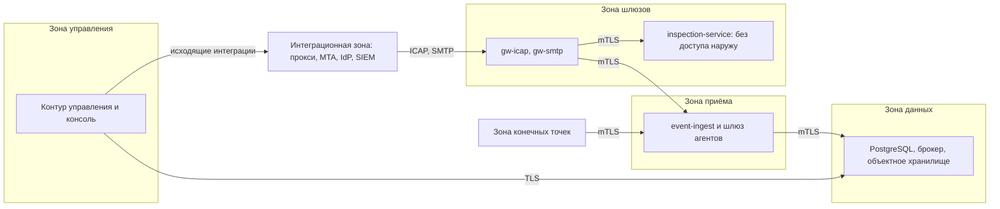
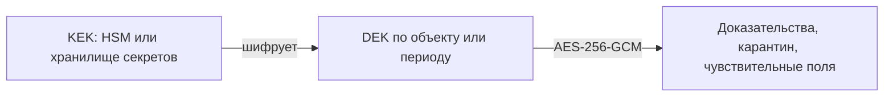

# Sentinel DLP — Security Architecture

| Атрибут | Значение |
|---|---|
| Статус документа | Draft — ожидает согласования |
| Версия | 0.1 |
| Дата | 2026-11-09 |
| Реализация | Отсутствует: все механизмы являются проектными требованиями |
| Связанные документы | [SYSTEM_ARCHITECTURE.md](SYSTEM_ARCHITECTURE.md), [PRODUCT_REQUIREMENTS.md](PRODUCT_REQUIREMENTS.md), [FEATURE_REGISTRY.md](FEATURE_REGISTRY.md) |

**Заявление о соответствии.** Sentinel DLP не заявляет соответствия какому-либо стандарту. Упомянутые стандарты используются как источники требований. Проверки соответствия не выполнялись.

## 1. Почему DLP требует особой защиты

DLP-платформа — привлекательная цель для атаки:

- Она **агрегирует чувствительные данные**: доказательства, индексы EDM и отпечатков.
- Её **агент работает с высокими привилегиями** на всём парке устройств. Компрометация канала управления или обновлений равносильна компрометации организации.
- Она **разбирает недоверенные файлы** на каждой конечной точке и на сервере.
- Её **операторы видят содержимое документов** и данные о сотрудниках, поэтому инсайдерский риск распространяется и на саму платформу.

Отсюда четыре главных принципа: минимум данных, минимум привилегий, раздельные доверенные домены и подтверждаемость каждого действия.

## 2. Защищаемые активы

| ID | Актив | Конфиденциальность | Целостность | Доступность |
|---|---|---|---|---|
| AS-01 | Доказательства и карантин | Критическая | Высокая | Средняя |
| AS-02 | Ключи подписи политик и обновлений | Критическая | Критическая | Средняя |
| AS-03 | Корневой CA и ключи KEK | Критическая | Критическая | Высокая |
| AS-04 | Индексы EDM и отпечатков | Высокая | Высокая | Средняя |
| AS-05 | Политики и исключения | Средняя | Критическая | Высокая |
| AS-06 | Журнал аудита | Средняя | Критическая | Высокая |
| AS-07 | Учётные записи операторов и токены API | Высокая | Высокая | Средняя |
| AS-08 | Бинарные файлы агента и установленный драйвер | Низкая | Критическая | Высокая |
| AS-09 | Инциденты и данные о сотрудниках | Высокая | Высокая | Средняя |
| AS-10 | Учётные записи сканирования и интеграций | Высокая | Высокая | Средняя |

## 3. Предварительная модель угроз

Модель предварительная; полная версия будет оформлена в `THREAT_MODEL.md` по STRIDE с привязкой к MITRE ATT&CK.

### 3.1. Нарушители

| ID | Нарушитель | Возможности | Заявляемая защита |
|---|---|---|---|
| TA-1 | Сотрудник без прав администратора | Обычный доступ к данным, попытка обхода | Блокировка и выявление в подтверждённых каналах |
| TA-2 | Локальный администратор / root | Может остановить агента, загрузить код, изменить ОС | Повышение стоимости и выявление вмешательства; **полная защита не заявляется** |
| TA-3 | Вредоносное ПО на конечной точке | Код в контексте пользователя или выше | Минимальные привилегии, защита каналов и ключей, выявление |
| TA-4 | Внешний атакующий в сети | Перехват, подмена, сканирование | TLS/mTLS, сегментация, минимизация поверхности |
| TA-5 | Злоумышленник с вредоносным файлом | Эксплуатация парсера через файл | Песочница, лимиты, memory-safe языки, фаззинг |
| TA-6 | Недобросовестный оператор DLP | Легитимный доступ к консоли | RBAC, разделение обязанностей, журнал доступа, внешний экспорт аудита |
| TA-7 | Атакующий цепочки поставок | Зависимости, CI, артефакты | SBOM, подпись, проверка зависимостей, изолированная сборка |
| TA-8 | Администратор инфраструктуры заказчика | Доступ к БД, хранилищу и хостам | Шифрование на уровне приложения, выявление изменения аудита; с доступом к KEK защита ограничена |

### 3.2. Основные угрозы

| ID | Угроза | STRIDE | ATT&CK (ориентир) | Основные меры | Остаточный риск |
|---|---|---|---|---|---|
| TH-01 | Подмена политики или понижение версии | T | T1562 Impair Defenses | Подпись пакета, монотонность версии, отдельный ключ | Низкий при защите ключа |
| TH-02 | Распространение вредоносного обновления агента | T, E | T1195 Supply Chain Compromise | Офлайн- или HSM-ключ, кольца раскатки, проверка подписи и отката | Низкий–средний |
| TH-03 | RCE через парсер документа | E | T1203 Exploitation for Client Execution | Песочница, лимиты, фаззинг, безопасный по памяти язык | Средний |
| TH-04 | Отключение или обход агента | D | T1562.001 Disable or Modify Tools | Watchdog, защита службы, оповещение о пропаже heartbeat | Высокий для TA-2 |
| TH-05 | Подмена или клонирование идентичности агента | S | T1078 Valid Accounts | Одноразовая регистрация, mTLS, привязка ключа к TPM при наличии, выявление дублей | Средний |
| TH-06 | Массовая выгрузка доказательств | I | T1213 Data from Information Repositories | Минимизация, отдельное право, журнал, лимиты, оповещения | Средний |
| TH-07 | Подмена журнала аудита | T, R | T1070 Indicator Removal | Хеш-цепочка, подпись контрольных точек, внешний экспорт | Низкий при внешнем экспорте |
| TH-08 | Кража и перебор индекса EDM | I | T1005 Data from Local System | Соль и ключ индекса, шифрование, распределение ограниченных индексов | Средний для малоэнтропийных значений |
| TH-09 | DoS шлюза или сервиса инспекции (архивные бомбы) | D | T1499 Endpoint DoS | Лимиты, квоты, изоляция, явный режим при отказе | Средний |
| TH-10 | Утечка данных через логи и метрики | I | T1005 | Запрет содержимого в логах, тест с маркером | Низкий |
| TH-11 | Эскалация в консоли (IDOR, XSS, CSRF, инъекции) | E, I | T1190 Exploit Public-Facing Application | Серверная авторизация, CSP, валидация, OWASP ASVS, пентест | Низкий–средний |
| TH-12 | SSRF через Webhook и цели интеграций | I, E | T1190 | Запрет внутренних адресов по умолчанию, список разрешённых, DNS-проверка | Низкий |
| TH-13 | Эксплуатация уязвимости драйвера для повышения прав | E | T1068 Exploitation for Privilege Escalation | Минимальный драйвер, строгая проверка ввода, ACL коммуникационного порта, Driver Verifier | Средний |
| TH-14 | Злоупотребление исключениями политик | T, R | T1562 | Срок действия, согласование, аудит использования | Низкий–средний |
| TH-15 | Обход инспекции: шифрование, смена формата, разбиение | I | T1027 Obfuscated Files or Information | Обнаружение истинного типа, политика на `not_inspected`, ограничения признаются | Высокий |
| TH-16 | Компрометация CI и артефактов сборки | T | T1195 | Изоляция сборки, подпись, защищённые ветки, SBOM, воспроизводимость где возможна | Средний |

## 4. Принципы защиты

| Принцип | Применение в Sentinel DLP |
|---|---|
| Secure by Design | Безопасные значения по умолчанию; небезопасная конфигурация останавливает запуск в производственном профиле |
| Zero Trust (применимые элементы) | Сеть не даёт доверия: каждый вызов аутентифицирован и авторизован; идентичность сервисов и агентов проверяется |
| Least Privilege | Отдельные роли, учётные записи БД для модулей, минимальные права сканирования и процессов агента |
| Defense in Depth | Подпись поверх TLS; шифрование приложения поверх шифрования хранилища |
| Privacy by Design | Минимизация данных, маскирование, ограниченное хранение, журнал доступа |
| Fail Explicitly | Режимы отказа настраиваются и видны; «не инспектировано» не считается чистым результатом |

## 5. Идентификация, аутентификация и авторизация

### 5.1. Операторы

- Локальные учётные записи: хеш пароля Argon2id, проверка по спискам скомпрометированных паролей, защита от перебора.
- MFA обязательна для административных операций (DLP-CORE-001). Предлагаемые факторы: WebAuthn и TOTP. Повторная проверка требуется для опасных действий: изменение ролей, публикация блокирующей политики, выгрузка доказательств, ротация ключей.
- SAML 2.0 и OIDC — с R0.5. При федерации политика доверия определяет, подтверждает ли MFA поставщик удостоверений.
- Сессии: короткий срок, защищённые cookie (`HttpOnly`, `Secure`, `SameSite`), отзыв на сервере.
- Аварийная учётная запись (break-glass): хранится отдельно, каждое использование создаёт оповещение.

### 5.2. Ролевая модель (исходная)

| Право | Администратор платформы | Администратор политик | Расследователь | Аудитор |
|---|---|---|---|---|
| Настройка системы и интеграций | ✔ | | | |
| Управление агентами | ✔ | | | |
| Изменение и публикация политик | | ✔ | | |
| Просмотр инцидентов (маскировано) | | Только статистика | ✔ | Только чтение |
| Просмотр полного доказательства | | | Отдельное право | |
| Экспорт инцидента | | | Отдельное право | |
| Просмотр аудита | Свои действия | Свои действия | Свои действия | ✔ |
| Назначение ролей | ✔, с двойным подтверждением для привилегированных ролей | | | |

Авторизация проверяется на сервере для каждого запроса. Области ограничивают доступ по подразделениям при подтверждении OQ-08. Оператор не может расследовать инцидент о самом себе.

### 5.3. Сервисы и агенты

- **mTLS** обязателен между агентом и сервером и между сервисами контура. Для браузера и внешних клиентов используется TLS.
- **Регистрация агента:** одноразовый короткоживущий токен → ключ создаётся на устройстве → CSR → сертификат с идентификатором агента. Ключ привязывается к TPM или Secure Enclave там, где это подтверждено (PoC-07).
- **Срок сертификатов:** короткий, с автоматической ротацией; при отзыве доступ прекращается на уровне приёма. Значения утверждаются при проектировании.
- **Сервисные клиенты API:** токены с областью и сроком, хранятся как хеши.

## 6. Сетевая сегментация и доверенные зоны

- Только минимальные маршруты между зонами; `inspection-service` и песочницы не имеют доступа в сеть.
- Консоль не публикуется в сегмент конечных точек.
- Исходящие соединения ограничены явным списком. Продукт не обращается в интернет.

## 7. Защита данных

### 7.1. В передаче

Минимум TLS 1.2, предпочтительно TLS 1.3, с утверждённым набором шифров. Отключение проверки сертификатов в производственном профиле невозможно. LDAP только через LDAPS или StartTLS. Syslog — через TLS. Требования национальной криптографии определяются ответом на OQ-11.

### 7.2. При хранении

Конвертное шифрование:

| Данные | Защита | Хранение по умолчанию |
|---|---|---|
| Доказательства | Шифрование приложения, контроль целостности | Хеш и маскированный фрагмент; копия — по явной политике |
| Индексы EDM | Ключевое хеширование и шифрование | Без исходных значений |
| Журнал агента | Шифрование локальным ключом, защита средствами ОС | Минимальные метаданные, усечение после доставки |
| Логи и метрики | Содержимое инспекции запрещено | Определяется заказчиком |
| Бэкапы | Шифрование, отдельное хранение ключей | Срок определяется заказчиком |

Обработка в памяти: минимальный срок жизни содержимого, отсутствие записи в аварийные дампы там, где это управляемо, хранение значений ключей только в защищённых областях, предоставляемых ОС.

### 7.3. Минимизация и хранение

- Маскирование совпадений по умолчанию (DLP-POLICY-015, ADR-012).
- Сроки хранения и удержание на время расследования (DLP-INCIDENT-010).
- Удаление подтверждается записью в аудите; удаление из резервных копий выполняется по истечении их срока.

## 8. Управление ключами и секретами

| Ключ | Назначение | Хранение | Ротация |
|---|---|---|---|
| Root CA | Корень PKI платформы | Офлайн или HSM | Плановая, процедура перехода |
| Intermediate CA | Выпуск сертификатов агентов и сервисов | HSM или хранилище секретов | Периодическая |
| Ключ подписи политик | Подлинность пакетов политик | HSM или хранилище секретов, отдельно от TLS | Плановая с перекрытием; пакеты содержат идентификатор ключа |
| Ключ подписи обновлений | Подлинность обновлений агента | Офлайн или HSM, только процесс выпуска | Плановая, поддержка цепочки доверия агентов |
| KEK | Защита DEK | HSM или хранилище секретов | Плановая, без перешифровки данных |
| Ключ агента | Идентичность устройства | TPM/Secure Enclave, иначе хранилище ОС | С ротацией сертификата |

- Секреты недоступны через API после сохранения и не попадают в логи, образы и репозиторий.
- Ключ подписи обновлений поставщика недоступен в контуре заказчика; ключ подписи политик принадлежит заказчику.
- Компрометация каждого ключа должна иметь задокументированный Runbook до выпуска R1.0.

## 9. Защита конечной точки

Цели и ограничения сформулированы в пределах возможностей ОС и политики организации. Подробности механизмов — в матрице [SYSTEM_ARCHITECTURE.md](SYSTEM_ARCHITECTURE.md#7-матрица-возможностей-по-ос).

- **Разделение процессов:** см. раздел 8.1 архитектуры. Парсер не имеет доступа к ключам, сети и записи на диск.
- **Песочница:** на Windows — AppContainer или ограниченный токен и Job Objects; на Linux — seccomp, namespaces, cgroups; на macOS — sandbox-профиль. Выбор подтверждается PoC-10.
- **Коммуникационный порт драйвера:** доступен только проверенной подписанной службе. Все входы драйвера считаются недоверенными.
- **Целостность:** проверка подписи компонентов и пакетов. Изменение порождает событие.
- **Защита от отключения:** запрет остановки для непривилегированных пользователей, контролируемый режим обслуживания с временным кодом. Администратор и root могут обойти защиту, и об этом указано в документации; пропажа heartbeat — важный сигнал.
- **Обновления:** подпись, проверка версии, кольца раскатки, откат и аварийная остановка.
- **Запрещённые приёмы:** руткит-подобное скрытие, внедрение в чужие процессы без необходимости, отключение других средств защиты.

## 10. Безопасность приложений и API

Проектные требования ориентируются на OWASP ASVS. Целевой уровень — подлежит утверждению; предлагается уровень 2, для аутентификации, доказательств и управления ключами — уровень 3.

- Схемная валидация ввода на границе; безопасные вызовы БД (параметризация); кодирование вывода.
- CSP без `unsafe-inline`, защита от CSRF, строгие заголовки.
- Ограничение частоты запросов и размера тела.
- Защита от SSRF, XXE, zip slip, инъекций LDAP и заголовков SMTP.
- Единый формат ошибок без внутренних деталей.
- Отсутствие тестовых учётных записей и демонстрационных данных в производственном профиле.

## 11. Журнал аудита

**Регистрируются:** вход и отказ, изменение ролей, политик, исключений и конфигурации; просмотр и выгрузка доказательств; действия над агентами; использование break-glass; операции с ключами.

**Содержимое записи:** время, субъект, IP, действие, объект, результат, идентификатор запроса, причина. Содержимое доказательств не включается.

**Целостность:** каждая запись содержит хеш предыдущей; контрольные точки подписываются и могут экспортироваться наружу. Без экспорта администратор инфраструктуры с доступом к ключу теоретически может пересчитать цепочку.

**Поведение при сбое:** если запись аудита критичного действия невозможна, действие отклоняется.

## 12. Безопасность поставки и разработки

Ориентир — практики NIST SP 800-218 (SSDF).

| Этап | Проверка | Условие блокировки |
|---|---|---|
| Pull Request | Code review, SAST, линтер, сканер секретов, unit- и контрактные тесты | Не пройдена обязательная проверка |
| Зависимости | SCA, проверка лицензий, закреплённые версии | Критическая эксплуатируемая уязвимость, запрещённая лицензия |
| Сборка | Изолированные исполнители, SBOM (CycloneDX или SPDX), подпись артефактов и аттестация происхождения | Отсутствие подписи или SBOM |
| Контейнеры | Сканирование образов, минимальная база, запуск без root | Превышение порога |
| Парсеры | Непрерывный фаззинг | Неразобранный сбой на критичном пути |
| Драйвер | Driver Verifier, анализ кода, HLK по решению ADR-011 | Любой сбой под Verifier |
| Перед релизом | DAST, проверка обновления и отката, независимый пентест до R1.0 | Неустранённые критические находки |

Ветки `main` и `develop` защищаются обязательным Pull Request, подписи коммитов рекомендуются. Настройка защиты веток — **NOT VERIFIED**: состояние на GitHub в этой работе не проверялось.

## 13. Выявление и реагирование на инциденты платформы

- События безопасности самой платформы передаются в SIEM: массовые просмотры, изменения политик, отказ подписи, множество отключений агентов.
- Runbook до R1.0: компрометация ключа подписи, отзыв партии агентов, отказ раскатки, компрометация оператора, утечка из хранилища доказательств.
- Процесс ответственного раскрытия и выпуска исправлений определяется до первого развёртывания у заказчика.

## 14. Трассировка обязательных механизмов

Статус всех механизмов: **Designed (черновик) — не реализовано, не проверено**.

| Требование `CLAUDE.md`, раздел 5 | Раздел | Функция | Метод проверки |
|---|---|---|---|
| TLS, mTLS | 5.3, 7.1 | DLP-CORE-004 | Тесты конфигурации, сканирование TLS |
| Encryption at Rest | 7.2 | DLP-CORE-006 | Тест с маркером по БД и хранилищу |
| RBAC | 5.2 | DLP-CORE-002 | Матричные тесты отказа для всех маршрутов |
| MFA для административных операций | 5.1 | DLP-CORE-001 | E2E и негативные тесты |
| Secure Secret Management | 8 | DLP-CORE-005 | Сканер секретов, тест логов |
| API Authentication / Authorization | 5, 10 | DLP-CORE-012, DLP-CORE-002 | Контрактные тесты, DAST |
| Input Validation | 10 | DLP-CORE-012 | Негативные тесты, фаззинг API |
| Audit Logging | 11 | DLP-CORE-003 | Тест верификатора, тест блокировки при сбое |
| Certificate Lifecycle Management | 5.3, 8 | DLP-CORE-004 | Тесты ротации и отзыва |
| Signed Updates | 9, 12 | DLP-ENDPOINT-012, DLP-CORE-011 | Тест подмены и понижения версии |
| Dependency Vulnerability Scanning | 12 | DLP-CORE-011 | Проверка конвейера |
| Software Bill of Materials | 12 | DLP-CORE-011 | Проверка артефакта выпуска |
| Threat Modeling | 3 | Документ `THREAT_MODEL.md` (не создан) | Рецензия |

### Применимость стандартов

| Стандарт | Использование | Статус подтверждения |
|---|---|---|
| ISO/IEC 27001, 27002, 27005 | Источник контролей, управление рисками; применимы к организации, а не только к продукту | Не оценивалось |
| NIST SP 800-53 | Каталог контролей при составлении требований | Не оценивалось |
| NIST SP 800-218 (SSDF) | Практики безопасной разработки | Не оценивалось |
| OWASP ASVS | Требования к веб-приложению и API | Не оценивалось |
| MITRE ATT&CK | Ориентир в модели угроз | Предварительное сопоставление; техники подлежат проверке |
| Zero Trust Architecture | Применимые элементы, см. раздел 4 | Не оценивалось |

## 15. Открытые вопросы безопасности

| ID | Вопрос | Решает |
|---|---|---|
| SEC-Q1 | Какой уровень ASVS принять целевым? | Архитектор и владелец ИБ |
| SEC-Q2 | Требования к HSM и национальной криптографии (OQ-11) | Владелец продукта, юрист |
| SEC-Q3 | Кто владеет ключом подписи обновлений и где он находится? | Владелец проекта |
| SEC-Q4 | Допустима ли инспекция на агенте для всех типов данных или часть должна идти на сервер? | Архитектор, DPO |
| SEC-Q5 | Требуется ли защита агента на уровне Antimalware-PPL и возможно ли её получить? | Команда агента, по итогам PoC |
| SEC-Q6 | Как проводится независимый пентест и кто его выполняет? | Владелец продукта |
