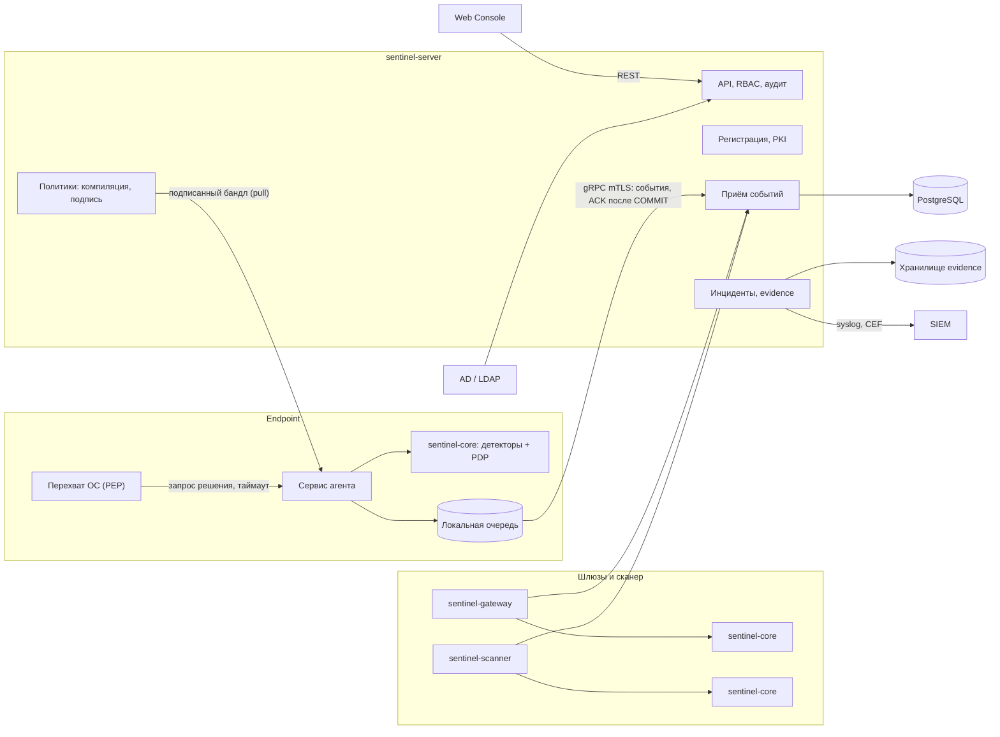

# Sentinel DLP — System Architecture

| Атрибут | Значение |
| --- | --- |
| Назначение | Высокоуровневая архитектура, компоненты, потоки, реестр ADR и архитектурных рисков |
| Версия | 2.1 (реестр рисков: R-22…R-24, уточнение R-24 по SR3-04 и решению владельца от 2026-11-11) |
| Дата | 2026-11-11 |
| Статус | Proposed — на архитектурном ревью. Утверждённые части отмечены решениями D-NN. Исходного кода нет |
| Основание | ARCH-0001 (документ Claude Docs, ревизия 2); D-01…D-10 |
| Связанные документы | docs/DECISION_LOG.md, docs/adr/, docs/FEATURE_REGISTRY.md, docs/THREAT_MODEL.md, docs/DATA_MODEL.md, docs/ROADMAP.md, docs/architecture/ |

## 1. Кратко

- Сервер — модульный монолит на Go (ADR-0001, ADR-0002; D-02).
- Разбор содержимого и принятие решений — общая Rust-библиотека `sentinel-core` в агенте, шлюзах и сканере (ADR-0003; D-02).
- Драйвер Windows — минимальный minifilter на C (ADR-0004).
- Блокирующее решение принимается локально; сервер в блокирующем пути не участвует (ADR-0016; D-05).
- PostgreSQL — единственная обязательная СУБД; внешнего брокера в MVP нет (ADR-0005, ADR-0006; D-06).
- По умолчанию передаются только метаданные (ADR-0017; D-07).

## 2. Компоненты

| Компонент | Ответственность | Единица поставки | Язык |
| --- | --- | --- | --- |
| Endpoint Agent | Перехват операций ОС (PEP), локальное решение, кэш политик, очередь событий, самозащита, обновление | Пакет MSI, PKG, DEB или RPM: сервис + драйвер или системное расширение. Разделение на процессы — C-04 | Rust; C (драйвер Windows); Swift + Rust (macOS) |
| Detection Engine | Тип файла, извлечение текста, детекторы, маскирование | Библиотека `sentinel-core`. Изоляция парсеров — C-03 | Rust |
| Policy Engine | Компиляция и подпись политик; PDP: детерминированная оценка и объяснение | Компилятор — модуль сервера; PDP — часть `sentinel-core` | Go, Rust |
| Management Server | Регистрация и PKI, политики, приём событий, API, RBAC, аудит, здоровье | `sentinel-server` | Go |
| Incident Management | Инциденты, корреляция, evidence, хранение | Модуль `sentinel-server` | Go |
| Data Discovery | Сканирование хранилищ | `sentinel-scanner` | Rust |
| Network Gateway | ICAP и SMTP | `sentinel-gateway` | Rust |
| Web Console | Интерфейс; работает только через REST API | Статическое SPA | TypeScript |

Именование компонентов ветки `feature/initial-documentation` (`libinspect`, `cp-*`, `gw-*`, `agent-*`) сопоставлено в RECON-0001 §4.

## 3. Взаимодействие

Сервер распространяет подписанные политики и принимает события, но не участвует в блокирующем решении. Консоль не имеет доступа к БД.

## 4. Основные потоки

1. **Решение** (синхронно, локально): PEP → сервис → `sentinel-core` → вердикт (FAILURE_MODE_DESIGN.md §2) → действие PEP.
2. **События** (асинхронно): локальная очередь → пакет по gRPC/mTLS → транзакция приёма с дедупликацией → ACK (EVENT_PIPELINE_DESIGN.md).
3. **Политики** (pull): публикация → компиляция с проверкой возможностей (CAPABILITY_MATRIX.md §4) → подпись → проверка подписи, версии и срока действия на агенте → атомарная замена.
4. **Evidence** (только по явному действию политики, D-07): шифрование на стороне приложения, отдельный канал, отдельное хранилище.

## 5. Реестр ADR

| ADR | Тема | Статус | Основание |
| --- | --- | --- | --- |
| ADR-0001 | Модульный монолит | Accepted | D-02 |
| ADR-0002 | Go для сервера | Accepted | D-02 |
| ADR-0003 | Rust для ядра, агента, шлюзов, сканера | Accepted; возможная поправка — C-03 | D-02 |
| ADR-0004 | Минимальный minifilter на C | Accepted | D-02, D-05 |
| ADR-0005 | PostgreSQL | Accepted with constraints | D-06 |
| ADR-0006 | Конвейер событий без брокера | Accepted with constraints | D-06 |
| ADR-0007 | Хранилище evidence | Proposed (только в ARCH-0001); C-05 | — |
| ADR-0008 | Поиск на PostgreSQL | Proposed (только в ARCH-0001) | — |
| ADR-0009 | gRPC для агентов, REST для консоли | Proposed (только в ARCH-0001) | — |
| ADR-0010 | Собственная схема политик | Proposed (только в ARCH-0001) | — |
| ADR-0011 | Встроенный подчинённый CA | Proposed (только в ARCH-0001) | — |
| ADR-0012 | OpenTelemetry, Prometheus, JSON-логи | Proposed (только в ARCH-0001) | — |
| ADR-0013 | React + TypeScript | Proposed (только в ARCH-0001) | — |
| ADR-0014 | Поставка RPM/DEB + OCI | Proposed (только в ARCH-0001); C-02 | — |
| ADR-0015 | Нативные парсеры; OCR на сервере | Proposed (только в ARCH-0001); связано с C-03 | — |
| ADR-0016 | Контракт вердикта и fail-safe | Accepted with constraints | D-05 |
| ADR-0017 | Минимизация данных и защита evidence | Accepted with constraints | D-07 |

Файлы созданы только для ADR со статусом Accepted. ADR со статусом Proposed оформляются файлами при рассмотрении. ADR-001…012 ветки `feature/initial-documentation` — другая нумерация; сопоставление в RECON-0001 §5.

## 6. Структура документации

- Документы, перечисленные в CLAUDE.md §7, находятся в корне `docs/`, как требуют CLAUDE.md §7 и §14.
- ADR — в `docs/adr/`.
- Дополнительные дизайн-документы — в `docs/architecture/` и `docs/security/`.

## 7. Реестр архитектурных рисков

| ID | Риск | В | Влияние | Мера | Происхождение |
| --- | --- | --- | --- | --- | --- |
| R-01 | Нет EV-сертификата и Partner Center — драйвер не загрузится на рабочих ПК | Высокая | Критическое | Оформление в фазе 0; тестовая подпись на стенде | ARCH-0001; FID/RSK-01 |
| R-02 | Apple не выдаёт entitlement Endpoint Security | Средняя | Высокое | Ранняя заявка; macOS в Production | ARCH-0001; FID/RSK-02 |
| R-03 | Нет инженера драйверов; BSOD у пользователей | Высокая | Критическое | Минимальный драйвер, Driver Verifier, HLK, кольца раскатки; вариант покупки драйвера — кандидат U-15 | ARCH-0001; FID/RSK-03 |
| R-04 | Конфликт с EDR/AV | Средняя | Высокое | Тесты на стенде с EDR организации (TC-D05-12) | ARCH-0001; FID/RSK-09 |
| R-05 | Ложные блокировки парализуют работу | Высокая | Высокое | Monitor перед Block (D-05); метрики precision | ARCH-0001; FID/PR-2 |
| R-06 | Объём требований превышает ресурсы | Высокая | Высокое | Фазы и критерии перехода | ARCH-0001; FID/PR-1 |
| R-07 | Правовые претензии, нарушение законодательства о персональных данных | Средняя | Высокое | Q-04, минимизация (D-07) | ARCH-0001; FID/PR-4 |
| R-08 | Сервер DLP становится источником утечки | Низкая | Критическое | THREAT_MODEL.md T-06, T-19…T-21 | ARCH-0001; FID/RSK-05 |
| R-09 | Пробелы fanotify на Linux; в общем случае контентная блокировка записи недостижима одинаково на всех ОС | Высокая | Среднее | Матрица возможностей (D-08); BPF LSM там, где возможно | ARCH-0001; FID/RSK-07 |
| R-10 | Блокировка буфера обмена и печати нестабильна | Высокая | Среднее | MONITOR_ONLY по умолчанию | ARCH-0001 |
| R-11 | Производительность анализа больших файлов | Средняя | Среднее | Лимиты, кэш вердиктов, замеры | ARCH-0001; FID/RSK-08 |
| R-12 | Изменения платформ (WESP, macOS, печать, Wayland) | Средняя | Среднее | Абстракция PEP; отслеживание изменений | ARCH-0001; FID/RSK-11 |
| R-13 | Код, созданный ИИ, без ревью содержит скрытые дефекты | Средняя | Высокое | Обязательное ревью человеком; защита веток | ARCH-0001 |
| R-14 | Нет размеченного корпуса | Высокая | Среднее | Синтетический корпус с разметкой | ARCH-0001 |
| R-15 | Контентная блокировка записи на USB недостижима без теневой записи | Высокая | Высокое | SPIKE-WIN-01; до него — только блокировка без анализа содержимого | FAILURE_MODE_DESIGN.md |
| R-16 | Нет гарантии fail-closed до старта сервиса и при отключённом драйвере | Средняя | Высокое | Документировать; fallback-таблица драйвера — NOT VERIFIED | FAILURE_MODE_DESIGN.md |
| R-17 | MTP/WPD и нефайловые устройства вне minifilter | Высокая | Среднее | Device-level deny (DLP-ENDPOINT-017) | FAILURE_MODE_DESIGN.md; FID |
| R-18 | Неудачные значения таймаутов и сроков политики ведут к DoS или к обходу | Средняя | Высокое | Замеры до утверждения параметров | FAILURE_MODE_DESIGN.md |
| R-19 | Два основных языка (Go и Rust) усложняют команду | Средняя | Среднее | Чёткие границы компонентов; Q-08 | FID/RSK-10 (U-18) |
| R-20 | Лицензии зависимостей несовместимы с моделью продукта | Средняя | Среднее | `cargo deny`, проверка лицензий; кандидат вопроса из FID/OQ-01 | FID/RSK-12 (U-18) |
| R-21 | Удалённое evidence восстанавливается из резервных копий до истечения их срока или уничтожения KEK периода | Средняя | Высокое | Ключи периода, уничтожение KEK во всех копиях, журнал удалений при восстановлении | DATA_PROTECTION_DESIGN.md §7 |
| R-22 | При полном отказе локального хранилища агента маркер `EVENTS_LOST` записать невозможно; содержимое потерянных событий не восстанавливается | Низкая | Среднее | `SEQUENCE_GAP`, `EPOCH_RESET`, метрики очереди в heartbeat | EVENT_PIPELINE_DESIGN.md §4.9 |
| R-23 | Устаревший воркер может создать дубликат во внешней системе без поддержки идемпотентности | Средняя | Низкое | `idempotency_key`; проверка аренды перед отправкой; короткие операции | EVENT_PIPELINE_DESIGN.md §5.3 |
| R-24 | Без аппаратного счётчика агент не может доказать свежесть состояния времени в офлайне; сигналы срока действия могут не появиться при откате состояния или снимка ВМ; восстановление снимка ВМ вместе с RAM возвращает разрешающие отступления без перезапуска; откат состояния агента не обнаруживается при полностью воспроизведённом состоянии с совпадающими данными первой передачи или без обработанных передач после снимка | Средняя | Высокое | Разрешающие отступления не переживают перезапуск (INV-T2); сброс при смене VM Generation ID — NOT VERIFIED; исследование TPM (DLP-ENDPOINT-020); обнаружение на сервере при связи; привилегированные офлайн-исключения и офлайн break-glass запрещены по умолчанию на ВМ с пользовательским или недоверенным гипервизором (решение владельца от 2026-11-11). Уровень риска — High | FAILURE_MODE_DESIGN.md §4.7.1, §4.12 |

## 8. Решения, ожидающие владельца

C-01…C-06 — docs/architecture/DECISION_PROPOSAL_C01_C06.md. Q-01…Q-09 и кандидаты новых вопросов — docs/DECISION_LOG.md.
