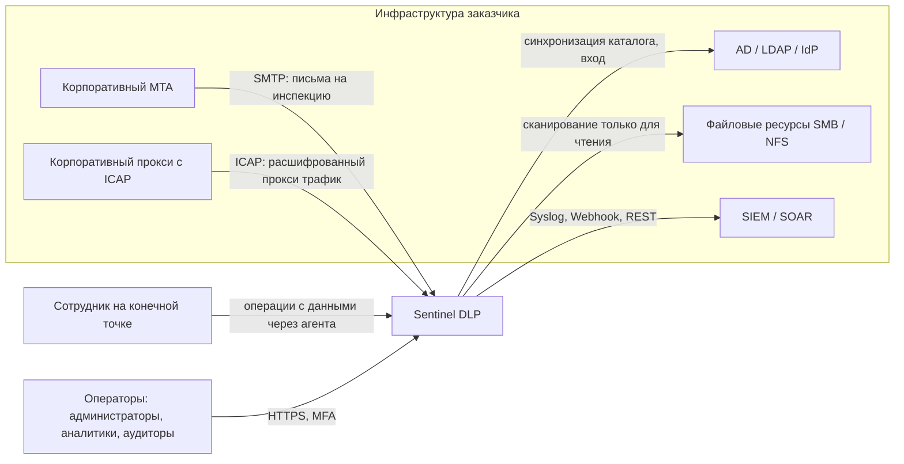
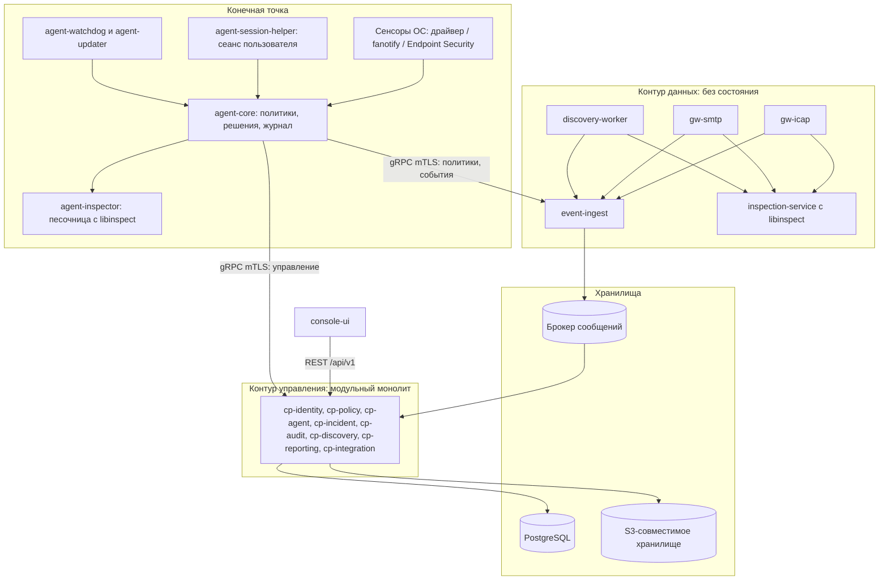
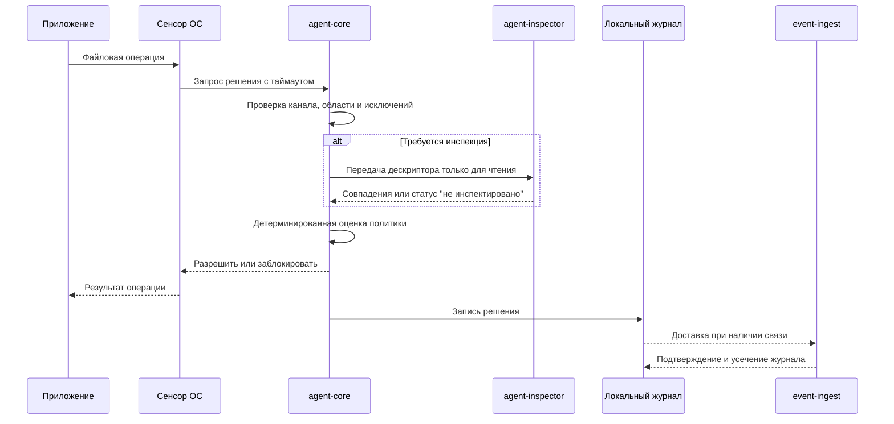

# Sentinel DLP — System Architecture

| Атрибут | Значение |
|---|---|
| Статус документа | Draft — архитектура предложена, **не согласована** |
| Версия | 0.1 |
| Дата | 2026-11-09 |
| Реализация | Отсутствует: в репозитории нет исходного кода |
| Связанные документы | [PRODUCT_REQUIREMENTS.md](PRODUCT_REQUIREMENTS.md), [SECURITY_ARCHITECTURE.md](SECURITY_ARCHITECTURE.md), [FEATURE_REGISTRY.md](FEATURE_REGISTRY.md), [ROADMAP.md](ROADMAP.md) |

## 1. Краткое изложение предлагаемой архитектуры

1. **Контур управления — модульный монолит** на Go с PostgreSQL: политики, агенты, инциденты, аудит, интеграции. Микросервисы не оправданы при текущих неизвестных и усложнили бы on-premises эксплуатацию.
2. **Контур данных — независимо масштабируемые компоненты без состояния:** ICAP- и SMTP-шлюзы, сервис инспекции, приём событий, воркеры сканирования.
3. **Единое ядро инспекции `libinspect` на Rust** используется агентом и сервером. Поэтому политика даёт одинаковый результат во всех каналах. Парсеры файлов всегда выполняются в изолированном процессе.
4. **Решение на конечной точке принимается локально**, по подписанному пакету политик и без обращения к серверу.
5. **Ядро ОС содержит минимум логики.** Драйвер только перехватывает операции и передаёт их в пользовательский режим. Парсинг и оценка политик в ядре запрещены.
6. **Порядок реализации от простого к рискованному:** сначала вертикальный срез через ICAP/SMTP (реальная блокировка без драйвера), затем агент в режиме наблюдения, затем блокировка на конечной точке.

Все решения имеют статус **Proposed** и фиксируются в разделе 13. Необходимые проверки перечислены в разделе 14.

## 2. Архитектурные драйверы

| Приоритет | Драйвер | Следствие для архитектуры |
|---|---|---|
| 1 | Security: продукт концентрирует чувствительные данные и работает с высокими привилегиями | Минимальные привилегии, песочница для парсеров, подписанные политики и обновления |
| 2 | Correctness: решения должны быть детерминированными и объяснимыми | Единое ядро инспекции, неизменяемые версии политик, запрет ML в блокирующем пути |
| 3 | Reliability: сбой не должен ломать рабочее место или почту | Минимальный драйвер, поэтапная раскатка, явные режимы при отказе |
| 4 | On-premises и изолированный контур | Минимальный набор инфраструктурных зависимостей, отсутствие внешних сервисов |
| 5 | Различие возможностей ОС | Абстракция каналов на агенте и явная матрица возможностей |
| 6 | Масштаб (не определён, OQ-04) | Горизонтально масштабируется контур данных; контур управления масштабируется при подтверждённой потребности |

## 3. Контекст системы

Граница ответственности: Sentinel не расшифровывает TLS самостоятельно. Веб-трафик поступает только от прокси, которому организация разрешила расшифровку.

## 4. Логическая архитектура

**Правила зависимостей:**

- Модули контура управления обращаются друг к другу только через внутренние интерфейсы; чужие таблицы напрямую не читаются. Это сохраняет возможность выделить модуль в сервис при подтверждённой необходимости.
- Контур данных не обращается к БД контура управления напрямую. Шлюзы получают подписанные пакеты политик и передают события через `event-ingest`.
- Веб-консоль не содержит бизнес-логики и работает только через публичный API. Статические данные на рабочих экранах запрещены (`CLAUDE.md`, 3.2).

## 5. Каталог компонентов

Подробные сведения по функциям находятся в [FEATURE_REGISTRY.md](FEATURE_REGISTRY.md). Статус всех компонентов: **Not implemented**.

| Компонент | Контур | Ответственность | Предлагаемая технология |
|---|---|---|---|
| `cp-platform` | Управление | Конфигурация, API, секреты, миграции, наблюдаемость | Go |
| `cp-identity` | Управление | Аутентификация, MFA, RBAC, федерация | Go |
| `cp-audit` | Управление | Журнал аудита и верификатор | Go |
| `cp-agent` | Управление | Реестр агентов, регистрация, раскатка обновлений | Go |
| `cp-policy` | Управление | Политики, версии, симуляция, подпись пакетов | Go + `libinspect` через сервис инспекции |
| `cp-incident` | Управление | Инциденты, доказательства, карантин, хранение | Go |
| `cp-discovery` | Управление | Цели, расписания, результаты, классификация | Go |
| `cp-reporting` | Управление | Отчёты и агрегаты | Go |
| `cp-integration` | Управление | AD/LDAP, Syslog, SIEM, Webhooks, SMTP-уведомления | Go |
| `console-ui` | Управление | Веб-консоль | TypeScript, React |
| `event-ingest` | Данные | Приём, проверка, дедупликация, запись событий в брокер | Go |
| `gw-icap` | Данные | ICAP-сервер REQMOD/RESPMOD | Go |
| `gw-smtp` | Данные | SMTP-шлюз для MTA | Go |
| `inspection-service` | Данные | Серверная инспекция, OCR, крупные индексы | Rust |
| `libinspect` | Общая библиотека | Детекторы, правила, EDM, отпечатки | Rust |
| `libinspect-parsers` | Общая библиотека | Парсеры форматов; запускаются только в песочнице | Rust; форматы без зрелых библиотек изолируются внешними компонентами |
| `discovery-worker` | Данные | Сканирование ресурсов | Go + вызовы инспекции |
| `ml-classifier` | Данные | Опциональная ML/NLP-классификация (после R1.0) | Определяется позже |
| `agent-core` | Конечная точка | Служба: политики, решения, журнал, связь | Rust |
| `agent-sensor-win` | Конечная точка | Файловый minifilter и контроль устройств | C (режим ядра), Rust (режим пользователя) |
| `agent-sensor-linux` | Конечная точка | fanotify, eBPF, USBGuard/udev, CUPS | Rust |
| `agent-sensor-macos` | Конечная точка | Endpoint Security, System Extension | Swift/Objective-C + Rust |
| `agent-session-helper` | Конечная точка | Буфер обмена и уведомления в сеансе пользователя, без повышенных прав | Rust, нативные API ОС |
| `agent-inspector` | Конечная точка | Инспекция в процессе с ограниченными правами | Rust + `libinspect` |
| `agent-watchdog` | Конечная точка | Контроль целостности и перезапуск | Rust |
| `agent-updater` | Конечная точка | Проверка подписи, установка и откат | Rust |
| `release-pipeline` | Поставка | Сборка, подпись, SBOM, образы, офлайн-пакет | CI заказчика/проекта |

## 6. Ключевые потоки

### 6.1. Решение на конечной точке

Если время инспекции истекает, применяется режим канала: `fail-open` с регистрацией или `fail-closed`. Режим задаётся политикой и виден в решении.

### 6.2. Сетевая инспекция

1. Прокси или MTA передаёт объект в `gw-icap` или `gw-smtp`.
2. Шлюз вызывает `inspection-service` с таймаутом и лимитами ресурсов.
3. Шлюз оценивает результат по пакету политик и возвращает разрешение, блокировку или карантин.
4. Решение передаётся в `event-ingest`, который записывает его в брокер; `cp-incident` создаёт инцидент идемпотентно.

### 6.3. Публикация политики

1. Администратор создаёт неизменяемую версию и выполняет симуляцию.
2. `cp-policy` компилирует версию в пакет и подписывает его ключом, отделённым от TLS-ключей.
3. Агенты и шлюзы получают пакет, проверяют подпись и монотонность версии и атомарно применяют его.
4. Получатель сообщает применённую версию. Консоль показывает долю применивших и отстающих.

### 6.4. Приём событий и инцидентов

Агент доставляет события пакетами с идентификатором и порядковым номером (at-least-once). `event-ingest` проверяет mTLS-идентичность и схему и записывает пакет в брокер. Подтверждение агент получает только после надёжной записи. `cp-incident` гарантирует дедупликацию по идентификатору. Для изменений контура управления используется transactional outbox.

## 7. Матрица возможностей по ОС

**Легенда подтверждения:**

- **[D]** — подтверждено документацией Microsoft Learn (проверено 2026-11-09), работоспособность в продукте не проверена.
- **[A]** — архитектурная гипотеза по инженерным знаниям. **NOT VERIFIED**, требует проверки документации и PoC.

До завершения PoC ни одна ячейка не является обещанием. Цели поддержки — только подтверждённые тестами версии (OQ-05).

| Канал | Windows | Linux | macOS |
|---|---|---|---|
| **Мониторинг файлов** | Minifilter (группа FSFilter Activity Monitor, 360000–389999) **[D]** | fanotify; eBPF как дополнение **[A]** | Endpoint Security, NOTIFY-события **[A]** |
| **Блокировка чтения/открытия** | Minifilter, pre-operation **[D — механизм]** | `FAN_OPEN_PERM`, `FAN_ACCESS_PERM` **[A]** | ES AUTH-события (`AUTH_OPEN`) с дедлайном ответа **[A]** |
| **Блокировка записи по содержимому** | Требует проектирования: варианты в PoC-01 **[A]** | В fanotify нет разрешения на запись; BPF LSM (зависит от ядра) может запретить запись, но не инспектировать содержимое **[A]** | Нет явного AUTH-события завершения записи; вариант требует исследования **[A]** |
| **Контроль USB-устройств** | Политики установки устройств, PnP-фильтрация **[A]** | USBGuard, udev **[A]** | ES `AUTH_MOUNT` для накопителей; прочие классы ограничены; MDM **[A]** |
| **Съёмные носители: только чтение** | Minifilter на томах; MTP/WPD-устройства не являются файловыми томами и требуют отдельного контроля **[A]** | Параметры монтирования, udisks/polkit **[A]** | ES `AUTH_MOUNT`, параметры монтирования **[A]** |
| **Печать** | События спулера. Сторонние модули несовместимы с Windows protected print mode; legacy-драйверы выводятся из обслуживания **[D]**. Блокировка — **PoC-05** | Обёртка бэкенда/фильтра CUPS **[A]** | CUPS с ограничениями системной защиты **[A]** |
| **Буфер обмена** | `AddClipboardFormatListener` — только уведомление о факте изменения, не предотвращает операцию **[D]** | X11: XFixes; Wayland: зависит от композитора и его протоколов **[A]** | Опрос `NSPasteboard`, уведомлений нет; ограничения приватности проверяются **[A]** |
| **Сетевые ресурсы** | Minifilter видит редиректор SMB; детали — в PoC-01 **[A]** | Поведение fanotify на сетевых ФС ограничено **[A]** | ES видит операции со смонтированными ФС **[A]** |
| **Защита от остановки** | Защита службы и DACL; Antimalware-PPL требует отдельных программ Microsoft **[A]** | systemd, неизменяемость ограничена; root обходит **[A]** | System Extension, управление через MDM **[A]** |
| **Внешние требования к подписи** | Подпись драйвера через Hardware Dev Center, нужен EV-сертификат; подписи по аттестации не означают сертификацию Windows; для производственной подписи Microsoft рекомендует HLK/WHCP **[D]**. Высота minifilter выделяется Microsoft **[D — реестр высот]** | Подписанные пакеты; подпись модулей при необходимости. Предпочтительно без модулей ядра **[A]** | Developer ID, нотаризация, entitlement `com.apple.developer.endpoint-security.client` по заявке в Apple **[A]** |

**Следствие для продукта:** политика может запросить только те действия, которые подтверждены для канала и ОС (DLP-POLICY-005). В остальных случаях действие явно понижается до наблюдения с предупреждением администратору.

## 8. Архитектура агента

### 8.1. Разделение привилегий

| Процесс | Привилегии | Обрабатывает недоверенное содержимое | Обоснование |
|---|---|---|---|
| Драйвер / системное расширение | Ядро или системный уровень | **Нет** | Ошибка влечёт отказ ОС; логика минимальна |
| `agent-core` | Системная служба | **Нет** | Хранит ключи и решения |
| `agent-inspector` | Минимальные, песочница | **Да** | Парсеры — главная поверхность атаки |
| `agent-session-helper` | Пользователь | Частично | Необходим доступ к сеансу |
| `agent-watchdog` | Системная служба | Нет | Независимый контроль |
| `agent-updater` | Системная, запуск на время обновления | Только проверенные подписанные пакеты | Минимизация времени работы |

### 8.2. Принципы безопасной работы драйвера

Сбои агентов безопасности с драйверами уровня ядра способны массово останавливать парк рабочих станций. Поэтому обязательны следующие правила:

- В драйвере нет разбора файлов, правил и контента политик. Данные, получаемые от пользовательского режима, строго проверяются.
- Отказ службы пользовательского режима не блокирует систему: драйвер ждёт ответ с таймаутом и переходит в заданный режим.
- Обновления, включая контентные, раскатываются по кольцам с автоматической остановкой.
- Есть задокументированное аварийное отключение перехвата и защита от циклической перезагрузки.
- Обязательны Driver Verifier, статический анализ и стресс-тесты на матрице версий ОС.
- Команда отслеживает планы Microsoft по переносу средств безопасности из режима ядра. Абстракция сенсора должна допускать замену механизма. Влияние на DLP-сценарии **NOT VERIFIED**.

### 8.3. Внутренний конвейер

`Сенсор → нормализация в единую схему → контекст (пользователь, процесс, устройство) → предварительный фильтр без содержимого → инспекция → оценка политики → действие → журнал → доставка`

Предварительный фильтр критичен для производительности: большинство операций не относится к каналам вывода данных и не должно читать содержимое.

## 9. Движок инспекции и движок политик

### 9.1. `libinspect`

- **Единое ядро** для агента, шлюзов и сканера; одинаковые корпусные тесты на всех платформах.
- **Регулярные выражения** с гарантированным линейным временем (свойство Rust-библиотеки `regex`; Vectorscan оценивается для множества шаблонов). Защищает от ReDoS в пользовательских правилах.
- **Лимиты на каждый запрос:** время, память, глубина вложенности, коэффициент распаковки, размер извлечённого текста.
- **Явные результаты:** `match`, `no_match`, `not_inspected(reason)`. Причины: шифрование, неподдерживаемый формат, лимит, сбой парсера. К статусу `not_inspected` применяется правило политики.
- **Совпадения передаются маскированными.** Открытые значения за пределы инспектора не выходят, кроме случаев явно включённого хранения доказательств.
- **Сравнение EDM и отпечатков** выполняется по хешам; индексы защищены и не содержат исходных данных. Малоэнтропийные значения подвержены перебору при краже индекса, поэтому индекс шифруется, а часть проверок может оставаться на сервере.
- **Выполнение тяжёлых механизмов** (OCR, ML) только асинхронно на сервере, вне блокирующего пути.

### 9.2. Движок политик

Вход: нормализованные признаки (субъект, устройство, канал, назначение, результат инспекции) и версия пакета. Выход: действие и объяснение.

Алгоритм:

1. Отобрать политики в области применения.
2. Применить действующие исключения (срок, область).
3. Вычислить правила; неизвестные атрибуты обрабатываются по явному правилу, а не как ошибка.
4. Выбрать результат: наивысший приоритет, затем наиболее строгое действие, затем наименьший идентификатор правила.
5. Понизить действие до доступного каналу и зафиксировать это в объяснении.
6. Вернуть решение: версия, правила, детекторы, причина, режим отказа.

Движок не имеет доступа к часам, сети и случайным числам, кроме значений, переданных во входе. Это делает решения детерминированными и воспроизводимыми в тестах.

## 10. Данные и хранилища

Подробная модель будет определена в `DATA_MODEL.md`. Основные группы:

| Группа | Основные сущности | Хранилище | Примечания |
|---|---|---|---|
| Идентичность и доступ | operator, role, role_binding, api_client | PostgreSQL | Хеши секретов |
| Аудит | audit_event, audit_checkpoint | PostgreSQL + внешний экспорт | Только добавление, хеш-цепочка |
| Агенты | agent, agent_group, agent_certificate, rollout | PostgreSQL | Статусы обновляются часто — отделяются от реестра |
| Политики | policy, policy_version, rule, detector, dictionary | PostgreSQL | Версии неизменяемы |
| События и инциденты | event, incident, decision | PostgreSQL, секционирование по времени | Удаление по секциям при хранении |
| Доказательства, карантин | evidence, quarantine_item | Объектное хранилище + метаданные в PostgreSQL | Шифрование на уровне приложения |
| Индексы | edm_index, fingerprint_index | Объектное хранилище, распространение пакетами | Без исходных значений |
| Поиск (опционально) | Индекс инцидентов | OpenSearch при подтверждённой потребности | Содержимое доказательств не индексируется по умолчанию |

## 11. Развёртывание и эксплуатация

| Профиль | Назначение | Состав | Статус |
|---|---|---|---|
| Single-node | Пилот, малые инсталляции | Контейнеры с systemd/Podman или Compose на одном хосте, без отказоустойчивости | Proposed |
| HA | Производственная среда | Kubernetes/OpenShift (Helm): несколько реплик, PostgreSQL с репликацией, отказоустойчивое объектное хранилище | Proposed |
| Air-gapped | Изолированный контур | Офлайн-пакет: образы, чарты, SBOM, подписи, зеркало обновлений агентов | Proposed |

Требования к контейнерам: запуск без root, совместимость с ограниченным SCC OpenShift, файловая система только для чтения там, где возможно, подписанные образы, отсутствие обращений наружу.

Сетевые зоны: зона приёма агентов, зона шлюзов, зона управления и зона хранения разделяются. Подробности — в [SECURITY_ARCHITECTURE.md](SECURITY_ARCHITECTURE.md#6-сетевая-сегментация-и-доверенные-зоны).

Эксплуатационные артефакты, которые создаются вместе с компонентами: Runbook, процедура обновления и отката, процедура восстановления, план сайзинга (после нагрузочных тестов).

## 12. Риски и ограничения

| ID | Риск | Вероятность | Влияние | Мера | Владелец |
|---|---|---|---|---|---|
| RSK-01 | Подпись и сертификация драйвера Windows (EV, Hardware Dev Center, высота) задерживаются | Средняя | Высокое | Начать процедуры в Фазе 1; разработка с тестовой подписью; ICAP/SMTP дают ценность раньше | Не назначен |
| RSK-02 | Apple не выдаёт entitlement Endpoint Security | Средняя | Высокое (macOS) | Заявка заранее; macOS позже в Roadmap; режим с ограниченными возможностями | Не назначен |
| RSK-03 | Ошибка драйвера приводит к массовому отказу ОС | Низкая–средняя | Критическое | Раздел 8.2; кольца раскатки; аварийное отключение | Не назначен |
| RSK-04 | Эксплуатация уязвимости парсера | Высокая | Высокое | Песочница, фаззинг, лимиты, memory-safe язык | Не назначен |
| RSK-05 | Компрометация хранилища доказательств | Средняя | Критическое | Минимизация, шифрование, раздельные права, журнал доступа | Не назначен |
| RSK-06 | Компрометация канала политик или обновлений | Низкая | Критическое | Отдельные ключи подписи, HSM, монотонность версий | Не назначен |
| RSK-07 | Блокировка записи по содержимому недостижима в равной мере на всех ОС | Высокая | Среднее | PoC-01…03; публикация матрицы; варианты наблюдения | Не назначен |
| RSK-08 | Высокие накладные расходы агента | Средняя | Высокое | Предварительный фильтр, кэш результатов, бенчмарки в CI | Не назначен |
| RSK-09 | Несовместимость с антивирусами/EDR и другими фильтрами | Средняя | Высокое | Матрица совместимости; тесты с основными продуктами заказчика | Не назначен |
| RSK-10 | Два основных языка (Go и Rust) усложняют команду | Средняя | Среднее | Чёткая граница по gRPC; решение после OQ-02 | Не назначен |
| RSK-11 | Изменения ОС (печать, режим ядра, Wayland) устаревают механизмы | Высокая | Среднее | Абстракция сенсоров; отслеживание планов производителей; регрессионные тесты на предварительных сборках | Не назначен |
| RSK-12 | Лицензии зависимостей несовместимы с моделью продукта | Средняя | Среднее | Решение OQ-01; проверка лицензий в CI; повторная проверка перед выбором | Не назначен |
| RSK-13 | Отсутствие референсного анализа (`REFERENCE_ANALYSIS.md`) | Высокая | Низкое–среднее | Получить перечень репозиториев (OQ-12) до окончания Фазы 0 | Не назначен |

## 13. Архитектурные решения (ADR)

Все решения сформулированы как предложения. После согласования они будут перенесены в `DECISION_LOG.md`, который пока не создан. Лицензии и состояние проектов должны быть повторно проверены на момент фиксации решения. Здесь они указаны по инженерным знаниям (**NOT VERIFIED**), а бенчмарки для решений этого раздела не выполнялись.

### ADR-001. Modular Monolith vs Microservices

- **Дата / Статус:** 2026-11-09 / Proposed
- **Контекст:** on-premises продукт, размер команды неизвестен, границы доменов ещё не проверены практикой, разные компоненты имеют разный профиль нагрузки.
- **Варианты:** (A) микросервисы; (B) монолит целиком; (C) модульный монолит контура управления + отдельные компоненты контура данных.
- **Решение:** вариант C.
- **Обоснование:** заказчику проще устанавливать и обновлять меньше сервисов; транзакции между политиками, инцидентами и аудитом проще; шлюзы и инспекция требуют независимого масштабирования и изоляции и поэтому отделены.
- **Последствия:** нужна проверка модульных границ в CI; контур управления масштабируется репликами с общей БД.
- **Риски:** эрозия границ модулей; смягчается линтером зависимостей и правилом запрета чужих таблиц.

### ADR-002. Языки реализации

- **Дата / Статус:** 2026-11-09 / Proposed, зависит от OQ-02
- **Контекст:** разные требования у серверных компонентов, разбора недоверенных файлов и агентов.

| Критерий | Go | Rust | C++ | C# |
|---|---|---|---|---|
| Безопасность памяти | Да (GC) | Да, без GC | Нет | Да (GC) |
| Сервер, API, gRPC | Отлично | Хорошо | Посредственно | Отлично |
| Агент, низкий расход ресурсов | Средне: runtime и GC | Отлично | Отлично | Средне: runtime и GC |
| Парсинг недоверенных данных | Хорошо | Отлично | Рискованно | Хорошо |
| Интеграция с нативными API ОС | Средне (cgo) | Хорошо | Отлично | Windows — отлично, прочие — средне |
| Драйверы Windows | Нет | Экосистема развивается, не выбрана для производства | C/C++ — стандарт | Нет |
| Поставка единым бинарным файлом | Отлично | Отлично | Хорошо | Хорошо |
| Доступность разработчиков | Высокая | Средняя | Высокая, но нужен опыт безопасности | Высокая |

- **Варианты:** (A) всё на Rust; (B) Go + Rust + C; (C) C# + C++; (D) всё на Go, кроме драйверов.
- **Решение:** вариант B. Go — контур управления и шлюзы; Rust — инспекция и пользовательская часть агента; C — минимальный драйвер Windows; Swift/Objective-C — обёртка macOS; TypeScript — консоль.
- **Обоснование:** безопасность памяти в разборе недоверенных данных и на агенте — первостепенна; для серверной логики Go даёт скорость разработки и простую эксплуатацию.
- **Последствия:** два основных языка, граница между ними через gRPC; компетенции в драйверах обязательны.
- **Риски:** нехватка специалистов (RSK-10). Запасной вариант при отсутствии опыта Rust — оценить вариант A или C после OQ-02.

### ADR-003. Основная база данных

- **Дата / Статус:** 2026-11-09 / Proposed
- **Контекст:** транзакции для политик, аудита и инцидентов; секционирование событий; on-premises.
- **Варианты:** (A) PostgreSQL; (B) коммерческие СУБД; (C) CockroachDB/YugabyteDB; (D) MongoDB.
- **Решение:** PostgreSQL как единый источник истины.
- **Обоснование:** зрелость, транзакции, секционирование, JSONB, широкое присутствие у заказчиков и отсутствие лицензионных отчислений.
- **Последствия:** горизонтальный рост событий ограничен; нужны секционирование и хранение; в HA требуется управление репликацией.
- **Риски:** при большом объёме событий — перенос аналитики в специализированное хранилище (проверяется PoC-08).

### ADR-004. REST vs gRPC

- **Дата / Статус:** 2026-11-09 / Proposed
- **Контекст:** разные потребители: консоль, внешние интеграции, агенты, внутренние сервисы.
- **Варианты:** (A) только REST; (B) только gRPC; (C) REST снаружи, gRPC внутри и для агентов.
- **Решение:** вариант C. REST/OpenAPI — консоль и интеграции; gRPC с mTLS — агенты и сервисы.
- **Обоснование:** REST универсален для интеграторов; gRPC даёт строгий контракт на нескольких языках и потоковую передачу.
- **Последствия:** два контракта и контрактные тесты для обоих.
- **Риски:** прокси и инспектирующие устройства могут нарушать HTTP/2 у агентов; проверяется в PoC-04, запасной вариант — транспорт поверх HTTPS.

### ADR-005. Брокер сообщений

- **Дата / Статус:** 2026-11-09 / Proposed, требуется PoC-08
- **Контекст:** буферизация событий, повторная обработка, простая on-premises-эксплуатация.

| Вариант | Плюсы | Минусы |
|---|---|---|
| NATS JetStream | Один бинарный файл, легко в air-gap | Экосистема коннекторов меньше Kafka |
| Kafka | Зрелость, масштаб, экосистема | Эксплуатационная сложность |
| RabbitMQ | Зрелость маршрутизации | Менее подходит для журнала с повторным чтением |
| Только PostgreSQL | Нет новой зависимости | Ограниченная пропускная способность |

- **Решение:** NATS JetStream и transactional outbox в PostgreSQL; интерфейс публикации абстрагирован.
- **Обоснование:** наименьшая эксплуатационная сложность при поддержке надёжного журнала.
- **Последствия:** ещё один компонент с состоянием в HA-профиле.
- **Риски:** пропускная способность и восстановление не подтверждены; при неудаче в PoC-08 — Kafka.

### ADR-006. Объектное хранилище

- **Дата / Статус:** 2026-11-09 / Proposed
- **Контекст:** доказательства, карантин, индексы; on-premises; заказчик может иметь собственное хранилище.
- **Варианты:** (A) S3 API с выбором бэкенда заказчиком (Ceph RGW и аналоги); (B) встроенный MinIO; (C) файловая система; (D) только PostgreSQL.
- **Решение:** работа через S3 API; шифрование на стороне приложения; для Single-node — совместимый компонент, выбранный после проверки лицензии и статуса поддержки.
- **Обоснование:** не привязывает продукт к бэкенду; шифрование не зависит от доверия к хранилищу.
- **Последствия:** нужна матрица совместимости и контрактные тесты.
- **Риски:** условия лицензий и поддержки свободных реализаций меняются; проверяются перед поставкой (RSK-12).

### ADR-007. Поиск

- **Дата / Статус:** 2026-11-09 / Proposed
- **Контекст:** поиск инцидентов, но индекс создаёт вторую копию чувствительных данных.
- **Варианты:** (A) PostgreSQL FTS и индексы; (B) OpenSearch с начала; (C) Elasticsearch; (D) ClickHouse для аналитики.
- **Решение:** начать с PostgreSQL; OpenSearch добавляется как опция только при подтверждённой потребности. Содержимое доказательств не индексируется по умолчанию.
- **Обоснование:** меньше компонентов и меньше копий чувствительных данных.
- **Последствия:** возможности полнотекстового поиска ограничены на старте.
- **Риски:** потребуется миграция индекса при росте.

### ADR-008. Упаковка и оркестрация

- **Дата / Статус:** 2026-11-09 / Proposed, зависит от OQ-05
- **Контекст:** разные заказчики, изолированные среды.
- **Варианты:** (A) только Kubernetes/OpenShift; (B) только пакеты ОС/ВМ; (C) OCI-образы как единый артефакт: Helm для HA и Single-node-профиль.
- **Решение:** вариант C; образы соответствуют ограничениям OpenShift.
- **Обоснование:** не навязывает Kubernetes малым инсталляциям и не дублирует сборку.
- **Последствия:** тестирование двух профилей установки.
- **Риски:** Single-node может расходиться с HA; тесты поставки выполняются на обоих профилях.

### ADR-009. Место принятия решения и роль ML/LLM

- **Дата / Статус:** 2026-11-09 / Proposed
- **Контекст:** блокировка требует низкой задержки и автономности; требование `CLAUDE.md`, 4.2 запрещает обязательную зависимость от ML/LLM.
- **Варианты:** (A) всё решается на сервере; (B) всё на агенте; (C) локальное детерминированное решение и асинхронное обогащение на сервере.
- **Решение:** вариант C. ML/LLM не может быть единственным основанием блокировки и не участвует в блокирующем пути.
- **Обоснование:** автономность, предсказуемость, отсутствие передачи содержимого в сеть.
- **Последствия:** часть крупных индексов недоступна офлайн; такие правила имеют явное резервное действие.
- **Риски:** объём пакетов политик и индексов для агентов.

### ADR-010. Язык политик

- **Дата / Статус:** 2026-11-09 / Proposed
- **Контекст:** решения должны быть детерминированными, объяснимыми, ограниченными по сложности и выполнимыми на агенте.
- **Варианты:** (A) собственная декларативная схема с компиляцией; (B) OPA/Rego; (C) Cedar; (D) встроенный скриптовый язык.
- **Решение:** вариант A: версионируемая схема и единый вычислитель на Rust. Rego и Cedar оцениваются как источник идей.
- **Обоснование:** контроль сложности и объяснений; нет полноты языка и побочных эффектов; единый результат на всех платформах.
- **Последствия:** нужны собственная спецификация и тесты; при развитии схемы требуется совместимость пакетов.
- **Риски:** соблазн постепенно превратить схему в язык программирования; сложность ограничивается намеренно.

### ADR-011. Механизм перехвата на Windows

- **Дата / Статус:** 2026-11-09 / Proposed, требуется PoC-01
- **Контекст:** нужно наблюдение и блокировка файловых операций; пользовательских механизмов недостаточно для синхронной блокировки.
- **Варианты:** (A) файловый minifilter; (B) ETW и только пользовательский режим; (C) перехват API в процессах; (D) приобретение коммерческого драйвера.
- **Решение:** вариант A с минимальной логикой. Перехват API не используется: он обходится, дестабилизирует приложения и конфликтует со средствами защиты.
- **Обоснование:** это поддерживаемый Microsoft механизм файловых фильтров.
- **Последствия:** нужны EV-сертификат, регистрация в Hardware Dev Center, выделение высоты и компетенции в режиме ядра.
- **Риски:** RSK-01, RSK-03, RSK-09, RSK-11. Вариант D оценивается, если компетенций нет.

### ADR-012. Минимизация хранения содержимого

- **Дата / Статус:** 2026-11-09 / Proposed
- **Контекст:** полная копия документов в DLP сама становится объектом атаки и правовым риском.
- **Варианты:** (A) всегда хранить копии; (B) никогда не хранить; (C) по умолчанию только хеш и маскированный фрагмент, копия по явной политике.
- **Решение:** вариант C.
- **Обоснование:** баланс доказательности и минимизации.
- **Последствия:** часть расследований потребует повторного получения файла или явной политики сбора.
- **Риски:** заказчик может включить копирование широко; настройка требует прав, аудита и предупреждения.

## 14. Программа технических проверок (PoC)

Код PoC не является производственным кодом и не должен в него попадать. Запуск PoC требует согласования архитектуры. Результаты фиксируются в `TEST_RESULTS.md`, а решения — в ADR.

| ID | Проверка | Критерий успеха | Влияет на |
|---|---|---|---|
| PoC-01 | Windows: блокировка записи на носитель по содержимому. Варианты: сопоставление источника на pre-create, инспекция при cleanup и удаление, теневая запись с последующей фиксацией | Выбран вариант с документированным окном экспозиции; накладные расходы измерены; нет отказов под Driver Verifier | ADR-011, DLP-ENDPOINT-003 |
| PoC-02 | Linux: fanotify, BPF LSM, USBGuard на целевых дистрибутивах и ядрах | Подтверждённая матрица наблюдения и блокировки | Матрица, DLP-ENDPOINT-001…003 |
| PoC-03 | macOS: Endpoint Security, дедлайны AUTH, контроль монтирования | Подтверждённая матрица; получен или оценён entitlement | Матрица, RSK-02 |
| PoC-04 | Связь агента: gRPC через корпоративные прокси и нестабильную сеть | Доставка без потерь, подтверждён или отвергнут запасной транспорт | ADR-004 |
| PoC-05 | Печать на Windows в обычном режиме и в protected print mode; CUPS | Определено, что доступно: наблюдение, инспекция, блокировка | DLP-ENDPOINT-004 |
| PoC-06 | Буфер обмена на Windows, X11/Wayland, macOS | Определена граница наблюдения и блокировки | DLP-ENDPOINT-005 |
| PoC-07 | Внешний корпоративный CA и привязка ключа агента к TPM | Модель и ограничения подтверждены | DLP-CORE-004 |
| PoC-08 | Нагрузка: брокер и PostgreSQL на симулированном целевом потоке | Измерены пропускная способность, восстановление и стоимость | ADR-003, ADR-005 |
| PoC-09 | Совместимость ICAP и SMTP с продуктами заказчика | Успешный сквозной сценарий на реальных версиях | DLP-NETWORK-002, -003 |
| PoC-10 | Качество и производительность `libinspect`: regex, словари, парсеры, песочница на трёх ОС | Измерены пропускная способность и качество; подтверждена изоляция | NFR-PERF-03, NFR-QUAL-01 |

## 15. Критерии согласования архитектуры

Реализация производственного кода может начаться, когда:

1. Владелец проекта рассмотрел решения ADR-001…ADR-012 и изменил их статусы на Accepted или Rejected.
2. Получены ответы как минимум на OQ-01…OQ-06 из [PRODUCT_REQUIREMENTS.md](PRODUCT_REQUIREMENTS.md#42-открытые-вопросы-для-согласования).
3. Выполнен разбор модели угроз (`THREAT_MODEL.md`).
4. Для R0.1 определены критерии приёмки и команда владельцев компонентов.
5. Завершены PoC, блокирующие выбранные решения, либо их риски приняты явно.
