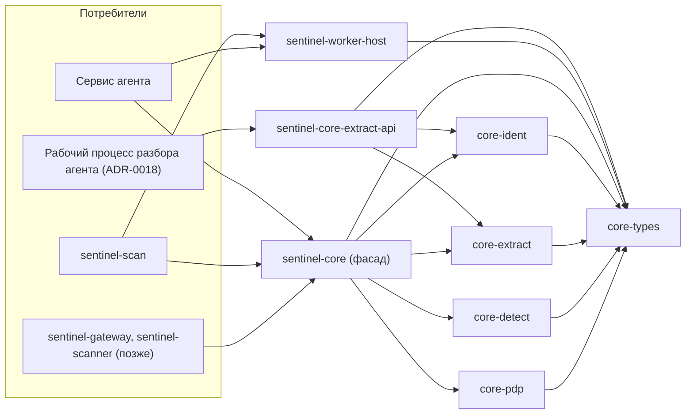
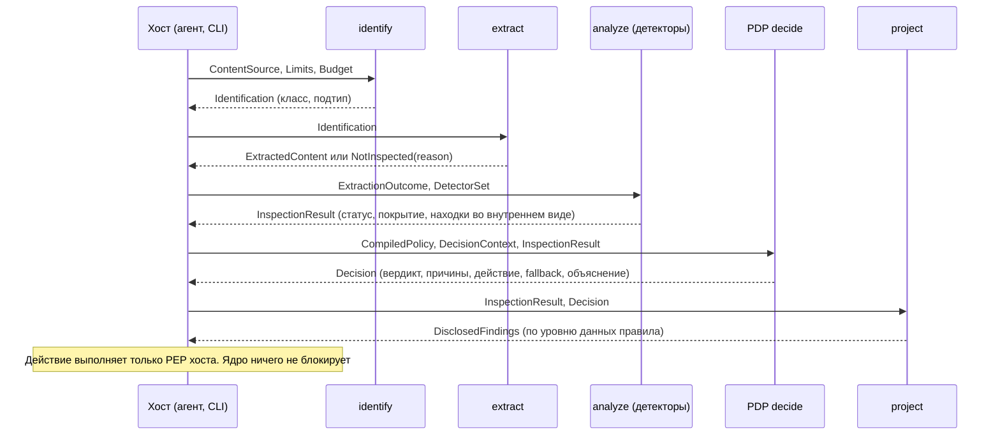

# Sentinel DLP — System Design: `sentinel-core` v0.1

| Атрибут | Значение |
| --- | --- |
| Назначение | Архитектурная спецификация библиотеки `sentinel-core` v0.1: состав workspace, публичный API, входной контракт, конвейер инспекции, контракты результатов, PDP, минимизация данных, граница с изоляцией разбора, обработка отказов, версионирование |
| Версия | 0.14 (Design Accepted, ревизия 14: уточнения CHG7-OD1, CHG7-OD2 (CHG-0007, 2026-11-13); ревизия 13: отметка разрешения публикации OA-11 без изменения содержания; ревизия 12: отметка Design Accepted (OA-10, 2026-11-12) без изменения содержания; ревизия 11: отметки об утверждении владельцем D-18…D-21, РВ-1…РВ-5, PG-1…PG-6, TA-1…TA-7 и §6.8 (OA-1…OA-9, 2026-11-12) без изменения содержания ревизии 10; ревизия 10: CHG5-AR9-01 — финальное решение по действительности отступлений на фактический момент решения для обоих путей API, предварительное решение `Engine::evaluate`; ревизия 9: CHG5-AR8-01 — вход действительности отступлений для раздельного PDP; редакция §6.8 по F-08; граница независимости модели; ревизия 8: CHG5-AR7-01, CHG5-AR7-02, PKG-01, редакция §4.3; ревизия 7: интеграционный кандидат — CHG5-AR6-01, нормативная интеграция РВ-1…РВ-5, OBS-02…04; ревизия 6: CHG5-AR5-01…05; ревизия 5: Target Design по проектам решений D-18…D-21 и уточнениям DPR-01…07; ревизия 4: R4-01…14; ревизия 3: CHG5-AR2-01…06; ревизия 2: CHG5-AR-01…08) |
| Дата | 2026-11-13 |
| Статус | **Design Accepted — 2026-11-12 (OA-10)**; объект принятия — архитектурное содержание rev10 с фиксацией OA-1…OA-9 в rev11 (запись — журнал решений, раздел 7). Реализация — только по отдельному разрешению владельца. §4.1–§4.3, §6.3, §6.7, §6.8 — **Target Design по решениям D-18…D-21, утверждённым владельцем** (Owner Approval 2026-11-12, OA-1…OA-4; DECISION_LOG.md §1, §4.1); требования PG-1…PG-6, TA-1…TA-7 и раздел 6.8 утверждены (OA-9). Согласование с принятыми документами (РВ-1…РВ-5, раздел 12.2) утверждено (OA-2, OA-5…OA-8); публикация по D-10 разрешена 2026-11-12 (OA-11; Draft PR в develop). Кода нет. Варианты, помеченные «Рекомендация», — предложения команды. Все числовые значения — Proposed. Механизмы — NOT VERIFIED |
| Изменение | CHG-0005 |
| Решения и ADR | D-03, D-05, D-07, D-14, D-16, D-17, D-18…D-21 (Accepted 2026-11-12); ADR-0003, ADR-0016, ADR-0017, ADR-0018, ADR-0019 |
| Связанные требования | DLP-DETECTION-001…006, DLP-DETECTION-015, DLP-POLICY-001…006, DLP-POLICY-011…015, DLP-ENDPOINT-021 |
| Связанные документы | docs/architecture/FAILURE_MODE_DESIGN.md, docs/security/DATA_PROTECTION_DESIGN.md, docs/architecture/CAPABILITY_MATRIX.md, docs/architecture/SENTINEL_SCAN_CLI_DESIGN.md, docs/architecture/SENTINEL_CORE_TEST_PLAN.md, docs/THREAT_MODEL.md |

## 1. Область v0.1

`sentinel-core` — общая библиотека определения типа, извлечения текста, детектирования и принятия решения (PDP). Её используют агент, шлюзы, сканер и CLI `sentinel-scan` (D-03, ADR-0003). Альтернативных реализаций нет.

| Входит в v0.1 | Не входит в v0.1 |
| --- | --- |
| Определение типа по сигнатуре (DLP-DETECTION-001) | Архивы (DLP-DETECTION-007), EDM (-009), отпечатки (-010), OCR (-012), устаревшие форматы (-013), ML/NLP (-014) |
| Извлечение текста TXT, CSV, OOXML (DLP-DETECTION-002), PDF (DLP-DETECTION-003) | IPC, пул рабочих процессов, профили песочниц (ADR-0018: код агента) |
| Regex-детекторы с валидаторами и порогами (DLP-DETECTION-004); словари с весами (DLP-DETECTION-005) | Компилятор политик и формирование бандла (сервер, Go) |
| Маскирование (DLP-DETECTION-006); проекция данных по уровню | Действия PEP: блокировка, уведомления, запись событий |
| PDP: оценка правил, приоритеты, fallback, объяснение (DLP-POLICY-001…003, -006, -011, -012) | Учёт времени политики и `time_state` (FAILURE_MODE_DESIGN.md §4: сервис агента) |
| Проверка подписи и загрузка бандла (DLP-POLICY-004) | Break-glass (DLP-ENDPOINT-014), кэш вердиктов (FAILURE_MODE_DESIGN.md §12) |
| Действия MONITOR, ALERT, BLOCK | JUSTIFY и QUARANTINE (Pending, DECISION_LOG.md §4) |

## 2. Состав и границы API

### 2.1. Варианты организации кода

| Критерий | A. Один crate с модулями и feature-флагами | B. Cargo workspace из нескольких crates с фасадом |
| --- | --- | --- |
| Принудительные границы | Только соглашения и видимость `pub(crate)` | Граф зависимостей проверяется компилятором: PDP не может импортировать парсеры |
| Изоляция по ADR-0018 | Рабочий процесс тянет весь crate | Рабочий процесс компонуется только с извлечением |
| Аудит `unsafe` | Один атрибут на весь crate | `#![forbid(unsafe_code)]` по crate; исключения видны в графе |
| Сложность | Ниже | Больше манифестов и согласование версий внутри workspace |
| Публичный API | Модули легко «протекают» наружу | Стабилен только фасад; внутренние crates не публикуются |

**Рекомендация: B.** Границы ADR-0018 и минимизации данных проверяются сборкой, а не ревью.

### 2.2. Crates (имена — Proposed)

| Crate | Назначение | Зависит от | Публичный |
| --- | --- | --- | --- |
| `sentinel-core` | Полный фасад: стабильный API всех этапов, версии схем | `sentinel-core-types`, `-ident`, `-extract`, `-detect`, `-pdp` | Да |
| `sentinel-core-extract-api` | Узкий публичный фасад рабочего процесса: `extract`, уточнение подтипа контейнера, кодирование `ExtractedContent` | types, ident, extract | Да |
| `sentinel-core-types` | Контракты: запрос, результаты, коды причин, решение, сериализация, версии | — | Через фасады |
| `sentinel-core-ident` | Определение класса по сигнатуре | types | Нет |
| `sentinel-core-extract` | Извлечение TXT, CSV, OOXML, PDF; уточнение подтипа контейнера | types | Нет |
| `sentinel-core-detect` | Нормализация текста, детекторы, валидаторы, маскирование, проекция данных | types | Нет |
| `sentinel-core-pdp` | Проверка подписи и загрузка бандла, проверка манифеста возможностей (§6.7), IR политики, оценка, объяснение | types | Нет |
| `sentinel-scan` | CLI (docs/architecture/SENTINEL_SCAN_CLI_DESIGN.md) | `sentinel-core`, `sentinel-worker-host` | Бинарный |
| `sentinel-extract-worker` | Бинарный рабочий процесс разбора; общий для агента и CLI | `sentinel-core-extract-api` | Бинарный |
| `sentinel-worker-host` | IPC-клиент, запуск, перезапуск и лимиты рабочих процессов; песочница (механизм — после SPIKE, D-14). **Вне `sentinel-core`** | `sentinel-core-types` | Внутренний |
| `sentinel-core-testkit` | Синтетические корпуса, golden-фикстуры, генераторы (только dev) | `sentinel-core` | Нет |

Правила графа:

- Граф ацикличен: базовые crates (`types`, `ident`, `extract`, `detect`, `pdp`) не зависят от фасадов `sentinel-core` и `sentinel-core-extract-api`; фасады не зависят друг от друга.
- `pdp` не зависит от `extract`, `ident` и `detect`. Он работает только с `InspectionResult`.
- `detect` не зависит от `extract`. Он работает только с `ExtractedContent`.
- `unsafe` запрещён во всех crates. Исключение возможно только по ADR-0003: отдельный модуль, обоснование, ревью.
- Сторонние парсеры форматов подключаются только в `extract`. Выбор crates — после сравнительной оценки (§12, вопрос O-04).
- Рабочий процесс `sentinel-extract-worker` зависит только от `sentinel-core-extract-api`. Его транзитивный граф не содержит `detect` и `pdp`.
- `sentinel-worker-host` не зависит от `extract`, `detect` и `pdp`; он передаёт байты и `ExtractedContent`, но не разбирает их.
- Граф проверяется в CI по `cargo metadata` против списка разрешённых зависимостей для каждого конечного артефакта (сервис, рабочий процесс, CLI). Отклонение — ошибка сборки (TC-CORE-22).

| Критерий | A. Один фасад с feature-флагом «только извлечение» | B. Отдельный узкий фасад `sentinel-core-extract-api` |
| --- | --- | --- |
| Состав рабочего процесса | Зависит от включённых features; объединение features при сборке workspace может подключить лишнее | Определяется графом зависимостей |
| Проверяемость | Нужно проверять каждую комбинацию features | Одна проверка графа артефакта |
| Стоимость | Один crate | Ещё один публичный crate и его версия |

**Рекомендация: B** — противоречие «фасад тянет всё» снимается без features.



### 2.3. Публичный API (эскиз; сигнатуры не окончательны)

```text
// Загрузка политики (режимы и проверки — §6.7)
CapabilityManifest::verify(bytes, ReleaseTrustAnchors) -> Result<VerifiedManifest, ManifestError>   // §6.7
PolicyBundle::load_enforcement_ready(bytes, PolicyTrustAnchors, &VerifiedManifest, EngineCaps) -> Result<CompiledPolicy<EnforcementReady>, BundleError>
PolicyBundle::load_inspection_only(bytes, PolicyTrustAnchors, EngineCaps)                   -> Result<CompiledPolicy<InspectionOnly>, BundleError>

// Этапы (раздельно — для ADR-0018)
Engine::identify(&ContentSource, &Limits, &Budget)               -> Identification
Engine::extract(&ContentSource, &Identification, &Limits, &Budget) -> ExtractionOutcome   // ExtractedContent | NotInspected(reason)
Engine::analyze(&ExtractionOutcome, &DetectorSet, &Limits, &Budget) -> InspectionResult
Pdp::decide(&CompiledPolicy | PolicyState, &DecisionContext, &InspectionResult, &DeviationValidity) -> Decision   // финальное решение; DeviationValidity — на момент этого вызова (§6.8)
Projector::project(&InspectionResult, &Decision)                 -> DisclosedFindings   // только финальное Decision; ProvisionalDecision не принимается

// Полный путь в одном процессе (CLI, тесты)
Engine::evaluate(&EvaluationRequest) -> Result<Evaluation, EngineFault>   // #[must_use]
Evaluation { inspection: InspectionResult, provisional: ProvisionalDecision }
// ProvisionalDecision — по EvaluationRequest.deviations; отдельный тип: не применяется, не записывается,
// не проецируется. Финальное решение — Pdp::decide хоста по Evaluation.inspection (§6.8)
EngineFault = INVALID_REQUEST | LIMITS_INVALID | INTERNAL(caught_panic)
```

Гарантии API ограничены живым процессом:

- **Управляемые отказы анализа** (формат, лимит, бюджет, дедлайн, ошибка чтения) возвращаются как `NOT_INSPECTED(reason)` в `InspectionResult`, а не как `Err`.
- **Ошибки вызова** (некорректный запрос или лимиты) и **перехваченная паника** возвращаются как `EngineFault`. Хост трактует любой `EngineFault` как отсутствие вердикта. Хост с PEP (сервис агента) применяет fallback подписанной политики и записывает `decision_origin = HOST_FALLBACK` (§10.2). `sentinel-scan` не PEP: fallback не применяет и выводит ошибку `ENGINE_FAULT` без вердикта (SENTINEL_SCAN_CLI_DESIGN.md §4.2.1). Вердикт INDETERMINATE за PDP не синтезируется.
- **Ответа может не быть вообще.** Ядро не гарантирует результат при аварийном завершении процесса (`panic=abort`), исчерпании памяти, переполнении стека, принудительном завершении, сбое IPC или зависании, пойманном дедлайном хоста. `catch_unwind` такие случаи не перехватывает. Ответственность хоста — §10.2.

Отсутствие ответа ядра никогда не означает ALLOW (INV-H1).

## 3. Входной контракт

```text
EvaluationRequest {
  content:  ContentSource          // ограниченное чтение; ядро не открывает пути и не обращается к ФС и сети
  object:   ObjectMeta             // объявленные имя или расширение, размер — недоверенные подсказки
  context:  DecisionContext        // канал, операция, область применения
  limits:   Limits                 // Proposed-значения, ADR-0018 §4
  budget:   Budget                 // рабочий бюджет и токен отмены (§10.1)
  snapshot: CORE_OWNED_BUFFER | NONE         // происхождение неизменного снимка (§3.2)
  digest_mode: NONE | FULL                  // FULL — прочитать объект целиком для полного хеша
  deviations: DeviationValidity             // на момент формирования запроса; только для предварительного решения (§6.8)
}
DeviationValidity = Provided { time_state: CURRENT | STALE | TIME_UNVERIFIABLE, valid_ids: [Id] }
                  | Unavailable          // вход не получен: граница сериализации, сбой хоста
// вычисляет хост на момент вызова, которому передаётся вход (§6.8); ядро часов не читает; один тип для Engine::evaluate и Pdp::decide

ContentSource   — read_at(offset, buf) и len(); реализации: буфер в памяти, ограниченный читатель
                  над дескриптором хоста, разделяемая память только для чтения (ADR-0018)
DecisionContext {
  channel, operation                 // перечисления из CAPABILITY_MATRIX.md §2
  principal_ref, device_ref          // непрозрачные идентификаторы; ядро их не интерпретирует
  scope_attrs: [GroupId | OrgUnitId] // членство разрешает хост; ядро только сравнивает
  policy_validity: CURRENT | STALE | TIME_UNVERIFIABLE | EXPIRED  // вычисляет хост (FAILURE_MODE_DESIGN.md §4.6)
  decision_time: Timestamp?          // для условий по времени; ядро часов не читает
}
```

### 3.1. Варианты доступа к содержимому

| Критерий | A. Срез байтов в памяти | B. Трейт `ContentSource` с ограниченным произвольным чтением |
| --- | --- | --- |
| Память | Весь объект в памяти; при 100 МБ (Proposed) — пиково | Читаются только нужные части (заголовок, центральный каталог ZIP, таблица xref PDF) |
| Передача дескриптора и разделяемой памяти по ADR-0018 | Требует копирования | Естественна |
| Простота | Выше | Нужна обработка ошибок чтения |
| Риск TOCTOU | Байты зафиксированы | Хост обязан гарантировать неизменность источника на время анализа (FAILURE_MODE_DESIGN.md §12) |

**Рекомендация: B** с готовой реализацией для среза в памяти. Ошибка чтения — `NOT_INSPECTED(ENGINE_ERROR)`.

### 3.2. Достоверность хеша содержимого (CHG5-AR-01, CHG5-AR2-01)

При произвольном чтении `read_at` ядро может прочитать не все байты, а источник может измениться во время анализа — в том числе без изменения длины. Заявление хоста «источник неизменен» само по себе ничего не доказывает. Поэтому доверие к хешу определяется происхождением снимка, а не заявлением.

```text
ContentDigest {
  full: Sha256?              // хеш всех байтов снимка за один проход; только при digest_mode = FULL
  full_status: COMPUTED | NOT_COMPUTED(PARTIAL_READ | SIZE_LIMIT | READ_ERROR | NOT_REQUESTED | NO_SNAPSHOT)
  read_set_digest: Sha256    // хеш прочитанных диапазонов с их смещениями; только для диагностики и тестов
  trust: TRUSTED_SNAPSHOT | UNTRUSTED
}
```

**Доверенное происхождение снимка в v0.1 одно — `CORE_OWNED_BUFFER`.** Это буфер, который:

- хост целиком скопировал в память процесса, где работает ядро;
- передал ядру во владение: в Rust — передача владения или неизменяемое заимствование на всё время анализа, поэтому изменение буфера во время анализа исключено системой типов;
- ядро использует и для анализа, и для вычисления `full` **в том же процессе**.

`trust = TRUSTED_SNAPSHOT` означает только одно: **`full` — хеш ровно тех байтов, которые проанализированы**. Это не утверждение о файле на диске или на носителе после анализа.

| Источник | `trust` | Основание |
| --- | --- | --- |
| `CORE_OWNED_BUFFER`, `digest_mode = FULL`, извлечение в том же процессе (TXT, CSV в сервисе; все форматы в режиме разработчика CLI) | TRUSTED_SNAPSHOT | Байты неизменны по построению, и разобраны именно они |
| `CORE_OWNED_BUFFER`, извлечение в рабочем процессе (OOXML, PDF по ADR-0018) | UNTRUSTED в v0.1 | Способ передачи байтов рабочему процессу — NOT VERIFIED (ADR-0018 §4); рабочий процесс может читать не тот буфер |
| Дескриптор файла, в том числе открытый с запретом записи для других | UNTRUSTED | Запрет совместной записи обходится другими дескрипторами, отображением в память, администратором, драйверами |
| Разделяемая память, запечатанная средствами ОС (например, memfd с печатями в Linux) | UNTRUSTED в v0.1 | Механизм и его проверка на трёх ОС — NOT VERIFIED; может стать доверенным происхождением после SPIKE и отдельного решения |
| Теневая копия драйвера для записи на USB | UNTRUSTED в v0.1 | NOT VERIFIED; R-15 |

**OBS-02 (ограничение реализации).** `input_digest`, возвращённый рабочим процессом, не является свидетельством безопасности или добросовестности рабочего процесса: скомпрометированный процесс может вернуть верный хеш и подложный или неполный текст. Сверка обнаруживает только подмену источника исправным процессом. Результат извлечения вне процесса всегда `UNTRUSTED`; риск R-25 сохраняется; повышение доверия по совпадению хеша запрещено (TC-CORE-41).

**Сверка при извлечении вне процесса.** Рабочий процесс возвращает в `ExtractedContent` поле `input_digest` — SHA-256 байтов, которые он фактически разобрал. Сервис сравнивает его с `full`; несовпадение → `NOT_INSPECTED(CONTENT_CHANGED)`. Сверка обнаруживает подмену источника исправным рабочим процессом. От скомпрометированного рабочего процесса она не защищает (R-25), поэтому результат остаётся `UNTRUSTED`. Доверенным такой путь может стать только после проверки неизменяемой передачи буфера (вопрос O-13).

Для недоверенного источника ядро не обещает обнаружить изменение. Изменение длины, если оно замечено, даёт `NOT_INSPECTED(CONTENT_CHANGED)`. Изменение содержимого при той же длине может остаться незамеченным, поэтому результат всегда `UNTRUSTED`.

Ответственность хоста (обязательство **INV-H2**):

- ключ разрешающего кэша вердиктов — полный ключ FAILURE_MODE_DESIGN.md §12: хеш содержимого, версия бандла, версия набора детекторов, хеш контекста (канал, область). `full` — только компонент содержимого; без остальных компонентов поиск запрещён;
- в кэш помещаются только решения, одновременно удовлетворяющие условиям: `trust = TRUSTED_SNAPSHOT`; `decision_origin = PDP`; вердикт ALLOW или BLOCK; статус инспекции `MATCH` или `NO_MATCH` при полном покрытии;
- INDETERMINATE, любые результаты с `NOT_INSPECTED` (в том числе `TIMEOUT` и `RESOURCE_EXHAUSTED`) и любые fallback в кэш не помещаются: они не детерминированы (§6.5);
- поиск для новой операции — только по `full` с `trust = TRUSTED_SNAPSHOT`, вычисленному по байтам этой операции, вместе с остальными компонентами ключа;
- решения с `UNTRUSTED` никогда не попадают в разрешающий кэш;
- `read_set_digest` никогда не используется как ключ кэша и не связывает вердикт с байтами.

**USB L3.** Доверенный хеш не даёт гарантии L3: ядро не знает, какие байты будут записаны на носитель. Связь вердикта с записываемыми байтами требует отдельного механизма — теневой записи или инспекции буфера в драйвере (FAILURE_MODE_DESIGN.md §8.1). До SPIKE-WIN-01 и отдельного решения L3 не заявляется; R-15 сохраняется.

## 4. Конвейер



| Этап | Что делает | Результат при отказе |
| --- | --- | --- |
| identify | Класс по сигнатуре (magic bytes); для текста без сигнатуры — по §4.3; объявленное расширение — только подсказка, расхождение фиксируется; достоверность классификации — `classification` (PG-4) | Неизвестный класс → `NOT_INSPECTED(UNSUPPORTED_FORMAT)` |
| extract | TXT, CSV: декодирование с определением кодировки; ZIP → подтип OOXML по структуре; OOXML, PDF: извлечение текста и метаданных в лимитах. OCR вне v0.1: PDF без текстового слоя → `NOT_INSPECTED(UNSUPPORTED_FORMAT)`; встроенные изображения — по §4.2. Пустой объект — `NO_MATCH`, покрытие COMPLETE | `PARSE_ERROR`, `RESOURCE_EXHAUSTED`, `CONTENT_ENCRYPTED`, `TIMEOUT`, `UNSUPPORTED_FORMAT` |
| analyze | Нормализация текста; детекторы; подсчёт; значения совпадений сохраняются только во внутреннем буфере | `RESOURCE_EXHAUSTED`, `TIMEOUT`, `ENGINE_ERROR` |
| decide | Оценка правил по `InspectionResult` и контексту | INDETERMINATE с причиной |
| project | Раскрытие находок по уровню данных правила-победителя | Без раскрытия: уровень METADATA |

Размещение этапов:

- **Агент:** `identify`, `analyze`, `decide`, `project` и разбор TXT и CSV — в сервисе; `extract` для OOXML и PDF — в рабочем процессе (ADR-0018 §1).
- **CLI:** то же разделение. TXT и CSV — в процессе CLI; OOXML и PDF — в рабочем процессе (по умолчанию) или в процессе CLI только в явном режиме разработчика. Последовательности — docs/architecture/SENTINEL_SCAN_CLI_DESIGN.md §7.1.
- **IPC, запуск и перезапуск рабочих процессов, песочница** — компонент хоста `sentinel-worker-host` вне `sentinel-core`. Его используют агент и CLI.
- Реализация `extract`, `detect` и `pdp` одна во всех местах размещения.

### 4.1. Частичное покрытие (решение D-18, O-01 B)

Часть объекта может быть разобрана до превышения лимита, ошибки или дедлайна. Найденные в разобранной части совпадения реальны; отсутствие других совпадений не доказано.

Правила Target Design (D-18, утверждено владельцем 2026-11-12):

- **Статус.** При неполном покрытии (§4.2) `MATCH` — только если в разобранной части достигнут порог хотя бы одного детектора (`threshold_met`). Иначе — `NOT_INSPECTED(reasons)`. `NO_MATCH` при неполном покрытии невозможен (INV-C4).
- **Источник частичного результата.** `MATCH` при неполном покрытии возможен только по **проверенному частичному извлечению**: разбор в том же процессе либо полностью принятый ответ рабочего процесса, прошедший проверку формата и версии `ExtractedContent`, сверку `input_digest` (§3.2) и содержащий `text_coverage = PARTIAL(reason)`, — рабочий процесс сам остановил разбор по своему лимиту или бюджету. Если рабочий процесс аварийно завершён, уничтожен хостом или ОС по дедлайну или лимиту памяти, или ответ не прошёл проверку, частично переданные данные отбрасываются; результат — только `NOT_INSPECTED(ENGINE_ERROR | TIMEOUT | RESOURCE_EXHAUSTED)` с `inspection_origin = HOST_SYNTHESIZED`, а не `MATCH` (ADR-0018 §5; TC-CORE-40).
- **Причины неполноты сохраняются при любом статусе.** `MATCH` с неполным покрытием несёт в `reasons` и полях покрытия те же причины, что и `NOT_INSPECTED`.
- **Монотонность атомов по содержимому.** При неполном покрытии `detector(id).count >= n` и `detector(id).threshold_met` — TRUE, если выполнены найденным, иначе UNKNOWN. Значение FALSE при неполном покрытии они не принимают, кроме случая применённого исключения анализа частей (§4.2). `NOT` над ними вычисляется по логике Клини (§6.3).
- **Атом неполноты** `inspection.incomplete[(reason)]` (§6.1) истинен при любой неполноте покрытия с этой причиной, независимо от статуса `MATCH` или `NOT_INSPECTED` (INV-C10). Найденное совпадение не отключает правило, охраняющее неполноту (G-11).
- Вердикт по объекту определяет алгоритм §6.3: найденное в разобранной части срабатывает по правилам содержимого; неизвестное в остальной части учитывается, только если способно изменить вердикт.

D-18 может быть утверждён только вместе с D-19 (O-02 B): при варианте A вопроса O-02 обработка UNKNOWN в статусе `MATCH` не определена.

| Альтернатива | Поведение | Почему не предлагается |
| --- | --- | --- |
| A. Любая неполнота → `NOT_INSPECTED`, найденное не учитывается | Описан в ревизиях 1–4; в его терминах пока сформулированы принятые ADR-0018 §5, ограничение D-14 и FAILURE_MODE_DESIGN.md §2.2 (раздел 12.2) | Обход через объём: документ с совпадениями в начале и «хвостом» за лимитом получает только fallback (T-03, T-14) |

### 4.2. Покрытие, неразобранные части и исключение анализа частей (решение D-20, O-11 C)

Покрытие описывается независимыми величинами:

- `text_coverage` — полнота разбора текстовых частей: COMPLETE или PARTIAL(reasons);
- `structure_enumeration` — удалось ли достоверно перечислить **все** части объекта (части пакета OOXML, объекты PDF): COMPLETE или INCOMPLETE(reason). INCOMPLETE — при повреждении структуры, превышении лимита, неизвестном типе контейнерной части, ошибке парсера;
- `uninspected_parts` — перечень **доказанных** частей, которые v0.1 не анализирует: `{ kind, count }`, где `kind` ∈ IMAGE, EMBEDDED_OBJECT, ATTACHMENT, UNKNOWN. Часть, тип которой не распознан, получает `kind = UNKNOWN`. Часть записывается, только если её существование установлено разбором структуры, а не по подозрению (PG-3, §4.3);
- `classification` — достоверность определения класса: CONFIRMED или AMBIGUOUS(reason) (§4.3).

`object_coverage = FULL` — только при `structure_enumeration = COMPLETE` и пустом `uninspected_parts`; иначе INCOMPLETE. **Полное покрытие** (`inspection_complete`) — `text_coverage = COMPLETE`, `object_coverage = FULL` и `classification = CONFIRMED` одновременно. Утверждение «совпадений нет» (`NO_MATCH`) допустимо только при полном покрытии (INV-C4).

**Исключение анализа частей объекта** (`PartInspectionExclusion`). Отдельная подписанная запись в бандле; это не правило и не `CapabilityException` ADR-0019:

```text
PartInspectionExclusion {
  exclusion_id,
  scope: { channels, operations, groups, org_units, devices }   // ограниченная: задано хотя бы одно из измерений субъекта или устройства (groups, org_units, devices); ограничение только по каналу или операции — не ограниченная (ИТ-06, CHG-0007)
  kinds: [IMAGE | EMBEDDED_OBJECT | ATTACHMENT]                  // непусто, без UNKNOWN
  justification, author, approver, approved_at,
  expires_at?, max_offline_validity      // срок действия и предельная длительность в офлайне (§6.8)
}
```

Требования к согласованию переиспользуются из ADR-0019 §2: непустое обоснование, утверждающий не автор, срок не истёк, ограниченная область. Смысл записи другой. Исключение ADR-0019 разрешает понизить действие, когда платформа не может блокировать. `PartInspectionExclusion` разрешает считать неразобранные части указанных видов осознанно не проверяемыми. ADR-0019 не меняется; поля исключений ADR-0019 для этой цели не используются.

Исключение применяется к объекту, только если выполнены все условия:

| Условие | Если не выполнено |
| --- | --- |
| Запись действительна в момент решения: её `exclusion_id` есть в `DeviationValidity.valid_ids` (§6.8) | Не применяется. Результат совпадает с результатом без этой записи (G-24) |
| Область исключения совпадает с контекстом решения | Не применяется |
| `classification = CONFIRMED`, `structure_enumeration = COMPLETE`, `text_coverage = COMPLETE` | Не применяется: неполнота другого рода (G-07, G-16) |
| `uninspected_parts` непуст; все `kind` ∈ `kinds`; нет `kind = UNKNOWN` | Не применяется |

Действие применённого исключения:

- атомы по содержимому вычисляются по разобранному тексту в двузначной логике (FALSE, если не выполнены);
- статус — `MATCH` или `NOT_INSPECTED(UNSUPPORTED_FORMAT)`, но не `NO_MATCH` (INV-C4);
- атом `inspection.incomplete(UNSUPPORTED_FORMAT)` остаётся TRUE: он отражает фактическое покрытие;
- найденное в тексте совпадение срабатывает как обычно: исключение не скрывает найденное (G-12);
- решение без победителя — `OUTCOME_INDEPENDENT_OF_UNKNOWN` с действием из контракта неполной инспекции (§6.3, шаг 7);
- `Decision.part_exclusion_id` и объяснение указывают исключение. При нескольких применимых записях — запись с наименьшим `exclusion_id` в байтовом порядке.

| Альтернатива | Почему не предлагается |
| --- | --- |
| A. Неразобранная часть → `NOT_INSPECTED`; механизма исключения нет | Массовые INDETERMINATE на обычных документах с изображениями |
| B (Design Draft 0.1). `NO_MATCH` при полном тексте | Ложное утверждение об отсутствии данных |
| C, ревизии 3–4: атом `uninspected_only(kinds)` в правиле | При O-02 B правило с атомом выше правил содержимого заглушает найденное совпадение, ниже — уступает UNKNOWN. Нельзя одновременно разрешить документ без совпадений и заблокировать документ с совпадением. Заменён исключением анализа частей |

### 4.3. Определение текста без сигнатуры и достоверность классификации

У TXT и CSV нет обязательной сигнатуры. Порядок:

1. **Сигнатуры известных форматов в начале файла имеют приоритет.** Сервис проверяет только сигнатуру в начале файла, без разбора структуры контейнера (ADR-0018 §1). Конец центрального каталога ZIP сервис не ищет. ZIP с произвольным префиксом (самораспаковывающиеся архивы, полиглоты) по сигнатуре не распознаётся. Дальше он проходит проверку на текст (шаг 2): содержимое, не прошедшее её, даёт `UNSUPPORTED_FORMAT`; нарушения PG-1 на всём содержимом снижают `text_coverage` до PARTIAL; расхождение с заявленным расширением контейнера даёт AMBIGUOUS (PG-4). В этих случаях `NO_MATCH` не выдаётся. Если вложение не нарушает ни одну из этих проверок, объект классифицируется как текст и может получить `NO_MATCH` — это остаточный риск (раздел «Ограничения» ниже), а не обещанное поведение. Архивы вне v0.1.
2. **Кандидат в текст** — при отсутствии сигнатуры, если начальный фрагмент (Proposed: 64 КиБ) декодируется без ошибок в одной из поддерживаемых кодировок (UTF-8, UTF-16 с BOM, Windows-1251 — вопрос O-09). Дополнительные условия (Proposed):
   - нет байтов NUL, кроме UTF-16;
   - доля управляющих символов, кроме перевода строки, табуляции и возврата каретки, ниже порога.
3. **TXT или CSV.** CSV — если устойчиво повторяется число разделителей в строках. Иначе TXT. Детекторы работают одинаково, разница — только в сегментации на ячейки.
4. **Иначе** — `NOT_INSPECTED(UNSUPPORTED_FORMAT)`.

Требования к достоверности классификации:

| ID | Требование | Где выполняется |
| --- | --- | --- |
| PG-1 | Условия шага 2 (декодирование, отсутствие NUL кроме UTF-16, доля управляющих символов) проверяются на **всём** содержимом в ходе декодирования, а не только на начальном фрагменте. Нарушение после начального фрагмента → `text_coverage = PARTIAL` | Сервис: часть декодирования простого текста, разрешённого ADR-0018 §1 |
| PG-2 | Поиск вложенных сигнатур контейнеров по всему содержимому в привилегированном сервисе **не выполняется**: ADR-0018 §1 разрешает сервису только сигнатуру в начале файла. Такая проба допустима только вне привилегированного процесса — в рабочем процессе разбора как операция `sentinel-core-extract-api`. В v0.1 проба не включается; включение, область применения и лимит стоимости — вопрос O-14 после выбора механизма D-14 и замера TC-CORE-36 | Рабочий процесс (Proposed) |
| PG-3 | Неоднозначность классификации и доказанная вложенная часть различаются. Найденная сигнатура или расхождение с заявленным типом → `classification = AMBIGUOUS(reason)`; это **не** запись в `uninspected_parts`. Запись `{ kind: EMBEDDED_OBJECT }` появляется, только если рабочий процесс разобрал структуру вложенной части | Сервис (PG-4); рабочий процесс (проба PG-2) |
| PG-4 | Заявленное расширение контейнерного формата (`.zip`, `.docx`, `.xlsx`, `.pptx`, `.pdf`) при классе «текст» → `AMBIGUOUS(DECLARED_CONTAINER_MISMATCH)` | Сервис: только метаданные, без чтения структуры |
| PG-5 | Текстовые маркеры (`%PDF-`, `PK` внутри текста) для неоднозначности не используются: ложные срабатывания на текстах о форматах | — |
| PG-6 | Пороги PG-1 и перечень расширений PG-4 калибруются на корпусе (O-12); до калибровки — Proposed | Команда |

При `classification = AMBIGUOUS` покрытие неполное: `NO_MATCH` невозможен; статус — `MATCH`, если порог достигнут в разобранном тексте, иначе `NOT_INSPECTED(UNSUPPORTED_FORMAT)`; атомы по содержимому монотонны (§4.1); `inspection.incomplete(UNSUPPORTED_FORMAT)` — TRUE; исключение анализа частей не применяется (G-16).

**Атомы `file.class` при `AMBIGUOUS`** (CHG5-AR5-03; INV-C14):

- класс объекта не установлен: `Identification.class` — только кандидат для объяснения; атомы `file.class = X` имеют значение UNKNOWN для любого X, в том числе для кандидата;
- в точной оценке (§6.3, шаг 6) класс — отдельное измерение мира: каждое различное значение `X` из атомов `file.class` применимых правил и значение OTHER; в одном мире класс ровно один;
- поэтому доказательство непересечения областей по разным константам `file.class` (§6.7) остаётся верным: два правила с разными константами не бывают TRUE в одном мире. Доказательство строится только по константам бандла при загрузке и никогда — по классу конкретного объекта;
- правило MONITOR или ALERT с атомом `file.class` выше правила BLOCK может стать UNKNOWN при неоднозначной классификации. Поэтому атом `file.class` учитывается в условии (a) конфликта приоритетов наравне с атомами по содержимому (§6.7; G-20).

Ограничения — что **не** обещается:

- Достоверная идентификация всех полиглотов поиском байтовых шаблонов не обещается ни в сервисе, ни в рабочем процессе.
- Для ZIP с префиксом и полиглотов «текст + ZIP» обнаружение рассчитано на PG-1 и PG-4; обнаружение всех таких объектов не подтверждено. PG-1 должен обнаруживать типичное вложение ZIP в текст UTF-8 или Windows-1251. По спецификации ZIP (APPNOTE) поле метода сжатия локального заголовка — 2 байта little-endian со значениями меньше 256, а номер диска в записи конца каталога однотомного архива равен 0, поэтому нулевые байты в структуре ZIP обязательны. Утверждение NOT VERIFIED до корпуса TC-CORE-34. Для UTF-16, где NUL допустим, и для других форматов этот довод не действует.
- Windows-1251 декодирует любой байт, кроме 0x98: успешное декодирование не доказывает, что содержимое — текст. Поэтому PG-1 проверяет NUL и управляющие символы на всём содержимом.
- Остаточный риск: текст с вложенными данными без нулевых байтов и без расхождения расширения классифицируется как CONFIRMED. Несжатые байты вложения детекторы видят как часть текста; сжатые или закодированные — нет. Риск зарегистрирован в §12.

## 5. Контракты

Нотация — эскиз, не код. Перечисления помечены как расширяемые: неизвестное значение обрабатывается по правилам §11.

```text
ReasonCode (FAILURE_MODE_DESIGN.md §2.3, без новых значений):
  TIMEOUT | UNSUPPORTED_FORMAT | CONTENT_ENCRYPTED | RESOURCE_EXHAUSTED | PARSE_ERROR | ENGINE_ERROR
  | POLICY_ABSENT | POLICY_INVALID | POLICY_EXPIRED | CONTENT_CHANGED
  // SERVICE_UNAVAILABLE, QUEUE_SATURATED, AGENT_NOT_READY формирует хост, не ядро

Identification { class: FileClass, subtype: Option<Subtype>, declared_mismatch: bool,
                 classification: CONFIRMED | AMBIGUOUS(DECLARED_CONTAINER_MISMATCH | EMBEDDED_SIGNATURE) }   // §4.3

ExtractedContent {                      // промежуточный результат; версионируемый формат (ADR-0018 §3)
  format_version, class, subtype,
  input_digest: Sha256,                 // хеш байтов, фактически разобранных; сверяется с `full` (§3.2)
  text_segments: [ { origin: BODY | HEADER | COMMENT | METADATA | …, text } ],
  metadata: { author_present, title_present, … }   // только признаки, без значений, если не нужны детекторам
  text_coverage: COMPLETE | PARTIAL([ReasonCode])
  structure_enumeration: COMPLETE | INCOMPLETE(reason)
  uninspected_parts: [ { kind, count } ]
}                                       // Debug и Display не раскрывают текст

ExtractionOutcome = Extracted(ExtractedContent) | NotInspected([ReasonCode])

DetectionResult {                       // по одному детектору
  detector_id, detector_version,
  match_count: u32, score: u32,         // целочисленные; плавающая точка не используется
  threshold_met: bool
}

InspectionResult {
  status: MATCH | NO_MATCH | NOT_INSPECTED
  reasons: [ReasonCode]                 // непусто при NOT_INSPECTED и при любой неполноте, в том числе при MATCH (§4.1)
  text_coverage: COMPLETE | PARTIAL     // §4.1
  structure_enumeration: COMPLETE | INCOMPLETE(reason)   // §4.2
  object_coverage: FULL | INCOMPLETE    // производное, §4.2
  classification: CONFIRMED | AMBIGUOUS(reason)          // §4.3
  class: FileClass                      // из Identification (§4.3); при AMBIGUOUS атомы file.class — UNKNOWN (ИТ-01, CHG-0007)
  inspection_complete: bool             // производное: полное покрытие §4.2
  uninspected_parts: [ { kind: IMAGE | EMBEDDED_OBJECT | ATTACHMENT | UNKNOWN, count } ]
  detections: [DetectionResult]         // отсортированы по detector_id
  digest: ContentDigest                 // §3.2
  engine: { core_version, detector_set_version, limits_profile_id }
  findings: Internal                    // значения совпадений; не сериализуется, не покидает процесс
}

Decision (FAILURE_MODE_DESIGN.md §2.2; дополнено по ADR-0019 §4 и полями `data_level`, `schema_version`):
  verdict: ALLOW | BLOCK | INDETERMINATE
  reasons: [ReasonCode]                 // непусто при INDETERMINATE
  policy_version?, policy_bundle_id?    // отсутствуют только при решении без проверенного бандла (§6.3, шаг 1; ИТ-05, CHG-0007)
  matched_rules: [RuleId]               // включая проигравшие
  required_action: (MONITOR | ALERT | BLOCK)?   // отсутствует только при decision_basis = NO_RULE_MATCHED (§6.3, шаг 7); при INDETERMINATE задаётся по шагу 8
  decision_basis: RULE_MATCHED | NO_RULE_MATCHED | OUTCOME_INDEPENDENT_OF_UNKNOWN | INDETERMINATE
  inspection_complete: bool             // копия из InspectionResult; не статус канала и не потеря возможности
  winner_rule_id: RuleId?               // только при единственном возможном победителе (§6.3, шаг 9)
  possible_winners: [RuleId]            // при нескольких возможных победителях
  part_exclusion_id: Id?                // применённое исключение анализа частей (§4.2)
  precedence_approval_ids: [Id]         // утверждения конфликтов приоритетов, участвовавшие в решении (§6.7)
  suppressed_precedence_pairs: [ (RuleId, RuleId) ]   // пары без действующего утверждения в этом контексте (§6.3, шаг 2)
  inactive_deviation_ids: [Id]          // записи-отступления, недействительные в момент решения (§6.8)
  deviation_input: PROVIDED | UNAVAILABLE | CONTRADICTORY   // §6.8
  incomplete_action_source: Id?         // запись IncompleteInspectionAction, если она дала одно из возможных действий
  action_certainty: DEFINITE | POSSIBLE // только при ALLOW: одно ли действие во всех мирах (§6.3, шаг 7)
  action_sources: [ { source: RuleId | IncompleteInspectionActionId, action } ]   // только при ALLOW; порядок ≻, запись контракта последней
  verification_mode: (ENFORCEMENT_READY | INSPECTION_ONLY)?   // отсутствует только при решении без проверенного бандла (ИТ-05)
  capability_check: (PERFORMED | SKIPPED)?                     // то же
  requested_action: BLOCK?              // только при исключении ADR-0019
  capability_exception_id: Id?
  fallback: BLOCK | ALLOW_WITH_AUDIT    // только при INDETERMINATE
  data_level: METADATA | MASKED_MATCH
  degraded: bool                        // true, если политика оценивалась не в состоянии CURRENT (STALE, TIME_UNVERIFIABLE; FAILURE_MODE_DESIGN.md §4.6) или решение принято без проверенного бандла (ИТ-04, CHG-0007)
  explanation: Explanation
  schema_version
```

`ProvisionalDecision` (§2.3) имеет ту же структуру, что и `Decision`, но это отдельный тип: его не принимает `Projector::project`, он не сериализуется в события и вывод и не передаётся PEP. Все поля финального `Decision` — `verdict`, `required_action`, `action_certainty`, `action_sources`, `decision_basis`, победители, `part_exclusion_id`, `precedence_approval_ids`, `suppressed_precedence_pairs`, `inactive_deviation_ids`, `deviation_input`, `fallback`, `data_level`, `explanation` — и проекция `DisclosedFindings` по `data_level` берутся из одного финального вызова `Pdp::decide`. Смешивать их с полями предварительного решения нельзя (§6.8).

Правила статусов:

| Ситуация | `status` | `text_coverage` | `object_coverage` | `reasons` |
| --- | --- | --- | --- | --- |
| Всё разобрано, порог хотя бы одного детектора достигнут | MATCH | COMPLETE | FULL | — |
| Всё разобрано, порогов нет | NO_MATCH | COMPLETE | FULL | — |
| Покрытие неполное, порог хотя бы одного детектора достигнут в разобранной части | MATCH | любое | любое | причины неполноты (§4.1) |
| Текст разобран полностью, есть неразобранные части или перечисление неполное, совпадений нет | NOT_INSPECTED | COMPLETE | INCOMPLETE | `UNSUPPORTED_FORMAT` (неразобранные части) или причина неполноты перечисления |
| Текст разобран частично, совпадений нет | NOT_INSPECTED | PARTIAL | любое | причины неполноты |
| Ничего не разобрано | NOT_INSPECTED | — | — | причина |
| Классификация неоднозначна (`classification = AMBIGUOUS`), порогов нет | NOT_INSPECTED | любое | любое | `UNSUPPORTED_FORMAT` (§4.3) |

`NO_MATCH` возможен только при полном покрытии: `text_coverage = COMPLETE`, `object_coverage = FULL`, `classification = CONFIRMED` (INV-C4). `NOT_INSPECTED` — результат инспекции. INDETERMINATE — только вердикт PDP.

## 6. PDP

### 6.1. Модель политики

PDP исполняет скомпилированное промежуточное представление (IR) из подписанного бандла. Компилятор — модуль сервера (SYSTEM_ARCHITECTURE.md §2); ядро проверяет бандл повторно как недоверенные данные.

```text
CompiledPolicy {
  bundle_id, policy_version, format_version, platform,
  detector_set: [DetectorSpec]          // regex с валидатором и порогом, словари с весами и порогом
  rules: [Rule]                         // отсортированы компилятором; PDP проверяет порядок
}
Rule {
  rule_id, priority: u32,
  protected_operation: bool             // пометка защищаемой операции (ADR-0016, решение 4)
  scope: { channels, operations, groups, org_units, devices }  // пусто = «все», если компилятор это разрешил
  condition: Expr                       // AND, OR, NOT над атомами
  action: MONITOR | ALERT | BLOCK
  requested_action, capability_exception_id   // ADR-0019, если исключение применено для этой платформы
  capability_exceptions: [CapabilityException]  // записи ADR-0019 §2 в подписанном бандле
  on_indeterminate: BLOCK | ALLOW_WITH_AUDIT  // ограничения компиляции — ADR-0016, D-17
  data_level: METADATA | MASKED_MATCH
}
Атомы Expr: detector(id).threshold_met; detector(id).count >= n;     // монотонны при неполном покрытии (§4.1)
            inspection.incomplete[(reason)];                         // истинен при любой неполноте с причиной (INV-C10)
            file.class = …; context.channel = …; context.operation = …
Ограничение формы: атом inspection.incomplete допускается только как конъюнкт верхнего уровня условия
            (condition = A1 AND A2 AND …); под OR и NOT — ошибка загрузки (§6.7)

Записи бандла уровня политики (подписаны вместе с правилами):
IncompleteInspectionAction {           // контракт неполной инспекции (§6.3, шаг 7); обязателен
  record_id, scope, action: MONITOR | ALERT  // нужна запись с неограниченной областью; при нескольких применимых — самое строгое действие, при равной строгости — наименьший record_id (ИТ-19, CHG-0007)
}
PartInspectionExclusion { … }          // исключение анализа частей объекта (§4.2)
PrecedenceConflictApproval {           // утверждение конфликта приоритетов (§6.7)
  approval_id, higher_rule_id, lower_rule_id,
  scope,                                // ограниченная; внутри пересечения областей пары
  justification, author, approver, approved_at,   // требования к согласованию — как ADR-0019 §2
  expires_at?, max_offline_validity      // срок действия (§6.8)
}
```

Ядро повторно проверяет бандл при загрузке как недоверенные данные (§6.7). Любое нарушение — `BundleError`; действует предыдущий проверенный бандл (ADR-0016, решение 7). Алгоритм подписи и crate — вопрос O-05. Записи `PartInspectionExclusion` и `PrecedenceConflictApproval` — отдельные сущности; `CapabilityException` ADR-0019 для них не используется.

### 6.2. Варианты языка политики

| Критерий | A. Собственное IR с фиксированным набором атомов | B. Встроенный общий язык правил (например, CEL или Rego) |
| --- | --- | --- |
| Детерминизм и объяснимость | Полный контроль трассировки | Зависит от интерпретатора; трассировка ограничена |
| Поверхность атаки и зависимости | Минимальны | Крупная зависимость в каждом PEP |
| Выразительность | Расширяется версией формата | Высокая |
| Время выполнения | Линейно по числу правил и атомов | Требует ограничения «топлива» |
| Согласованность с ADR-0010 (Proposed, собственная схема политик) | Да | Нет |

**Рекомендация: A.**

### 6.3. Алгоритм оценки — Target Design (D-18…D-20, утверждено)

Алгоритм — Target Design по решениям D-18 (O-01 B), D-19 (O-02 B) и D-20 (O-11 C), утверждённым владельцем 2026-11-12 (OA-1…OA-3; DECISION_LOG.md §1, §4.1). CHG-0005 — Design Accepted 2026-11-12 (OA-10); реализация начинается только по отдельному разрешению владельца. Альтернативы — раздел 6.4. Таблица решений FAILURE_MODE_DESIGN.md §6.1 (редакция Target Design) согласована с алгоритмом; согласование с ADR-0018 §5, ограничением D-14 и FAILURE_MODE_DESIGN.md §2.2 — раздел 12.2 (утверждено: OA-2, OA-5, OA-6).

1. **Состояние политики.** Хост передаёт `PolicyState`:
   - `ABSENT` — проверенной политики не было никогда (первый запуск) → INDETERMINATE(POLICY_ABSENT);
   - `INVALID` — сохранённый действующий бандл при запуске или повторной проверке не прошёл проверку, а резервной проверенной копии нет (FAILURE_MODE_DESIGN.md §2.3) → INDETERMINATE(POLICY_INVALID);
   - `policy_validity = EXPIRED` → INDETERMINATE(POLICY_EXPIRED). Вызов `Pdp::decide` с проверенным бандлом при `policy_validity = EXPIRED` — некорректный запрос (`EngineFault::InvalidRequest`): хост обязан передать `PolicyState` (ИТ-03, CHG-0007).

   Новый полученный недостоверный бандл состояние не меняет: `BundleError`, действует прежний (§10.2). В этих трёх случаях `fallback` берётся из bootstrap-политики хоста (FAILURE_MODE_DESIGN.md §6.3), которую хост передаёт как `PolicyState`. Поведение после `hard_expiry_at` — Pending (FAILURE_MODE_DESIGN.md §4.9); ядро только сообщает причину. При `STALE` и `TIME_UNVERIFIABLE` правила оцениваются как обычно; ограничения разрешающих отступлений (FAILURE_MODE_DESIGN.md §4.5) применяет хост.
2. **Применимость и порядок.** Отбираются правила, область которых совпадает с контекстом. Порядок ≻: больший `priority`; при равенстве — более строгое действие (BLOCK > ALERT > MONITOR); при равенстве — меньший `rule_id` в байтовом порядке. Порядок полный и детерминированный.

   **Превосходство в конфликтной паре (CHG5-AR7-01, AR7-02).** Для пары конфликта h ≻ l (§6.7) правило h может стать победителем, когда l тоже TRUE, только если запись `PrecedenceConflictApproval` для пары действительна в момент решения (§6.8) и её область покрывает контекст. Иначе в этом мире h не становится победителем над l; порядок ≻ не меняется. Такая пара называется **подавленной**; при наличии подавленных пар шаг 5 не применяется и выполняется шаг 6.
3. **Значения атомов.**
   - Полное покрытие (§4.2) или применённое исключение анализа частей (§4.2): все атомы двузначны.
   - Неполное покрытие: атомы по содержимому монотонны (§4.1) — TRUE, если выполнены найденным, иначе UNKNOWN. Атомы контекста и `inspection.incomplete[(reason)]` известны всегда. Атомы `file.class` известны при `classification = CONFIRMED` и имеют значение UNKNOWN при AMBIGUOUS (§4.3).
   - Условия вычисляются в логике Клини: `NOT UNKNOWN = UNKNOWN`, `FALSE AND UNKNOWN = FALSE`, `TRUE OR UNKNOWN = TRUE`.
4. **Кандидаты.** W — первое по порядку ≻ правило со значением TRUE (если есть). U — правила со значением UNKNOWN, стоящие по порядку выше W; если W нет — все правила со значением UNKNOWN.
5. **U пусто.** Неизвестное не может изменить победителя. Единственный возможный победитель — W или его отсутствие. Переход к шагу 7.
6. **U непусто — точная оценка в модели независимых счётчиков.** «Мир» — допустимое сочетание фактических количеств по детекторам, атомы которых неизвестны, а при `classification = AMBIGUOUS` — ещё и класса файла (§4.3). Для детектора количество не меньше найденного; миры различаются только интервалами между порогами (`n` из атомов `count >= n` и порог детектора для `threshold_met`), превышающими найденное. Порог детектора здесь — в единицах `match_count`; детекторы, у которых `threshold_met` определяется по `score` (словари с весами, DLP-DETECTION-005), моделью миров v0.1 не покрываются (ИТ-10, CHG-0007; утверждено решением владельца CHG7-OD2 от 2026-11-13). В каждом мире условия вычисляются двузначно; победитель — первое TRUE-правило по ≻ с учётом подавленных пар (шаг 2) или его отсутствие. Множество возможных победителей собирается по всем мирам. Число миров ограничено при загрузке бандла (§6.7, «Сложность»); перебор детерминирован. Реализация может использовать эквивалентные сокращения, если результат совпадает с перебором (TC-CORE-32).

   **Граница точности (CHG5-AR5-04).** Модель считает количества разных детекторов независимыми: возможно любое сочетание не меньше найденного. Реальные детекторы бывают связаны: совпадения одного могут быть подмножеством совпадений другого. Тогда часть миров недостижима, и алгоритм может выдать INDETERMINATE там, где с учётом связи вердикт одинаков. При `on_indeterminate = BLOCK` это **ложный fallback BLOCK** относительно реальных данных (G-21). Ошибка консервативна: скрытого ALLOW она не даёт; fallback BLOCK допустим только для защищаемых операций (ADR-0016, D-17). Математический алгоритм в rev6 не меняется; учёт связей детекторов — вопрос O-15, частота — TC-CORE-39.
7. **Вердикт по возможным исходам.** Исход правила BLOCK — вердикт BLOCK. Исход правила MONITOR или ALERT — ALLOW с этим действием. Исход «победителя нет»: при полном покрытии — ALLOW без `required_action`; при неполном — ALLOW с действием из контракта неполной инспекции (`IncompleteInspectionAction`, §6.1).
   - Все возможные исходы — BLOCK → **BLOCK**, `required_action = BLOCK`, `decision_basis = RULE_MATCHED`.
   - Все возможные исходы — ALLOW → **ALLOW** с контрактом требуемого действия (CHG5-AR5-02):
     - `required_action` — самое строгое действие среди возможных исходов (ALERT > MONITOR). Исход «победителя нет» при неполном покрытии вносит действие из `IncompleteInspectionAction`;
     - `action_certainty` — DEFINITE, если у всех возможных исходов одно действие; иначе POSSIBLE;
     - `action_sources` — для каждого различного возможного действия его источник: правило или запись `IncompleteInspectionAction`; порядок ≻, запись контракта последней;
     - семантика действий — ADR-0019 §4 и FAILURE_MODE_DESIGN.md §2.4a: MONITOR — операция разрешена, событие аудита записывается обязательно; ALERT — то же и оповещение на сервере. При `action_certainty = POSSIBLE` оповещение помечается как вызванное неполной инспекцией. Оно не понижается до MONITOR и не повышается до BLOCK;
     - при неполном покрытии `required_action` присутствует всегда и не ниже MONITOR (INV-C13): аудит неполной инспекции не зависит от политики сбора.

     `decision_basis`:
     - `NO_RULE_MATCHED` — полное покрытие и победителя нет; поле `required_action` отсутствует: PEP нечего исполнять, событие — только по политике сбора (FAILURE_MODE_DESIGN.md §6.1, строка 3). Значение `NONE` не вводится;
     - `RULE_MATCHED` — победитель есть во всех мирах;
     - `OUTCOME_INDEPENDENT_OF_UNKNOWN` — покрытие неполное и хотя бы в одном мире победителя нет. Действие этого исхода (MONITOR или ALERT) берётся только из подписанного контракта неполной инспекции; ядро значения по умолчанию не подставляет (INV-C11). Итоговый `required_action` — по правилу выше (G-19).
   - Исходы различаются по вердикту → **INDETERMINATE** с причинами неполноты.
8. **Fallback** при INDETERMINATE — самое строгое `on_indeterminate` среди правил, являющихся возможными победителями, **и правил, которые стали бы победителями без подавления пар** (недействительное утверждение не ослабляет fallback); без таких правил — `ALLOW_WITH_AUDIT` (FAILURE_MODE_DESIGN.md §3). `required_action` = BLOCK при fallback BLOCK, иначе MONITOR (аудит) — по ADR-0019 §4. Fallback BLOCK возникает, только если BLOCK — один из возможных исходов и `on_indeterminate = BLOCK` прошло ограничения раздела 6.7. Достоверный BLOCK не превращается в разрешение через разрешающий fallback более приоритетного правила без утверждения: такая политика не загружается (раздел 6.7, «Конфликт приоритетов»).
9. **Победитель и уровень данных.** Если возможный победитель один, он записывается как победитель, уровень данных — его. Если их несколько, победитель не записывается, объяснение перечисляет возможных победителей, уровень данных — минимальный среди них; если хотя бы в одном мире победителя нет — METADATA. При INDETERMINATE — METADATA.

`NOT_INSPECTED` — результат инспекции; INDETERMINATE — только вердикт PDP. Таблица ожидаемых результатов — docs/architecture/SENTINEL_CORE_TEST_PLAN.md §5 (G-01…G-30); согласованность Model Verified (одноразовая модель, в границах модели независимых счётчиков; раздел 13).

### 6.4. Рассмотренные альтернативы

| Вопрос | Альтернатива | Почему не предлагается | Принятая редакция (D-18…D-20, утверждено 2026-11-12) |
| --- | --- | --- | --- |
| O-01 Частичное покрытие | A: неполнота → `NOT_INSPECTED`, найденное не учитывается | Обход через объём (§4.1) | B (D-18): §4.1, шаг 3 |
| O-02 Обработка неизвестного | A: `NOT_INSPECTED` без явного условия → INDETERMINATE | Ложные INDETERMINATE там, где вердикт не зависит от содержимого (G-02) | B (D-19): шаги 4–8 |
| O-02, способ вычисления | Приближение «любое правило U выше W → INDETERMINATE» (Decision Approval Package, условие У-4) | При коррелированных порогах даёт INDETERMINATE, где вердикт на деле одинаков; с `on_indeterminate = BLOCK` — ложный BLOCK (G-15, G-17). Приближение сохранено как шаг 5: при пустом U оно точно | Точная оценка по мирам (шаг 6) |
| O-11 Неразобранные части | Атом `uninspected_only(kinds)` в правиле (ревизии 3–4) | Не совместим с O-02 B (§4.2) | Исключение анализа частей (D-20, §4.2) |
| Атом неполноты | `inspection.status = NOT_INSPECTED[(reason)]` | При O-01 B найденное совпадение переводит статус в `MATCH` и отключает охраняющее правило | `inspection.incomplete[(reason)]` (INV-C10) |
| Требуемое действие при ALLOW в нескольких мирах (AR5-02) | Действие W или контракта; наименее строгое; два поля без единого `required_action` | Пропуск оповещения из возможного мира; не определено при отсутствии W; ADR-0019 §4 ожидает одно `required_action` | Самое строгое действие + `action_certainty` + `action_sources` (шаг 7) |

| Критерий O-02 | A | B (D-19) |
| --- | --- | --- |
| Скрытый ALLOW | Нет | Нет: ALLOW только если все возможные исходы — ALLOW; разрешающий fallback против достоверного BLOCK — только по утверждению (§6.7) |
| Ложные INDETERMINATE | Больше | Меньше |
| Сложность и объяснимость | Проще | Перебор миров ограничен при загрузке; объяснение перечисляет U и возможных победителей |

### 6.5. Детерминизм

Одинаковые байты, контекст, бандл, лимиты и версии ядра дают побайтно одинаковые `InspectionResult` (без `findings`) и `Decision` при условии, что не сработали дедлайн хоста и отмена. Средства:

- нет чтения часов, сети, ФС и случайных чисел в PDP и детекторах;
- только упорядоченные коллекции в выходных данных; сортировка находок по (`detector_id`, смещение);
- целочисленная арифметика весов и порогов;
- рабочий бюджет в единицах работы, а не во времени (§10.1);
- каноническая сериализация `Decision` для golden-тестов.

### 6.6. Объяснение решения

`Explanation` содержит: версию ядра, набора детекторов и бандла; класс файла и покрытие; детекторы с количеством совпадений и порогом (без значений); каждое применимое правило с итогом TRUE, FALSE или UNKNOWN и атомом, определившим итог; победителя и основание выбора (приоритет, строгость, `rule_id`); множество U и возможных победителей с числом рассмотренных миров (§6.3); основание INDETERMINATE; применённый fallback; исключение ADR-0019; применённое исключение анализа частей; утверждения конфликтов приоритетов; запись контракта неполной инспекции, давшую действие; `action_certainty` и `action_sources`; класс-кандидат и миры по классу при неоднозначной классификации; правила с атомом неполноты, затенённые правилом выше по порядку. Значения совпадений, имена файлов и пути в объяснение не входят.

### 6.7. Проверка бандла при загрузке (CHG5-AR-03, CHG5-AR2-02)

Ядро не доверяет результату компилятора и проверяет бандл заново. Принятые ADR-0016 и ADR-0019 не меняются: это повторная проверка их правил.

**Два режима загрузки.** Они различаются типом результата, а не только флагом:

| Режим | Для чего | Проверки возможностей | Тип результата |
| --- | --- | --- | --- |
| `EnforcementReady` | PEP: агент, шлюзы | Обязательны все строки таблицы ниже; без манифеста возможностей — `BundleError` | `CompiledPolicy<EnforcementReady>` |
| `InspectionOnly` | Аналитика без PEP: CLI, тесты, симуляция | Подпись и состав проверяются; строки «Платформа», «BLOCK», «Понижение», «`on_indeterminate = BLOCK`», «UNSUPPORTED» не выполняются | `CompiledPolicy<InspectionOnly>`; в каждом `Decision` — `verification_mode = INSPECTION_ONLY`, `capability_check = SKIPPED` |

- API хостов PEP принимает только `CompiledPolicy<EnforcementReady>`. Подставить `InspectionOnly` нельзя на уровне типов; на уровне данных `Decision` несёт `verification_mode`, и агент отклоняет решение не своего режима.
- `capability_check = SKIPPED` допустим только в режиме `InspectionOnly`.

| Проверка | Правило | Основание |
| --- | --- | --- |
| Подпись, якорь доверия, версия формата, версия не ниже текущей | Нарушение → `BundleError` (оба режима) | DLP-POLICY-004; FAILURE_MODE_DESIGN.md §6.1, строка 10 |
| Состав (оба режима) | Нет неизвестных атомов и действий; нет `FULL_EVIDENCE`, JUSTIFY, QUARANTINE; детекторы в пределах лимитов. Атом `inspection.incomplete` — только конъюнктом верхнего уровня. Атомы ревизий 3–4 `inspection.status = NOT_INSPECTED` и `uninspected_only` неизвестны формату и отклоняются. Нарушение состава отклоняет бандл и в `InspectionOnly` | D-16; §4.2, §6.1 этого документа; DECISION_LOG.md §4 |
| Контракт неполной инспекции (оба режима) | Есть хотя бы одна запись `IncompleteInspectionAction` с неограниченной областью; действие — MONITOR или ALERT. Иначе `BundleError` | §6.3, шаг 7; INV-C11 |
| Исключения анализа частей (оба режима) | Каждая запись `PartInspectionExclusion`: ограниченная область, непустые `kinds` без UNKNOWN, непустое обоснование, утверждающий не автор, срок не истёк (проверка срока — как у записей ADR-0019 при загрузке). Иначе `BundleError` | §4.2; требования к согласованию — ADR-0019 §2 |
| Конфликт приоритетов (оба режима) | **Конфликт — любая пара** применимых правил h ≻ l с пересекающейся областью, где действие l — BLOCK, а действие h — MONITOR или ALERT (CHG5-AR7-02): h может затенить BLOCK. Классы для отчёта и объяснения: (a) условие h содержит атомы по содержимому или атомы `file.class` (они неизвестны при `classification = AMBIGUOUS`, §4.3) и `h.on_indeterminate = ALLOW_WITH_AUDIT`; (b) условие l содержит атом `inspection.incomplete` конъюнктом верхнего уровня; (c) все остальные, в том числе достоверное затенение правилом только по контексту (G-23). Конфликт без записи `PrecedenceConflictApproval` для пары (h, l) → `BundleError(UNAPPROVED_PRECEDENCE_CONFLICT)`. Запись должна иметь ограниченную область внутри пересечения областей пары («внутри» — каждый контекст, совпадающий с областью записи, совпадает с областями обоих правил: для каждого измерения, ограниченного хотя бы одним правилом пары, значения записи заданы и лежат в пересечении); во время работы она действует только в своей области и пока действительна (§6.3, шаг 2; §6.8). При нескольких действительных записях для одной пары, покрывающих контекст, в решении указывается запись с наименьшим `approval_id` (ИТ-18, CHG-0007). Области считаются непересекающимися, только если это доказуемо по константам бандла: пустое пересечение в одном из **однозначных** измерений области — `channels`, `operations`, `devices` (контекст несёт ровно одно значение каждого) — или разные константы одного атома `context.channel`, `context.operation`, `file.class` среди конъюнктов верхнего уровня. Измерения `groups` и `org_units` непересечения не доказывают: субъект может состоять в нескольких группах и подразделениях (`scope_attrs` — список), поэтому пара областей `groups = [hr]` / `groups = [finance]` конфликтует для субъекта в обеих группах; ограниченное утверждение для такой пары невыразимо (его `groups` должны лежать в пустом пересечении), и бандл отклоняется до переработки правил (CHG7-R1, ИТ-21, CHG-0007). Для `file.class` доказательство верно и при неоднозначной классификации, потому что в каждом мире класс ровно один (§4.3); класс конкретного объекта для доказательства не используется. Компилятор сервера выполняет ту же проверку (зависимость POLICY_ENGINE_DESIGN.md, §12) | §6.3, шаг 8; DPR-01; ADR-0016 не меняется |
| Сложность (оба режима) | Наибольшее число миров (§6.3, шаг 6) — произведение по детекторам (число различных порогов + 1), умноженное на (число различных констант `file.class` + 1), — не превышает лимит профиля (Proposed: 4096; вопрос O-07). Иначе `BundleError` | §6.3, шаг 6; R-11 |
| Манифест (только `EnforcementReady`) | Манифест возможностей проверен `CapabilityManifest::verify`: подпись по доверенным якорям выпуска пакетов агента (`ReleaseTrustAnchors`, отдельно от якорей политики), формат, платформа, диапазон версий агента. Без проверенного манифеста загрузка `EnforcementReady` невозможна (тип `VerifiedManifest`) | CAPABILITY_MATRIX.md §4.2 |
| Платформа | `platform` бандла совпадает с платформой манифеста | ADR-0019 §1 |
| BLOCK | Для каждой пары (канал, операция) правила с действием BLOCK манифест возможностей содержит BLOCK_CAPABLE с `verified_by` | ADR-0019 §1; CAPABILITY_MATRIX.md §4.2 |
| Понижение | Правило с `requested_action = BLOCK` и действием ALERT или MONITOR ссылается на запись исключения в бандле. Требования к записи: область совпадает с платформой, каналом и операцией; обоснование непустое; утверждающий не автор; срок не истёк (если задан). У области нет подтверждённого BLOCK_CAPABLE, иначе исключение лишнее и отмечается в отчёте загрузки. Пониженное действие проходит проверку для этой области | ADR-0019 §2, §3 |
| `on_indeterminate = BLOCK` | Только при `protected_operation = true`, ограниченной области и BLOCK_CAPABLE с `verified_by` для (платформа, канал, операция). Исключение понижения это не отменяет | ADR-0016, решение 4; D-17 |
| UNSUPPORTED | Правило для канала со статусом UNSUPPORTED на платформе отклоняется | CAPABILITY_MATRIX.md §4.3 |

Манифест возможностей — подписанный манифест пакета агента (CAPABILITY_MATRIX.md §4.2). Хост передаёт байты манифеста; ядро проверяет подпись само и не читает манифест с диска. Агент берёт манифест из своего подписанного пакета. CLI принимает его только вместе с якорем выпуска (docs/architecture/SENTINEL_SCAN_CLI_DESIGN.md §2). Отчёт загрузки различает проверку подписи и подтверждённую исполнимость (`signature` и `enforceability`); CLI выводит оба (docs/architecture/SENTINEL_SCAN_CLI_DESIGN.md §2).

#### 6.7.1. Отзыв и ротация релизных якорей доверия (OBS-04)

Требования определяются **до реализации режима `EnforcementReady`**; механизм — вопрос O-16. Требования TA-1…TA-7 утверждены владельцем 2026-11-12 (OA-9); механизм — NOT VERIFIED.

| ID | Требование |
| --- | --- |
| TA-1 | Набор `ReleaseTrustAnchors` версионируется и доставляется только в подписанном пакете агента или подписанным обновлением; из конфигурации, реестра или файловой системы вне пакета не принимается |
| TA-2 | Ротация: набор может одновременно содержать текущий и следующий ключ; подпись манифеста указывает идентификатор ключа; срок перекрытия ограничен |
| TA-3 | Отзыв: подписанный список отозванных ключей с монотонной версией; понижение версии списка отклоняется; ключ, которым подписан список, не совпадает с отзываемыми ключами выпуска |
| TA-4 | Скомпрометированный ключ: манифест, подписанный отозванным ключом, не проходит `CapabilityManifest::verify` (`ManifestError`), даже если подпись математически верна |
| TA-5 | Получение обновлённого списка отзыва вызывает повторную проверку манифеста загруженной политики. Если манифест подписан отозванным ключом, политика `EnforcementReady` не продолжает действовать молча: событие безопасности и переход по правилам состояния политики (§6.3, шаг 1). Конкретное состояние и fallback — решение O-16 |
| TA-6 | Невозможность проверить актуальность списка отзыва не превращается в доверие: состояние отражается в отчёте загрузки и в событии |
| TA-7 | CLI принимает список отзыва вместе с `--manifest-trust-anchor`; без списка в выводе `revocation_check: NOT_CHECKED` |

**Потеря возможности во время работы** — `EffectiveCapabilities` в heartbeat — не входит в загрузку бандла и не меняет `Decision`. Её обрабатывает PEP по FAILURE_MODE_DESIGN.md §2.4a и ADR-0019 §4: канал `DEGRADED`; `ENFORCEMENT_FAILED` только при `required_action = BLOCK`.

### 6.8. Срок действия разрешающих отступлений (CHG5-AR7-01)

`PrecedenceConflictApproval` разрешает исход, который без него был бы строже: правило MONITOR или ALERT побеждает правило BLOCK. `PartInspectionExclusion` действует иначе: оно меняет интерпретацию неизвестного по неразобранным частям, и результат с ним может оказаться как мягче, так и строже, чем без него (F-08; например, правило BLOCK с отрицанием атома содержимого). Поэтому гарантия для недействительного исключения — **семантика отсутствующей записи**, а не «больше строгости».

Для целей срока действия обе записи учитываются как **разрешающие отступления** в смысле FAILURE_MODE_DESIGN.md §4.5: для исключения это консервативно — оно не продлевается при недостоверном времени. Их действительность подчиняется FAILURE_MODE_DESIGN.md §4.4–§4.6 без изменения инвариантов INV-T1…INV-T5. Статус — Target Design, утверждено владельцем 2026-11-12 (OA-2, OA-3, OA-9); механизм учёта времени — NOT VERIFIED.

**Кто вычисляет и когда (CHG5-AR8-01, CHG5-AR9-01).** Ядро не читает часы (§6.5). Хост вычисляет действительность каждой записи по своему состоянию времени (FAILURE_MODE_DESIGN.md §4.4) и передаёт `DeviationValidity` (§2.3). **Момент решения** — момент, на который хост вычисляет `DeviationValidity` для финального вызова `Pdp::decide`; вызов следует сразу за вычислением. `InspectionResult` от действительности отступлений не зависит: `Engine::analyze` её не получает, исключение анализа частей применяет PDP (§4.2). Поэтому финальное решение всегда можно получить вызовом PDP по готовому `InspectionResult` без повторного извлечения.

| Путь | Предварительное решение | Финальное решение |
| --- | --- | --- |
| Раздельный конвейер (сервис агента; извлечение в рабочем процессе, ADR-0018) | Нет | `Pdp::decide(…, &DeviationValidity)` после завершения извлечения и анализа; вход вычисляется непосредственно перед вызовом. Значение, вычисленное при начале извлечения, не используется (G-25) |
| `Engine::evaluate` (CLI, тесты) | `Evaluation.provisional` по `EvaluationRequest.deviations`, вычисленному на момент формирования запроса без упреждения по дедлайну или бюджету. Не применяется, не записывается, не проецируется | После возврата хост вызывает `Pdp::decide` по `Evaluation.inspection` со входом, вычисленным непосредственно перед этим вызовом (G-26…G-30) |

Для обоих путей:

- вход финального вызова вычисляется по **всем** записям-отступлениям загруженного бандла, включая записи, недействительные при формировании запроса или при начале извлечения (G-30);
- результат зависит только от фактического момента решения и состояния времени в этот момент, а не от дедлайна, бюджета или момента начала обработки (G-28);
- решение применяется сразу; если хост откладывает применение, перед применением он повторяет финальный `Pdp::decide` с новым входом;
- если хост не может вычислить вход, финальный вызов получает `DeviationValidity::Unavailable` (таблица ниже).

Упреждающее отключение записей, истекающих до дедлайна запроса (ревизия 9), отменено. Из-за F-08 отключение `PartInspectionExclusion` может изменить результат в любую сторону, в том числе смягчить его до фактического истечения записи (G-26: при действующей записи — BLOCK, при упреждающем отключении — INDETERMINATE с fallback ALLOW_WITH_AUDIT).

Обязательство хоста **INV-H3**: решение, которое хост применяет, записывает или раскрывает, получено финальным вызовом `Pdp::decide`, вход которого вычислен по всем записям-отступлениям бандла на момент этого вызова. Запись передаётся как действительная только при выполнении всех условий таблицы ниже на этот момент; при сомнении — недействительна. Действительность не вычисляется с упреждением и не переносится из более раннего момента.

**Отсутствующий или противоречивый вход.** Ядро не подставляет действительность и не выдаёт из-за неё `EngineFault`. Решение вычисляется так, как если бы действительных записей-отступлений не было: эта интерпретация определена детерминированно и совпадает с семантикой недействительных записей. Утверждение, что она всегда строже fallback хоста или безопаснее его, не делается: по F-08 решение без исключения анализа частей может быть мягче решения с ним (G-26, G-27), а fallback хоста при отсутствии вердикта может быть BLOCK. Сравнение с fallback хоста не выполнялось.

| Вход | Признак | Обработка |
| --- | --- | --- |
| Отсутствует | `DeviationValidity::Unavailable` (вход не получен через IPC или сериализацию, сбой хоста) | Все отступления недействительны; `deviation_input = UNAVAILABLE` в решении; хост формирует событие |
| Противоречив | `time_state = TIME_UNVERIFIABLE` при непустом `valid_ids`; идентификатор, которого нет в загруженном бандле или который не является записью-отступлением | Все отступления недействительны для этого решения (не только спорные); `deviation_input = CONTRADICTORY` с перечнем противоречий в объяснении; хост формирует событие |
| Повторяющиеся идентификаторы | Один `Id` несколько раз | Нормализуются в множество; не противоречие |
| Корректен | Остальные случаи | `deviation_input = PROVIDED` |

| Условие действительности | Источник | Если не выполнено |
| --- | --- | --- |
| Запись прошла проверку при загрузке (§6.7) | Ядро | Бандл не загружается |
| Состояние времени `CURRENT` либо `STALE` с `elapsed < max_offline_validity` | FAILURE_MODE_DESIGN.md §4.6 | Недействительна |
| Состояние времени не `TIME_UNVERIFIABLE` | FAILURE_MODE_DESIGN.md §4.6 | Недействительна: все разрешающие отступления отключены |
| Оценка текущего времени меньше `expires_at` (если задан) | FAILURE_MODE_DESIGN.md §4.4 | Недействительна. Истечение во время работы отключает запись с ближайшего решения |
| В текущем запуске сервиса получено свежее время сервера после загрузки записи | FAILURE_MODE_DESIGN.md §4.5, п. 1–2 | После перезапуска в офлайне недействительна до повторной проверки на сервере |
| Нет признака отката: `CLOCK_ROLLBACK`, разрыв времени (FAILURE_MODE_DESIGN.md §4.7), `VM_ROLLBACK_SUSPECTED` | FAILURE_MODE_DESIGN.md §4.4, §4.7 | Переход в `TIME_UNVERIFIABLE`; недействительна |

Действие недействительной записи:

| Запись | Если недействительна | Результат |
| --- | --- | --- |
| `PartInspectionExclusion` | Не применяется (§4.2) | Результат совпадает с результатом без этой записи (G-24, G-27). Без исключения неизвестное по неразобранным частям интерпретируется по §6.3, шаг 3; результат может быть строже или мягче, чем с записью (F-08) |
| `PrecedenceConflictApproval` | Пара подавляется (§6.3, шаг 2) | Правило h не побеждает TRUE-правило l; запрещающее правило l действует (G-23). Подавление не ослабляет fallback (§6.3, шаг 8) |

Согласование с инвариантами FAILURE_MODE_DESIGN.md §4.12 (не меняются):

| Инвариант | Как соблюдается |
| --- | --- |
| INV-T1: запрещающие и контролирующие правила не зависят от времени | Время влияет только на отступления; правило l с действием BLOCK и правила без отступлений действуют при любом состоянии времени |
| INV-T2: отступление в офлайне — не дольше одного запуска и своего срока по монотонным часам | Условие «свежее время сервера в текущем запуске»; срок — по оценке хоста. Ограничение INV-T2 при восстановлении снимка ВМ вместе с RAM сохраняется (FAILURE_MODE_DESIGN.md §4.7.1): запись может снова считаться действительной |
| INV-T3, INV-T4 | Не затрагиваются: записи не продвигают и не подтверждают время |
| INV-T5: никакое состояние времени не даёт глобальной блокировки или разрешения | Недействительность отключает только конкретные отступления; результат — строгая интерпретация отдельных правил, а не глобальный запрет |

Решение указывает применённые и отключённые записи (`inactive_deviation_ids`, `suppressed_precedence_pairs`). CLI доверенного времени не имеет: по умолчанию все записи недействительны; явный `--deviation-time` проверяет только `expires_at` на указанный момент и помечается в выводе (docs/architecture/SENTINEL_SCAN_CLI_DESIGN.md §2). Решение в выводе CLI — тоже финальный вызов `Pdp::decide`; при `--deviation-time` моментом решения считается указанный момент.

## 7. Разделение PDP и PEP

- Ядро не выполняет действий: не блокирует, не уведомляет, не пишет события, не обращается к ФС, сети и драйверу.
- `Decision` — рекомендация для PEP. `enforced_action` и `enforcement_status` формирует только PEP (FAILURE_MODE_DESIGN.md §2.4, §2.4a).
- Ни одно поле ядра не утверждает, что операция заблокирована.

## 8. Минимизация данных

| Объект | Где существует | Что раскрывается |
| --- | --- | --- |
| Байты содержимого и `ExtractedContent` | Только в памяти процесса инспекции и в канале ADR-0018 | Никогда не сериализуются наружу, кроме канала ADR-0018 |
| `findings` (значения совпадений) | Внутри `InspectionResult`, без сериализации | Только через `project` |
| `DisclosedFindings` при METADATA | Выход `project` | `detector_id`, количество |
| `DisclosedFindings` при MASKED_MATCH | Выход `project`, только если правило-победитель этого требует | Не более 3 фрагментов, контекст не более 32 символов, значение маскировано по типу (DATA_PROTECTION_DESIGN.md §2, Proposed); для коротких значений фрагменты не выдаются (DATA_PROTECTION_DESIGN.md §3) |
| `FULL_EVIDENCE` | Не поддерживается в v0.1 | Бандл с этим уровнем отклоняется (D-16) |

Дополнительно:

- типы с содержимым реализуют `Debug` с редактированием;
- сообщения об ошибках содержат коды, а не фрагменты входа;
- буферы с содержимым очищаются при освобождении (best effort; копии в стеке и регистрах не гарантируются);
- проверка — тест с маркером TC-D07-07.

## 9. Граница с изоляцией разбора (ADR-0018)

| Ответственность | `sentinel-core` | Хост (агент) |
| --- | --- | --- |
| Разбор форматов, извлечение текста | Да, единственная реализация | Вызывает `extract` через `sentinel-core-extract-api` в рабочем процессе |
| Формат `ExtractedContent` и его версия | Определяет и проверяет при десериализации как недоверенные данные | Передаёт по IPC |
| IPC, пул, перезапуск рабочих процессов, профили песочниц, лимиты ОС | Нет | Да |
| Таймаут на стороне хоста и принудительное завершение | Нет | Да; отказ → `NOT_INSPECTED(ENGINE_ERROR)` или `TIMEOUT` (ADR-0018 §5) |

### 9.1. Варианты формата `ExtractedContent`

| Критерий | A. Protocol Buffers | B. CBOR | C. Компактный бинарный формат Rust-сериализации |
| --- | --- | --- | --- |
| Эволюция схемы | Поля с номерами; хорошо | Самоописываемый; хорошо при дисциплине | Слабая: изменение структуры ломает формат |
| Детерминированное кодирование | Не гарантировано по умолчанию; нужна каноническая форма | Есть детерминированный профиль (RFC 8949, раздел 4.2) | Да |
| Согласованность с gRPC (ADR-0009, Proposed) | Да | Нет | Нет |
| Устойчивость к недоверенному вводу | Зависит от реализации; нужен фаззинг | То же | То же |

**Рекомендация:** A или B после оценки реализаций (вопрос O-06). C не рекомендуется из-за слабой эволюции схемы. Формат `Decision` для CLI — JSON (docs/architecture/SENTINEL_SCAN_CLI_DESIGN.md §4).

## 10. Отказы, ресурсы и отмена

### 10.1. Варианты ограничения работы

| Критерий | A. Только дедлайн по времени | B. Рабочий бюджет в единицах работы и дедлайн хоста как страховка |
| --- | --- | --- |
| Детерминизм `RESOURCE_EXHAUSTED` | Нет: зависит от загрузки CPU | Да: зависит только от входа и лимитов |
| Защита синхронного пути | Да | Да, через дедлайн хоста |
| Калибровка | Нужна одна величина | Единицы работы калибруются бенчмарком (TC-D14-05) |

**Рекомендация: B.** Единицы работы — прочитанные байты, распакованные байты, узлы XML и объекты PDF, символы для детекторов. Исчерпание → `RESOURCE_EXHAUSTED`. Дедлайн хоста передаётся токеном отмены и проверяется на границах блоков; срабатывание → `TIMEOUT`. Отмена по иной причине (остановка хоста) не имеет отдельного кода в FAILURE_MODE_DESIGN.md §2.3 — вопрос O-03; до решения ядро возвращает `ENGINE_ERROR`.

### 10.2. Отказы, отсутствие вердикта и fallback (CHG5-AR-02, CHG5-AR2-04)

Различаются четыре явления. Их нельзя смешивать в событиях и интерфейсе:

| Явление | Источник | Как записывается |
| --- | --- | --- |
| Вердикт PDP (ALLOW, BLOCK, INDETERMINATE) | Живой процесс, где работает PDP | `decision_origin = PDP` |
| Отсутствие вердикта | PDP не ответил: процесс уничтожен, `EngineFault`, дедлайн | Вердикта нет; INDETERMINATE не синтезируется |
| Fallback хоста | Живой хост с PEP (сервис агента) применяет fallback подписанной политики, потому что вердикта нет | `decision_origin = HOST_FALLBACK`, причина отсутствия вердикта (`ENGINE_FAILURE`, `DEADLINE`), применённое действие |
| Автономный fallback PEP или драйвера | Хост с PDP недоступен; действует fallback-таблица драйвера (FAILURE_MODE_DESIGN.md §6.2) | `decision_origin = PEP_AUTONOMOUS_FALLBACK`; счётчик в драйвере, событие после восстановления |

Отказ **рабочего процесса разбора** при живом сервисе — иной случай. Сервис формирует результат инспекции `NOT_INSPECTED(ENGINE_ERROR)` или `NOT_INSPECTED(TIMEOUT)` с `inspection_origin = HOST_SYNTHESIZED` (ADR-0018 §5) и передаёт его живому PDP. Возникающий INDETERMINATE — настоящий вердикт PDP по честно обозначенному результату инспекции.

| Отказ | Что возвращает ядро | Что делает хост | `decision_origin` |
| --- | --- | --- | --- |
| Неизвестный формат, повреждение, шифрование, лимит, бюджет | `NOT_INSPECTED(reason)` | Передаёт в PDP | PDP |
| Дедлайн через токен отмены, ядро успело ответить | `NOT_INSPECTED(TIMEOUT)` | Передаёт в PDP | PDP |
| Ошибка чтения; изменение длины | `NOT_INSPECTED(ENGINE_ERROR)` или `NOT_INSPECTED(CONTENT_CHANGED)` | Передаёт в PDP | PDP |
| Рабочий процесс разбора: аварийное завершение, исчерпание памяти, зависание, сбой IPC, несовпадение версий | Ответа рабочего процесса нет | Синтезирует `NOT_INSPECTED(ENGINE_ERROR\|TIMEOUT)` с `inspection_origin = HOST_SYNTHESIZED`; частично переданные данные отбрасываются, `MATCH` не формируется (§4.1); вызывает PDP | PDP |
| `EngineFault` из PDP или `evaluate` | `EngineFault` | Вердикта нет. Хост с PEP применяет fallback подписанной политики; `sentinel-scan` выводит ошибку `ENGINE_FAULT` без вердикта | HOST_FALLBACK (только хост с PEP) |
| Процесс, в котором работает PDP, уничтожен (`panic=abort`, исчерпание памяти, переполнение стека, принудительное завершение) или не ответил до дедлайна PEP | Ответа нет | Драйвер или PEP применяет автономный fallback | PEP_AUTONOMOUS_FALLBACK |
| Новый полученный бандл недостоверен | `BundleError` | Действует прежний проверенный бандл; состояние не меняется | — |
| Сохранённый действующий бандл повреждён, резервной копии нет | `BundleError` при повторной загрузке | `PolicyState::INVALID` → INDETERMINATE(POLICY_INVALID) | PDP |
| Проверенной политики не было никогда | — | `PolicyState::ABSENT` → INDETERMINATE(POLICY_ABSENT) | PDP |
| Неизвестный код причины от другой версии | — | Трактуется как `ENGINE_ERROR` (FAILURE_MODE_DESIGN.md §2.3) | — |

Обязательство хоста **INV-H1**:

- отсутствие вердикта, `EngineFault` и отказ IPC никогда не приводят к ALLOW без аудита;
- хост с PEP применяет fallback подписанной политики (или bootstrap-политики) и записывает `decision_origin`; хост без PEP (`sentinel-scan`) fallback не применяет и записывает отсутствие вердикта как ошибку (`ENGINE_FAULT`);
- хост не формирует запись, будто PDP вернул INDETERMINATE, если PDP не ответил.

ADR-0016 не меняется: fallback по-прежнему задаётся подписанной политикой; уточняется только происхождение записи. Поля `decision_origin` и `inspection_origin` — зависимость DATA_MODEL.md (§12).

### 10.3. Инварианты ядра

| ID | Инвариант |
| --- | --- |
| INV-C1 | Достоверный вердикт при неполном покрытии выдаётся, только если он одинаков во всех мирах (§6.3, шаги 5–7); `NO_RULE_MATCHED` — только при полном покрытии |
| INV-C2 | `verdict = BLOCK` только если в каждом мире победитель — правило с действием BLOCK; неопределённость не превращается в BLOCK, кроме fallback, который применяет PEP; fallback BLOCK — только если BLOCK — один из возможных исходов **в модели независимых счётчиков** (§6.3, шаг 6; при связанных детекторах возможен ложный fallback BLOCK — G-21) |
| INV-C3 | INDETERMINATE всегда с непустыми `reasons` из FAILURE_MODE_DESIGN.md §2.3 |
| INV-C4 | `NO_MATCH` только при полном покрытии: `text_coverage = COMPLETE`, `object_coverage = FULL`, `classification = CONFIRMED` |
| INV-C5 | Ядро не формирует `enforced_action` и не утверждает факт блокировки |
| INV-C6 | Значения совпадений не покидают процесс инспекции иначе чем через `project` по уровню данных правила |
| INV-C7 | Одинаковый вход даёт одинаковый результат (§6.5) |
| INV-C8 | `digest.trust = TRUSTED_SNAPSHOT` только для `CORE_OWNED_BUFFER` с вычисленным `full` и извлечением в том же процессе (§3.2) |
| INV-C9 | В режиме `EnforcementReady` бандл, не прошедший любую проверку §6.7, не загружается; `capability_check = SKIPPED` возможен только в режиме `InspectionOnly` и есть в каждом его решении; PEP не принимает `InspectionOnly` |
| INV-C10 | Атом `inspection.incomplete(reason)` истинен при любой неполноте покрытия с этой причиной, независимо от статуса `MATCH`; применённое исключение анализа частей его не меняет |
| INV-C11 | Запись `IncompleteInspectionAction` задаёт действие **только для исхода «победителя нет»** при неполном покрытии; ядро значения по умолчанию не подставляет. Итоговое `required_action` при ALLOW определяется по §6.3, шаг 7, как самое строгое среди возможных действий (INV-C13), в том числе при `OUTCOME_INDEPENDENT_OF_UNKNOWN` (G-19, G-22). Отметка `inspection_complete = false` не меняет статус канала и не является потерей возможности (FAILURE_MODE_DESIGN.md §2.4a) |
| INV-C12 | Бандл с неутверждённым конфликтом приоритетов (§6.7, классы (a), (b), (c)) не загружается ни в одном режиме. Во время работы правило h не побеждает TRUE-правило l конфликтной пары без действительного утверждения, покрывающего контекст; разрешающий fallback против достоверного BLOCK без утверждения невозможен |
| INV-C13 | При ALLOW, кроме `decision_basis = NO_RULE_MATCHED` (§6.3, шаг 7; G-08), `required_action` — самое строгое среди возможных исходов, `action_certainty` и `action_sources` заполнены; при `NO_RULE_MATCHED` все три поля отсутствуют; при неполном покрытии `required_action` не отсутствует и не ниже MONITOR (ИТ-09, CHG-0007) |
| INV-C14 | При `classification = AMBIGUOUS` атом `file.class` не принимает TRUE или FALSE по классу-кандидату; доказательство непересечения областей строится только по константам бандла |
| INV-C15 | Недействительная (§6.8) запись `PartInspectionExclusion` или `PrecedenceConflictApproval` не участвует в решении: исключение не применяется (результат — как без записи; по F-08 он может быть мягче результата с записью), пара подавляется, fallback не ослабляется |

## 11. Версионирование, совместимость и недоверенный ввод

| Объект | Версия | Правило совместимости |
| --- | --- | --- |
| API фасада | SemVer crate | Ломающее изменение — новая major-версия |
| `Decision`, `InspectionResult` | `schema_version` | Добавление полей — minor; новый код причины — только со сменой версии схемы (FAILURE_MODE_DESIGN.md §2.3) |
| `ExtractedContent` | `format_version` | Сервис и рабочий процесс одной версии пакета; несовпадение → `NOT_INSPECTED(ENGINE_ERROR)` (ADR-0018 §3) |
| Бандл | `format_version` | Неизвестная major-версия → `BundleError`; набор атомов фиксирован версией |
| Набор детекторов | `detector_set_version` | Входит в ключ кэша вердиктов (FAILURE_MODE_DESIGN.md §12) |

Недоверенный ввод:

- рекурсия по вложенности ограничена явно;
- regex — движок с гарантией линейного времени (DLP-DETECTION-004); движки с возвратами запрещены;
- регулярные выражения из бандла проверяются при загрузке на размер и сложность;
- нормализация текста — Unicode NFKC и приведение регистра с учётом русского языка (DLP-DETECTION-005). Проверяются гомоглифы, невидимые символы и разрывы внутри значений; ограничения фиксируются в каталоге детекторов;
- кодировки TXT и CSV: UTF-8, UTF-16 с BOM, Windows-1251 (Proposed). Ошибка декодирования — замена с учётом в `text_coverage`, а не отказ; определение текста — §4.3;
- каждый парсер покрывается фаззингом (ADR-0003, TC-SEC-04).

## 12. Открытые вопросы и решения до реализации

| ID | Вопрос | Кто решает | Блокирует |
| --- | --- | --- | --- |
| O-01 | Частичное покрытие. **Решено: B, D-18 (Owner Approval 2026-11-12, OA-1)** | Владелец | Контракт `InspectionResult` |
| O-02 | Обработка UNKNOWN. **Решено: B с точной оценкой по мирам, D-19 (Owner Approval 2026-11-12, OA-2); согласование с ADR-0018 §5, D-14 и FAILURE_MODE_DESIGN.md §2.2 утверждено (раздел 12.2; OA-2, OA-5, OA-6)** | Владелец | PDP |
| O-03 | Код причины для отмены хостом, отличной от дедлайна | Владелец; смена версии схемы | Контракт причин |
| O-04 | Crates парсеров OOXML и PDF, regex, Unicode-нормализации | Команда; сравнительная оценка: лицензия, `unsafe`, сопровождение, фаззинг | Реализация `extract`, `detect` |
| O-05 | Алгоритм подписи бандла и манифеста возможностей, формат доверенных якорей политики и выпуска, crate; связь с ADR-0011 (Proposed) и Q-07 | Владелец | Загрузка бандла и манифеста |
| O-06 | Формат `ExtractedContent` (§9.1) | Команда после оценки | ADR-0018, IPC |
| O-07 | Единицы рабочего бюджета и их калибровка; лимит числа миров (§6.7, «Сложность») | Бенчмарк TC-D14-05, TC-CORE-32 | Лимиты |
| O-08 | Каталог детекторов v0.1 и валидаторы; национальные идентификаторы | Владелец, офицер ИБ (Q-07) | DLP-DETECTION-004, -015 |
| O-09 | Перечень кодировок TXT и CSV | Владелец (связано с Q-02) | Извлечение |
| O-10 | ID функции для CLI `sentinel-scan` в FEATURE_REGISTRY.md (кандидат: новая функция раздела 1, основание D-03) | Владелец | Трассировка |
| O-11 | Неразобранные части объекта. **Решено: C в форме исключения анализа частей, D-20 (Owner Approval 2026-11-12, OA-3)** | Владелец, офицер ИБ | Контракт `InspectionResult`, PDP |
| O-12 | Порог доли управляющих символов, размер начального фрагмента, перечень расширений PG-4 (§4.3, PG-6) | Команда; корпус TC-CORE-34 | `identify` |
| O-13 | Доверенные происхождения снимка помимо `CORE_OWNED_BUFFER` (запечатанная разделяемая память, теневая копия драйвера) | Владелец после SPIKE-WIN-01, SPIKE-LNX-01, SPIKE-MAC-01 | Разрешающий кэш на агенте; L3 (R-15) |
| O-14 | Проба вложенных сигнатур в рабочем процессе (PG-2): включение, область применения, лимит стоимости | Владелец после выбора механизма D-14 и замера TC-CORE-36 | Достоверность классификации текста |
| O-15 | Учёт объявленных связей детекторов (подмножество, импликация) при построении миров. **Зависит от TC-CORE-39.** Риск до решения: ложный fallback BLOCK для защищаемых операций с `on_indeterminate = BLOCK` при связанных детекторах (§6.3, шаг 6; G-21). Алгоритм не меняется без доказанного контрпримера на реальном корпусе | Владелец после замера TC-CORE-39 | Точность PDP при связанных детекторах |
| O-16 | Механизм отзыва и ротации `ReleaseTrustAnchors` (§6.7.1, TA-1…TA-7): формат списка отзыва, ключ его подписи, состояние политики после отзыва ключа манифеста; связь с O-05 и ADR-0011 (Proposed) | Владелец | Реализация `EnforcementReady` |

Зависимости:

- **DATA_MODEL.md и DLP-POLICY-015:** спецификация зависимостей — §12.1. DATA_MODEL.md в CHG-0005 не изменяется.
- **POLICY_ENGINE_DESIGN.md** (обязательный документ CLAUDE.md §7): формат бандла и компилятор. Компилятор обязан выполнять проверки §6.7 («Контракт неполной инспекции», «Исключения анализа частей», «Конфликт приоритетов», «Сложность») и выдавать отчёт о затенённых правилах. Этот документ определяет только сторону PDP.
- **Spike:** SPIKE-WIN-01 — механизм изоляции и задержка IPC (ADR-0018); SPIKE-LNX-01, SPIKE-MAC-01 — то же для пилота и Production.
- **Бенчмарки:** TC-D14-05 (бюджет синхронного пути не утверждён), производительность детекторов на 1, 10 и 100 МБ.

Риски:

| Риск | Связь | Мера |
| --- | --- | --- |
| Задержка анализа превышает `T_insp` | R-11 | Рабочий бюджет, бенчмарк, кэш вердиктов на стороне хоста |
| Выход за границу песочницы | R-25, T-05 | ADR-0018; в CLI — изолированный рабочий процесс по умолчанию, режим разработчика только явным параметром (docs/architecture/SENTINEL_SCAN_CLI_DESIGN.md §7) |
| Утечка содержимого через логи, ошибки, `Debug`, дампы | T-21 | §8; TC-D07-07 |
| Ложные срабатывания и пропуски | R-05, R-14 | Валидаторы, пороги, корпус, DLP-DETECTION-015 |
| Обход через неподдерживаемые форматы и неполное покрытие | T-03, T-14 | Найденное при неполном покрытии учитывается (§4.1); атом `inspection.incomplete`; fallback; конфликт приоритетов только по утверждению (§6.7) |
| Полиглот «текст + вложенные данные без нулевых байтов» классифицирован как текст | T-03 | PG-1, PG-4; проба PG-2 вне привилегированного процесса — O-14; идентификация всех полиглотов не обещается (§4.3) |
| Ложный fallback BLOCK при связанных детекторах (модель независимых счётчиков) | R-05 | Только для защищаемых операций с `on_indeterminate = BLOCK`; замер TC-CORE-39; вопрос O-15 |
| Затраты перебора миров на синхронном пути | R-11 | Лимит числа миров при загрузке; шаг 5 без перебора при пустом U; замер TC-CORE-32 |
| Отступление продолжает действовать после истечения или отката времени | T-14; R-16 | §6.8: действительность вычисляет хост по FAILURE_MODE_DESIGN.md §4.4–§4.6; при сомнении — недействительно; ограничение при восстановлении снимка ВМ с RAM (§4.7.1) сохраняется |
| Широкое исключение анализа частей становится скрытым разрешением | T-14 | Ограниченная область, утверждение не автором, срок; исключение не скрывает найденные совпадения (G-12); видно в решении и объяснении |
| Уязвимые сторонние парсеры | T-10, R-20 | Оценка crates (O-04), `cargo audit`, `cargo deny`, фаззинг |

### 12.1. Спецификация зависимостей DATA_MODEL.md

DATA_MODEL.md в CHG-0005 не изменяется. Ниже — что модель данных должна принять до реализации. Статус всех строк — Proposed.

| Сущность | Поле или значение | Тип и значения | Источник | Потребители |
| --- | --- | --- | --- | --- |
| Результат инспекции | `text_coverage`, `structure_enumeration`, `object_coverage`, `uninspected_parts` | §4.2, §5 | `sentinel-core` | Событие, инцидент, отчёты |
| Результат инспекции | `classification` | CONFIRMED, AMBIGUOUS(DECLARED_CONTAINER_MISMATCH, EMBEDDED_SIGNATURE) | §4.3 | Событие, расследование |
| Результат инспекции | `inspection_complete` | bool, производное | §4.2 | Событие, метрика доли неполной инспекции |
| Решение | `decision_basis` | + `OUTCOME_INDEPENDENT_OF_UNKNOWN` | §6.3, шаг 7 | Событие, отчёты |
| Решение | Отсутствующий `required_action` | только при `NO_RULE_MATCHED` | §6.3, шаг 7 | PEP, событие |
| Решение | `winner_rule_id`, `possible_winners` | RuleId?, [RuleId] | §6.3, шаг 9 | Объяснение, расследование |
| Решение | `part_exclusion_id`, `precedence_approval_ids`, `incomplete_action_source` | Id?, [Id], Id? | §4.2, §6.7, §6.3 | Аудит утверждений |
| Решение | `action_certainty`, `action_sources` | DEFINITE или POSSIBLE; [{source, action}] | §6.3, шаг 7 | PEP, сервер оповещений, SOC |
| Решение | `requested_action`, `capability_exception_id`, `verification_mode`, `capability_check`, `decision_origin`, `inspection_origin` | §5, §6.7, §10.2 | ADR-0019 §3; §10.2 | PEP, событие |
| Бандл | `IncompleteInspectionAction`, `PartInspectionExclusion`, `PrecedenceConflictApproval` | §6.1 | Сервер (компилятор, POLICY_ENGINE_DESIGN.md) | PDP, аудит изменений политики |
| Событие | Признак неполной инспекции и причины | Атрибут события решения, **не** статус канала | FAILURE_MODE_DESIGN.md §6.1, строка 4 | SIEM, метрики |
| Решение и результат | `ContentDigest`, версии схем | §3.2, §11 | `sentinel-core` | Кэш хоста, совместимость |
| Отчёт загрузки | Идентификатор ключа подписи манифеста, версия списка отзыва, `revocation_check` | §6.7.1 (TA-2, TA-3, TA-7) | `sentinel-core` | Агент, CLI, аудит |
| Бандл и решение | `expires_at`, `max_offline_validity` записей-отступлений; `DeviationValidity` (`Provided` или `Unavailable`); `inactive_deviation_ids`, `suppressed_precedence_pairs`, `deviation_input`. Сохраняются и передаются только поля финального решения; `ProvisionalDecision` в модель данных не входит | §2.3, §5, §6.1, §6.8 | Сервер; хост; `sentinel-core` | PDP, аудит, расследование |

### 12.2. Согласование с принятыми документами (интеграционный кандидат rev7; утверждено владельцем 2026-11-12)

Расхождения AC-01…AC-11, выявленные в ревизии 6 (CHG5-AR5-01), устранены в **локальном интеграционном кандидате** по согласованному направлению РВ-1…РВ-5. Изменения утверждены владельцем 2026-11-12: D-18, D-19 (OA-1, OA-2; РВ-2 — в составе OA-2), РВ-1 (OA-5), РВ-3 (OA-6), РВ-4 (OA-7), РВ-5 (OA-8). Публикация по D-10 разрешена 2026-11-12 (OA-11): Draft PR в develop; до merge в базовой ветке действуют прежние редакции.

| ID | Документ и место | Было | В кандидате | Основание |
| --- | --- | --- | --- | --- |
| AC-01 | ADR-0018 §5, правила после таблицы | «Если у правила есть условие на `NOT_INSPECTED` — достоверный вердикт; иначе INDETERMINATE» | Достоверный вердикт, если он одинаков при любом значении неизвестного; иначе INDETERMINATE | РВ-1 |
| AC-02 | ADR-0018 §5, таблица отказов | Превышение лимита → только `NOT_INSPECTED` | `MATCH` возможен только по проверенному частичному извлечению; отказ, уничтожение процесса или непроверенный ответ — только `NOT_INSPECTED` | РВ-1 |
| AC-03 | ADR-0018, «Риски», T-14 | «условия политики на `NOT_INSPECTED`» | Атом `inspection.incomplete`; проверка конфликтов приоритетов | РВ-1 |
| AC-04 | DECISION_LOG.md §2, ограничение D-14 | «INDETERMINATE(reason) — только вердикт PDP при отсутствии условия политики на это состояние» | Строка D-14 **не изменена**; запись D-19 содержит оговорку о приоритете новой семантики над этой фразой (вариант (a)) | РВ-2 |
| AC-05 | FAILURE_MODE_DESIGN.md §2.2 | Условие на `NOT_INSPECTED` → достоверный вердикт | Достоверный, если одинаков при любом значении неизвестного | РВ-3 |
| AC-06 | FAILURE_MODE_DESIGN.md §13, FI-D05-08 | INDETERMINATE при отсутствии условия | INDETERMINATE, только если неизвестное может изменить вердикт | РВ-4 |
| AC-07…AC-10 | TEST_STRATEGY.md: TC-D14-01, TC-SEC-04, TC-D12-01, TC-D14-02 | То же; «каждый образец даёт `NOT_INSPECTED`» | То же; неполная инспекция, `MATCH` только по проверенному частичному извлечению | РВ-4 |
| AC-11 | THREAT_MODEL.md, T-14 | «условия политики на NOT_INSPECTED» | Атом `inspection.incomplete`; проверка конфликтов приоритетов | РВ-5 |

### 12.3. Таблица соответствия решений и документов

| Решение (статус) | ADR-0016 (Accepted) | ADR-0018 (Accepted in principle) | ADR-0019 (Accepted) | FAILURE_MODE_DESIGN.md | TEST_STRATEGY.md | THREAT_MODEL.md | Принятые D |
| --- | --- | --- | --- | --- | --- | --- | --- |
| D-18 O-01 B (Accepted 2026-11-12) | Совместимо, не меняется | §5: `MATCH` по проверенному частичному извлечению (кандидат, РВ-1) | Не затрагивается | §2.1 (кандидат rev5), FI-D05-08 (кандидат, РВ-4) | TC-D05-08 (rev5), TC-D14-02, TC-SEC-04 (кандидат, РВ-4) | T-14 (кандидат, РВ-5) | D-14: оговорка РВ-2 (a) в D-19 |
| D-19 O-02 B (Accepted 2026-11-12) | Совместимо: трёхзначный вердикт, fallback из подписанной политики, отсутствие вердикта ≠ ALLOW | §5: правила вердикта (кандидат, РВ-1) | §4: семантика MONITOR и ALERT для контракта действия при ALLOW | §2.2 (кандидат, РВ-3), §3, §6.1 (кандидат rev5) | TC-D05-08, TC-SEC-02 (rev5); TC-D12-01, TC-D14-01, TC-SEC-04 (кандидат, РВ-4) | T-14 | D-05 (fail-closed только для защищаемых операций) не меняется; D-14 — оговорка РВ-2 (a); D-17 не меняется |
| D-20 O-11 C (Accepted 2026-11-12) | Не затрагивается | Не затрагивается | Требования к согласованию переиспользуются; `CapabilityException` не используется; ADR-0019 не меняется | §2.1 (`NO_MATCH` — полное покрытие) | — | — | — |
| D-21 S-01 B (Accepted 2026-11-12) | Не затрагивается | Тот же механизм изоляции в CLI; механизм — после D-14 и SPIKE-WIN-01 | Не затрагивается | — | — | R-25 сохраняется | D-14: механизм не выбран |

## 13. Статус проверки

Кода нет. Все механизмы, лимиты и производительность — NOT VERIFIED. Тестовый план — docs/architecture/SENTINEL_CORE_TEST_PLAN.md; ни один тест не запускался.

**Model Verified, не Product Verified.** Согласованность алгоритма §6.3 с golden-ожиданиями G-01…G-30 проверена одноразовой моделью вне репозитория (не производственный код). На 20 000 случайных политиках с атомами содержимого, контекста, неполноты и `file.class`, в том числе при неоднозначной классификации, модель не нашла расхождений с полным перебором, ложного BLOCK и разрешающего fallback против достоверного BLOCK без утверждения. Граница: всё это верно только в модели независимых счётчиков; для связанных детекторов утверждение «нет ложного fallback BLOCK» неверно (G-21, §6.3, шаг 6).

**Граница независимости модели.** Оракул модели (полный перебор) использует те же функции определения конфликтных пар, подавления и выбора победителя в мире, что и проверяемый алгоритм. Нулевые расхождения подтверждают согласованность перебора миров с сокращениями алгоритма (шаги 4–6), но не являются независимой проверкой самой логики конфликтов и подавления: её ошибка была бы одинаковой в алгоритме и оракуле. Эту логику проверяют golden-ожидания G-10, G-13, G-14, G-18, G-23, G-25, заданные вручную, и будущие TC-CORE-35, -43…-45.

**Протокол финального решения в модели (CHG5-AR9-01).** Модель хоста вычисляет действительность записей на момент решения и вызывает PDP; G-26…G-30 сверены с ней. Совпадение финального решения в обоих путях API и его независимость от дедлайна выполняются в модели по построению и самостоятельной проверкой не являются. Модель воспроизводит контрпример к редакции ревизии 9 (G-26) и считает расхождения этой редакции на случайных сценариях — только как демонстрацию класса дефекта.

### 13.1. Ограничения реализации (OBS-02…OBS-04)

| ID | Ограничение | Где определено | Проверка |
| --- | --- | --- | --- |
| OBS-02 | `input_digest` рабочего процесса не свидетельствует о безопасности или добросовестности рабочего процесса; результат извлечения вне процесса всегда `UNTRUSTED`; R-25 сохраняется | §3.2 | TC-CORE-41 (Contract, Fault injection) |
| OBS-03 | Код выхода 0 CLI в режиме `status` означает успешное выполнение, а не ALLOW и не полное покрытие | SENTINEL_SCAN_CLI_DESIGN.md §4.3 | TC-SCAN-14 (Contract) |
| OBS-04 | Требования к отзыву и ротации `ReleaseTrustAnchors`, включая скомпрометированный ключ, определяются до реализации `EnforcementReady` | §6.7.1; вопрос O-16 | TC-CORE-42 (Contract, Negative) |

### 13.2. Сверка замечаний SEC-01…SEC-03

Самостоятельных правил для SEC-01…SEC-03 не вводится: они совпадают с уже внесёнными уточнениями.

| Замечание | Соответствует | Где |
| --- | --- | --- |
| SEC-01 | DPR-01: конфликт приоритетов, разрешающий fallback против достоверного BLOCK | §6.3, шаг 8; §6.7; INV-C12 |
| SEC-02 | DPR-02: контракт неполной инспекции; сигнал неполной инспекции не равен потере возможности канала | §6.1, §6.3, шаг 7; INV-C11, INV-C13 |
| SEC-03 | DPR-05, DPR-06: поиск сигнатур вне привилегированного процесса; неоднозначность классификации отдельно от доказанных частей | §4.2, §4.3; INV-C4, INV-C14 |

### 13.3. Утверждённые решения; что остаётся Proposed и NOT VERIFIED

| Категория | Состав |
| --- | --- |
| Решения, утверждённые владельцем 2026-11-12 (OA-1…OA-9; ранее Proposed) | D-18, D-19, D-20, D-21; требования PG-1…PG-6; TA-1…TA-7; срок действия отступлений, подавление пар и финальное решение на момент решения (§6.8, CHG5-AR7-01, AR7-02, AR8-01, AR9-01); изменения интеграционного кандидата РВ-1…РВ-5 (ADR-0018 §5 и T-14, оговорка D-19 к D-14, FAILURE_MODE_DESIGN.md §2.2, FI-D05-08, TC-D12-01, TC-D14-01, TC-D14-02, TC-SEC-04, THREAT_MODEL.md T-14). Числовые значения остаются Proposed. Design Accepted — 2026-11-12 (OA-10). Публикация по D-10 разрешена 2026-11-12 (OA-11). Ожидает решения: разрешение на реализацию |
| Прежние Proposed вне CHG-0005 (не меняются) | ADR-0007, ADR-0014; поведение после `hard_expiry_at`; bootstrap-политика |
| Открытые вопросы | O-03…O-10, O-12…O-16; S-02…S-05 |
| Механизмы NOT VERIFIED | Механизм изоляции разбора и задержка IPC (D-14, SPIKE-WIN-01); доверенные происхождения снимка кроме `CORE_OWNED_BUFFER` (O-13); USB L3 (R-15); утверждение о нулевых байтах в структуре ZIP (TC-CORE-34); производительность перебора миров и лимит (TC-CORE-32, O-07); точность детекторов (TC-CORE-10); доля обнаружения полиглотов; отзыв и ротация якорей (O-16); вычисление действительности отступлений хостом, финальный вызов PDP и учёт времени (§6.8; FAILURE_MODE_DESIGN.md §4.4–§4.7); сравнение строгости решения без отступлений с fallback хоста; изолированный рабочий процесс CLI; все TC — Not Run |
| Model Verified | Граница независимости: оракул использует общие с алгоритмом функции конфликтов, подавления и выбора победителя (§13). Алгоритм §6.3 с подавлением пар, golden G-01…G-30 (протокол финального решения G-26…G-30 — по построению модели, §13), свойства «недействительное утверждение не ослабляет результат» и «недействительное исключение равносильно отсутствию записи», свойства «нет ложного BLOCK» и «нет разрешающего fallback против достоверного BLOCK без утверждения» — только в модели независимых счётчиков |
