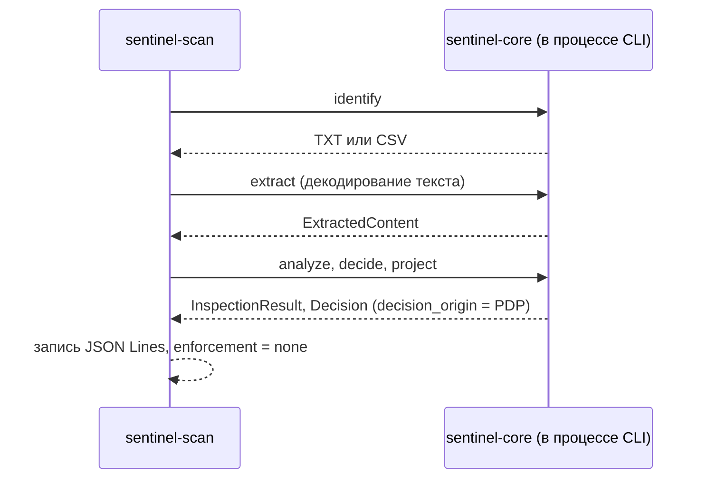
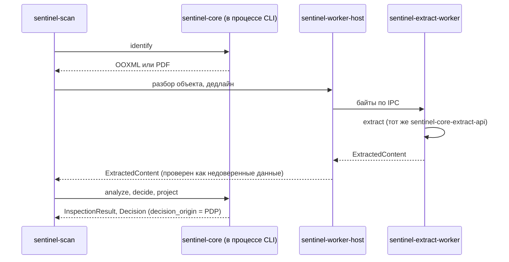
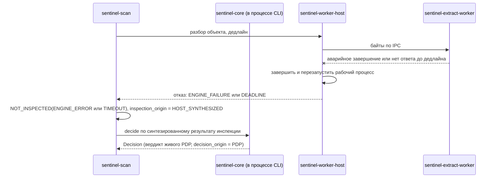

# Sentinel DLP — System Design: CLI `sentinel-scan` v0.1

| Атрибут | Значение |
| --- | --- |
| Назначение | Спецификация CLI `sentinel-scan`: команды и аргументы, источник политики, машиночитаемый вывод, коды выхода, потоковая и пакетная обработка, лимиты, отмена, запрет раскрытия содержимого |
| Версия | 0.12 (Design Accepted, ревизия 12: отметка Design Accepted (OA-10, 2026-11-12) без изменения содержания; ревизия 11: отметка об утверждении D-21 владельцем (OA-4, 2026-11-12) без изменения содержания; ревизия 10: в выводе только финальное решение; ревизия 9: вход `DeviationValidity` в CLI; ревизия 8: CHG5-AR7-01 — время отступлений; ревизия 7: OBS-03, OBS-04; ревизия 6: CHG5-AR5-02, -05; ревизия 5: проекты решений D-18…D-21, DPR-02, DPR-06; ревизия 4: R4-04, R4-05, R4-08; ревизия 3: CHG5-AR2-02, -04, -05; ревизия 2: CHG5-AR-03, -05, -07, -08) |
| Дата | 2026-11-12 |
| Статус | **Design Accepted — 2026-11-12 (OA-10).** Реализация — только по отдельному разрешению владельца. Изоляция по умолчанию (§7) — **Target Design по решению D-21, утверждённому владельцем** (Owner Approval 2026-11-12, OA-4). Кода нет. Варианты с пометкой «Рекомендация» — предложения. Числовые значения — Proposed |
| Изменение | CHG-0005 |
| Решения и ADR | D-03, D-05, D-07, D-16, D-18…D-21 (Accepted 2026-11-12); ADR-0003, ADR-0016, ADR-0017, ADR-0018 |
| Связанные требования | DLP-DETECTION-001…006, DLP-DETECTION-015, DLP-POLICY-002, DLP-POLICY-003, DLP-POLICY-011; ID функции CLI — вопрос O-10 (docs/architecture/SENTINEL_CORE_DESIGN.md §12) |
| Связанные документы | docs/architecture/SENTINEL_CORE_DESIGN.md, docs/architecture/SENTINEL_CORE_TEST_PLAN.md, docs/architecture/FAILURE_MODE_DESIGN.md, docs/security/DATA_PROTECTION_DESIGN.md |

## 1. Назначение и границы

`sentinel-scan` — инструмент разработчика, тестировщика и офицера ИБ. Он применяет `sentinel-core` к файлам и выводит результат инспекции и вердикт PDP.

- CLI использует только публичный API фасада `sentinel-core` и компонент хоста `sentinel-worker-host` для рабочих процессов (SENTINEL_CORE_DESIGN.md §2.2). Собственных детекторов, парсеров и логики решения у него нет; IPC и песочница — вне `sentinel-core`.
- CLI — не PEP. **Вердикт BLOCK в выводе не означает, что какая-либо операция заблокирована.** CLI ничего не блокирует, не перемещает и не изменяет файлы.
- CLI сам по себе не песочница. Рискованные форматы (OOXML, PDF) разбираются только в изолированном рабочем процессе или в явно выбранном режиме разработчика (§7).

## 2. Команды

| Команда | Что делает | Политика |
| --- | --- | --- |
| `sentinel-scan scan [ОПЦИИ] ВХОД…` | Полный конвейер: identify → extract → analyze → decide → project | Обязательна |
| `sentinel-scan inspect [ОПЦИИ] ВХОД…` | Конвейер без PDP: класс, покрытие, детекторы и количество совпадений | Нужен только набор детекторов из бандла |
| `sentinel-scan policy verify БАНДЛ [--capability-manifest ФАЙЛ --manifest-trust-anchor ФАЙЛ]` | Раздельно: `signature` — подпись, якорь, версия и состав (VALID или INVALID); `enforceability` — подтверждённая исполнимость на платформе манифеста (VERIFIED с платформой и версией манифеста, FAILED с перечнем нарушений, NOT_CHECKED без манифеста); недостоверный манифест или неверный релизный якорь — `enforceability = FAILED` с причиной `MANIFEST_INVALID` | Проверяемый бандл |
| `sentinel-scan version` | Версии CLI, ядра, схем вывода, набора детекторов | — |

`ВХОД` — путь к файлу, путь к каталогу (только с `--recursive`) или `-` для стандартного ввода.

| Опция | Значение по умолчанию | Назначение |
| --- | --- | --- |
| `--policy ФАЙЛ` | — | Подписанный бандл |
| `--trust-anchor ФАЙЛ` | — | Доверенный ключ или сертификат для проверки бандла (`PolicyTrustAnchors`) |
| `--manifest-trust-anchor ФАЙЛ` | — | Релизный доверенный ключ для проверки подписи манифеста возможностей (`ReleaseTrustAnchors`, SENTINEL_CORE_DESIGN.md §6.7). Отделён от якоря политики. Обязателен вместе с `--capability-manifest`; без него — код 64. Отзыв и ротация релизных якорей — SENTINEL_CORE_DESIGN.md §6.7.1 (OBS-04): CLI принимает список отзыва; без него в выводе `revocation_check: NOT_CHECKED` |
| `--channel`, `--operation` | Обязательны для `scan` | Контекст решения (CAPABILITY_MATRIX.md §2) |
| `--scope-attr ID` (повторяемая) | Пусто | Группы и подразделения для области правил |
| `--limits ФАЙЛ` | Встроенный профиль Proposed | Профиль лимитов; идентификатор профиля попадает в вывод |
| `--recursive`, `--max-depth N`, `--max-files N` | Выключено; 16; 10 000 (Proposed) | Обход каталогов (§6) |
| `--jobs N` | 1 | Параллельная обработка; порядок вывода не меняется (§6) |
| `--disclose metadata\|masked` | `metadata` | Верхняя граница раскрытия (§5) |
| `--diagnostic-disclose input-ref,digest` | Выключено | Диагностическое раскрытие пути и SHA-256 содержимого; предупреждение о приватности в stderr (§5) |
| `--isolation worker\|developer-in-process` | `worker` | Режим разбора рискованных форматов (§7) |
| `--capability-manifest ФАЙЛ` | — | Подписанный манифест возможностей. Сначала проверяется `CapabilityManifest::verify` по `--manifest-trust-anchor`; затем бандл загружается в режиме `EnforcementReady` со всеми проверками SENTINEL_CORE_DESIGN.md §6.7. Недостоверный манифест или нарушение проверок — код 78. Без него — режим `InspectionOnly`, `capability_check = SKIPPED` в каждой записи |
| `--timeout-per-object СЕК` | 30 (Proposed) | Дедлайн на объект; срабатывание → `TIMEOUT` |
| `--exit-code-mode status\|verdict` | `status` | Семантика кода выхода (§4) |
| `--deviation-time ISO8601` | — | Момент, на который проверяется `expires_at` записей `PartInspectionExclusion` и `PrecedenceConflictApproval` (SENTINEL_CORE_DESIGN.md §6.8). Без параметра доверенного времени нет: CLI передаёт ядру `DeviationValidity::Provided { time_state: TIME_UNVERIFIABLE, valid_ids: [] }`, все такие записи недействительны. С параметром `max_offline_validity` не проверяется (нет работающего сервиса); каждая запись вывода содержит `deviation_time_source: OPERATOR_SUPPLIED` и момент решения считается равным указанному |
| `--timings` | Выключено | Добавить в вывод длительности; без флага вывод детерминирован |

## 3. Источник политики

| Критерий | A. Только подписанный бандл; неподписанная политика — только в тестовой сборке | B. Неподписанная политика разрешена флагом `--insecure-unsigned-policy` с пометкой в выводе |
| --- | --- | --- |
| Риск использовать непроверенную политику в оценке | Нет | Есть: пометку можно не заметить |
| Удобство разработки правил | Нужен тестовый ключ и подпись | Выше |
| Согласованность с DLP-POLICY-004 | Полная | Частичная |

**Рекомендация: A.** Тестовые бандлы подписываются тестовым ключом из корпуса `sentinel-core-testkit`. Тестовый ключ не принимается релизной сборкой без явного `--trust-anchor`.

Бандл проверяется тем же кодом, что и в агенте (SENTINEL_CORE_DESIGN.md §6.7). Ошибка проверки — код выхода 78; анализ не выполняется.

Режим загрузки в `scan` и `inspect` по умолчанию — `InspectionOnly`: CLI — аналитический инструмент без PEP. Режим отражается в каждой записи (`verification_mode`) и в итоговой записи. Даже в режиме `EnforcementReady` CLI ничего не исполняет: режим означает только, что политика прошла проверки исполнимости для платформы манифеста.

## 4. Вывод и коды выхода

### 4.1. Варианты формата

| Критерий | A. JSON Lines: запись на объект и итоговая запись | B. Один JSON-документ | C. SARIF |
| --- | --- | --- | --- |
| Потоковая обработка больших пакетов | Да | Нет: документ закрывается в конце | Нет |
| Простота разбора скриптами | Высокая | Высокая | Ниже: формат для анализаторов кода |
| Соответствие предметной области | Да | Да | Слабое: ориентирован на местоположение в исходном коде |

**Рекомендация: A.** stdout содержит только записи JSON Lines. Диагностика пишется в stderr.

### 4.2. Запись об объекте (схема `sentinel-scan/result/v1`, эскиз)

```text
{
  "schema": "sentinel-scan/result/v1",
  "seq": 17,
  "input_id": "#17",                           // непрозрачный идентификатор; путь и хеш по умолчанию не выводятся
  "diagnostic": null,                          // только с --diagnostic-disclose: { "input_ref": …, "content_sha256": … }
  "isolation": "worker | none",                // none — режим разработчика (§7)
  "object": { "class": "OOXML", "subtype": "DOCX", "declared_mismatch": false, "size": 48213 },
  "inspection": {
    "status": "MATCH | NO_MATCH | NOT_INSPECTED",
    "text_coverage": "COMPLETE | PARTIAL",
    "object_coverage": "FULL | INCOMPLETE",
    "structure_enumeration": "COMPLETE | INCOMPLETE",
    "classification": "CONFIRMED | AMBIGUOUS",     // SENTINEL_CORE_DESIGN.md §4.3
    "inspection_complete": false,                  // MATCH возможен и при неполном покрытии (SENTINEL_CORE_DESIGN.md §4.1)
    "uninspected_parts": [ { "kind": "IMAGE", "count": 2 } ],
    "inspection_origin": "CORE | HOST_SYNTHESIZED",
    "reasons": [],
    "detections": [ { "detector_id": "…", "count": 3, "threshold_met": true } ]
  },
  "decision": {                                // отсутствует у команды inspect
    "verdict": "ALLOW | BLOCK | INDETERMINATE",
    "decision_basis": "RULE_MATCHED | NO_RULE_MATCHED | OUTCOME_INDEPENDENT_OF_UNKNOWN | INDETERMINATE",
    "winner_rule_id": "…", "possible_winners": [],     // SENTINEL_CORE_DESIGN.md §6.3, шаг 9
    "part_exclusion_id": null, "precedence_approval_ids": [], "incomplete_action_source": null,
    "inactive_deviation_ids": [], "suppressed_precedence_pairs": [], "deviation_input": "PROVIDED", "deviation_time_source": "NONE | OPERATOR_SUPPLIED",
    "action_certainty": "DEFINITE | POSSIBLE", "action_sources": [ { "source": "…", "action": "ALERT" } ],   // только при ALLOW (SENTINEL_CORE_DESIGN.md §6.3, шаг 7)
    "reasons": [], "required_action": "BLOCK",    // null только при decision_basis = NO_RULE_MATCHED; при INDETERMINATE — по SENTINEL_CORE_DESIGN.md §6.3, шаг 8
    "verification_mode": "INSPECTION_ONLY | ENFORCEMENT_READY",
    "capability_check": "PERFORMED | SKIPPED",          // SKIPPED только при INSPECTION_ONLY
    "decision_origin": "PDP",                         // всегда PDP: CLI fallback не применяет (§4.2.1)
    "requested_action": null, "capability_exception_id": null,
    "fallback": null, "data_level": "METADATA",
    "matched_rules": ["…"], "policy_version": 42, "policy_bundle_id": "…",
    "explanation": { … }                       // SENTINEL_CORE_DESIGN.md §6.6
  },
  "disclosed": { "level": "METADATA", "snippets": [] },
  "enforcement": "none",                       // всегда: CLI не PEP
  "engine": { "core_version": "…", "detector_set_version": "…", "limits_profile_id": "…" },
  "error": null                                // IO_READ_FAILED, ISOLATION_REQUIRED, UNSUPPORTED_INPUT, ENGINE_FAULT, CANCELLED; при ошибке decision = null
}
```

#### 4.2.1. Отсутствие вердикта в CLI

CLI не PEP и fallback подписанной политики не применяет. Если `Engine::evaluate` вернул `EngineFault` (SENTINEL_CORE_DESIGN.md §2.3), запись по входу содержит `error = ENGINE_FAULT` и `decision = null`; вердикт не синтезируется и не подменяется fallback. Поэтому `decision_origin` в выводе CLI всегда `PDP`, а значения `HOST_FALLBACK` и `PEP_AUTONOMOUS_FALLBACK` в нём не встречаются. Аварийное завершение процесса CLI — код 70 (для уже выведенных записей stdout остаётся корректным JSON Lines).

Итоговая запись `sentinel-scan/summary/v1` содержит число объектов по `verdict` и `inspection.status`, число объектов с неполной инспекцией (`inspection_complete = false`, в том числе со статусом `MATCH`), число записей с `isolation: "none"` (`isolation_none_count`), число решений ALLOW с `action_certainty = POSSIBLE`, число ошибок и максимальный итоговый код.

Сопоставление: `verdict` и `reasons` — без преобразований из `Decision` ядра. Объект `decision` и `disclosed` — результат финального вызова `Pdp::decide` (SENTINEL_CORE_DESIGN.md §6.8); предварительное решение `Engine::evaluate` в вывод не попадает. Поле `enforcement` фиксировано значением `none`, поэтому вывод нельзя принять за результат PEP.

### 4.3. Варианты кодов выхода

| Критерий | A. Код отражает выполнение; вердикты — только в выводе (опционально — отдельный режим) | B. Код отражает вердикт, как у `grep` |
| --- | --- | --- |
| Путаница «код ≠ блокировка» | Минимальна | Выше: код 1 читается как «заблокировано» |
| Удобство CI-проверок «нет утечек в каталоге» | Через `--exit-code-mode verdict` | Сразу |

**Рекомендация: A.**

| Код | `status` (по умолчанию) | `verdict` |
| --- | --- | --- |
| 0 | Каждый вход получил запись без ошибки (`error = null`); вердикты любые | Каждый вход получил вердикт ALLOW; ошибок нет |
| 10 | — | Есть BLOCK |
| 11 | — | Есть INDETERMINATE, BLOCK нет |
| 12 | Хотя бы у одного входа `error ≠ null`: `IO_READ_FAILED`, `ISOLATION_REQUIRED`, `UNSUPPORTED_INPUT`, `ENGINE_FAULT` | То же |
| 64 | Ошибка аргументов | То же |
| 66 | Хотя бы один явно указанный вход не существует (проверяется до начала обработки) | То же |
| 70 | Внутренняя ошибка CLI | То же |
| 74 | Ошибка записи stdout | То же |
| 78 | Политика отсутствует или недостоверна | То же |
| 130 | Прервано пользователем (SIGINT) | То же |

**OBS-03 (ограничение).** Код 0 в режиме `status` означает только успешное выполнение: каждый вход обработан без ошибки. Он **не** означает ALLOW, отсутствие нарушений или полное покрытие: при коде 0 возможны BLOCK, INDETERMINATE, `NOT_INSPECTED` и `MATCH` с неполным покрытием. Это указывается в `--help`; вывод не содержит производных полей вида «чисто» по коду выхода (TC-SCAN-14).

`NOT_INSPECTED` и INDETERMINATE — результаты анализа, а не ошибки CLI. Они не меняют код выхода в режиме `status`. Вход без вердикта (`decision = null` из-за ошибки) никогда не даёт код 0: он относится к коду 12.

**Приоритет кодов** (CHG5-AR-08). Если условий несколько, возвращается первый подходящий:

1. 64, 66, 78 — проверяются до обработки; входы не анализируются;
2. 130 — прерывание;
3. 74, затем 70;
4. 12;
5. только в режиме `verdict`: 10, затем 11;
6. 0.

Пример: в режиме `verdict` при BLOCK у одного входа и ошибке чтения другого возвращается 12; число BLOCK видно в итоговой записи.

## 5. Запрет раскрытия (CHG5-AR-07)

- **stdout:** значения совпадений и текст содержимого не выводятся никогда. Фрагменты выводятся, только если одновременно `--disclose masked` и `data_level = MASKED_MATCH` у правила-победителя. Применяются правила маскирования ядра (SENTINEL_CORE_DESIGN.md §8); итоговый уровень — минимум из двух.
- **Пути и хеши:** по умолчанию не выводятся ни в stdout, ни в stderr. Путь может содержать ФИО и названия проектов, SHA-256 идентифицирует документ (DATA_PROTECTION_DESIGN.md §2). Вход обозначается непрозрачным `input_id` — порядковым номером в запуске. Соответствие номера и пути вызывающий восстанавливает по своему списку входов.
- **Диагностическое раскрытие** — только `--diagnostic-disclose input-ref,digest`. Перед обработкой в stderr выводится предупреждение: вывод содержит персональные и идентифицирующие данные. В итоговой записи — `diagnostic_disclosure: true`.
- **stderr:** коды ошибок и `input_id`. Без путей (если нет диагностического раскрытия), фрагментов содержимого, сообщений сторонних парсеров и `Debug`-представлений типов с содержимым.
- CLI не пишет временных файлов с содержимым. Аварийные дампы — по DATA_PROTECTION_DESIGN.md §9.
- Проверка — TC-SCAN-05 и тест с маркером TC-D07-07.

## 6. Пакетная обработка и детерминизм

- **Порядок входов** — порядок аргументов. Содержимое каталога сортируется по байтовому представлению относительного пути.
- **Обход каталогов.** Символические ссылки по умолчанию не разыменовываются. Специальные файлы (устройства, FIFO, сокеты) пропускаются с записью об ошибке `UNSUPPORTED_INPUT`. Ограничения — `--max-depth` и `--max-files`.
- **Параллельность** `--jobs N` не меняет порядок и содержимое записей: вывод упорядочен по `seq`.
- **Детерминизм.** Без `--timings` одинаковые входы, бандл, профиль лимитов и версии дают побайтно одинаковый stdout. Исключение — входы, для которых сработал дедлайн (`TIMEOUT`); их отмечает `reasons`.
- **Стандартный ввод** читается ограниченно: превышение лимита размера → `NOT_INSPECTED(RESOURCE_EXHAUSTED)`. Чтение не продолжается бесконечно.
- **Отмена** (SIGINT, Ctrl+C) прерывает обработку на границе блоков. Незавершённые объекты получают запись с `error = CANCELLED`, затем пишется итоговая запись, код выхода — 130. Частичный stdout остаётся корректным JSON Lines.

## 7. Изоляция при анализе недоверенных файлов (CHG5-AR-05)

TXT и CSV разбираются в процессе CLI: по ADR-0018 §1 они не относятся к рискованному разбору. OOXML и PDF — рискованный разбор.

| Критерий | A. Режим разработчика: разбор в процессе CLI | B. Изолированный рабочий процесс тем же механизмом, что в агенте (ADR-0018) |
| --- | --- | --- |
| Защита от эксплуатации парсера | Нет: эксплуатация получает права пользователя CLI | Да, после реализации и проверки механизма |
| Зависимость от SPIKE-WIN-01 и выбора механизма D-14 | Нет | Есть |
| Допустимое применение | Разработка и отладка на доверенных файлах или в одноразовой ВМ без сети | Любые файлы, в том числе недоверенные |

**Target Design: B, решение D-21 (Owner Approval 2026-11-12, OA-4).**

- **По умолчанию `--isolation worker` (B).** Механизм песочницы до SPIKE-WIN-01 и решения по D-14 не выбирается. Пока изолированный рабочий процесс не реализован и не проверен, OOXML и PDF в режиме по умолчанию **не разбираются**: запись с `error = ISOLATION_REQUIRED`, код выхода 12. Вердикт по таким входам не выдаётся.
- **`--isolation developer-in-process` (A)** — только явным параметром:
  - перед обработкой — предупреждение в stderr;
  - в каждой записи — `isolation: "none"`;
  - запуск с правами администратора или root отклоняется;
  - в `--help` и документации сказано, что режим не для недоверенных файлов вне одноразовой изолированной среды;
  - режим включается **только** параметром командной строки: CLI не читает режим изоляции из файлов конфигурации и переменных окружения; переменная окружения или файл конфигурации с таким значением игнорируются с предупреждением в stderr (TC-SCAN-13).
- Режим A не считается безопасным режимом эксплуатации и не используется в автоматизации с недоверенными файлами.
- **Функциональное ограничение v0.1.** Пока механизм изоляции не выбран (D-14) и рабочий процесс не реализован и не проверен, CLI в режиме по умолчанию для недоверенных файлов фактически анализирует только TXT и CSV. Это следствие D-21; владелец принял его явно при утверждении D-21 (OA-4, 2026-11-12).

S-01 — решено: B, D-21 (Owner Approval 2026-11-12, OA-4).

### 7.1. Последовательности по форматам и отказам (CHG5-AR2-05)

TXT и CSV — в процессе CLI:



OOXML и PDF — в рабочем процессе (режим по умолчанию):



Отказ рабочего процесса или дедлайн:



Если рабочий процесс недоступен до начала разбора (не реализован или не запускается), CLI не синтезирует результат: запись получает `error = ISOLATION_REQUIRED`, вердикта нет.

Если аварийно завершается сам процесс CLI, записи по незавершённым объектам и итоговая запись отсутствуют. Отсутствие итоговой записи — признак незавершённого запуска; потребитель вывода не трактует его как отсутствие нарушений.

## 8. Открытые вопросы

| ID | Вопрос | Кто решает |
| --- | --- | --- |
| S-01 | Изоляция CLI. **Решено: B, D-21 (Owner Approval 2026-11-12, OA-4)** (§7) | Владелец |
| S-02 | Источник политики: A или B (§3) | Владелец |
| S-03 | Значения по умолчанию `--max-files`, `--max-depth`, `--timeout-per-object` | Команда; Proposed |
| S-04 | Режим `--exit-code-mode verdict` в v0.1 или позже | Владелец |
| S-05 | Платформы сборки CLI в v0.1 (Linux, Windows) | Владелец; связано с Q-02 |

## 9. Статус проверки

Кода нет. Все положения — Design Accepted 2026-11-12 (OA-10); механизмы — NOT VERIFIED. Тесты — docs/architecture/SENTINEL_CORE_TEST_PLAN.md; ни один не запускался.
